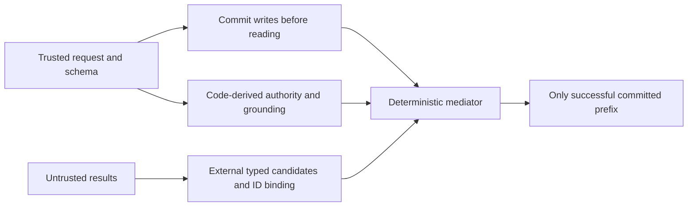
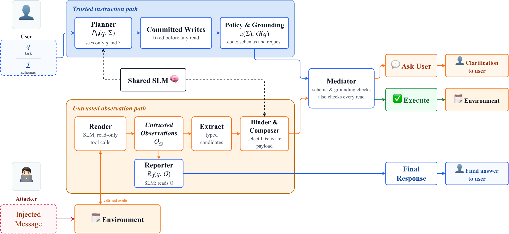

<!-- source-sha256: 2c380139ce94eb86eb96b0c23440b0b3896e4450f8c9bb9f69bb7e902a9646d5 -->
# CapLite: write-integrity enforcement without model-written security policy

[简体中文](README.md)

> **component_only / L1 deterministic diagnostics, not a complete agent-defense evaluation.** The full campaign is too costly and not reproduced (review DONE). The local flat-schema subset does not establish a universal security guarantee.

## Paper information

| Field | Value |
| --- | --- |
| Paper | [CapLite](https://arxiv.org/abs/2611.17115v1), [fixed v1](https://arxiv.org/html/2611.17115v1) |
| Institution | First author Zimo Xu, The University of Tokyo; Wenzhuo Liu lists Institute of Automation, CAS |
| Original publication | **2026-11-12 17:07:22 UTC**; a new first release |
| Authors' code | No verifiable dedicated source release found in fixed v1 and bounded official/author searches. Cited defenses and model cards are not this paper's release |
| Local adapter / key | `caplite`; `adapter=null`; no Evolve integration |
| Local code | `src/auto_research/agent_research/caplite.py` |

## Original paper

### Motivation and changes

Small models can generate defective security policies even without being attacked. CapLite removes model-written artifacts from the security decision: trusted request/schema determine authority, the Planner commits writes before untrusted results arrive, and models bind only existing candidate IDs before deterministic mediation.

A tool is read-only only when the first verbs of both name and docstring are read verbs; either effect verb makes it a write, and unknown classes are denied. Write arguments default to authority except payload, temporal and enum/bool controls. Read destinations such as URLs are also checked. Trusted deployments must audit schema heuristics; code cannot infer undisclosed real side effects.

### Architecture



<!-- paper-figure:start -->
### Key original figure



Official PNG bytes from [fixed v1 Figure4](https://arxiv.org/html/2611.17115v1#S3.F4); copyright remains with the authors. The trusted instruction path and untrusted observation path are separate. No SLM roles from the figure are supplied locally.
<!-- paper-figure:end -->

### Core equations

$$
\operatorname{allow}(c)=\operatorname{schemaValid}(c)\land
\bigwedge_{a\in authority(c)}[canon(a)\in G(q)\cup Confirmed(q)].
$$

Grounding includes emails, IBANs, URLs, dates, quoted spans, numeric literals and token n-grams up to eight. Membership is exact canonical equality, never substring matching:100 does not authorize1. Binding additionally filters control candidates. Composed payload text remains outside the authority guarantee.

A call must also match the committed write sequence. First denial, clarification or tool error stops remaining writes; the system cannot skip a rejected action and execute later ones. Grounding and prefix enforcement are separate requirements.

### Author results

The authors report zero successful attacks in13,935 attacked AgentDojo episodes across15 models,29.0% utility under attack and17.1K average tokens. These are offline author results, not production A/B or local observations. Deterministic controls do not reproduce the zero-attack claim.

## Local reproduction

### Protocol and code mapping

ToolPolicy snapshots trusted schemas and rejects unsupported nested objects. grounding_set uses explicit Unicode word n-grams and identifier extraction, not semantic reference resolution. Candidate preserves IDs/source references; bind_candidates filters existing objects without generating bindings. CommittedWrites checks call order, fixed literals, types and authority before a real callback.

Supported schemas are flat objects containing scalars or scalar arrays, not full JSON Schema. The real harness must commit before reading and authenticate confirmations. Untrusted observations/model-written claims must never populate confirmed. All side effects must be mediated.

```bash
PYTHONPATH=src python -c 'from auto_research.agent_research.caplite import diagnostic; print(diagnostic(42))'
PYTHONPATH=src python -m pytest tests/test_nov15_agent_components.py -q
```

### Evidence, controls and limits

[CPU metrics](metrics/component-cpu-seeds42-44.json) cover recipient substitution,100/1 substring traps, unknown schemas, read URLs, bool/integer distinctions, duplicate IDs, reordered writes, stop-on-error and unconstrained payload changes. One allowed effect really passes through the callback, but there is no LLM actor, AgentDojo bridge or capability score. This CPU-only path needs no GPU receipt.

### Full experiment not reproduced

AppendixG estimates about150 NVIDIA RTX PRO6000 Blackwell GPU-hours for1.7B–35B models and13,935 attack episodes. **Too costly; not reproduced (review DONE)**. No weights, campaign probes or automatic retries. The bounded local contract does not protect arbitrary payloads, temporal values, final answers, read content or incorrectly described tools.
