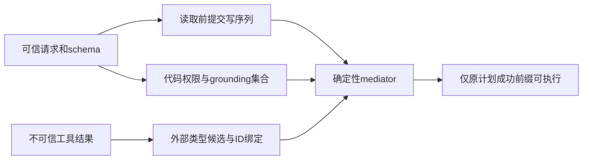
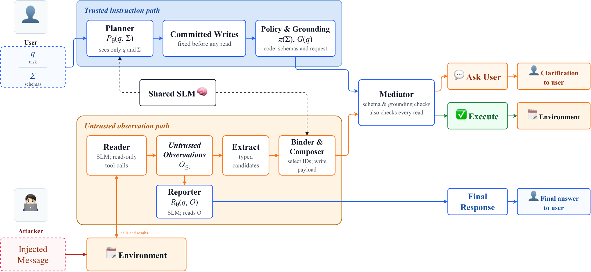

# CapLite：不让小模型编写安全策略的写入完整性执行核

[English](README-en.md)

> **component_only／L1确定性机制诊断，不是完整Agent防御评测。** 完整实验高成本不复现（审查 DONE）。本地只支持显式平面schema的受限执行核，不声称通用安全保证。

## 论文信息

| 字段 | 内容 |
| --- | --- |
| 论文链接 | [CapLite](https://arxiv.org/abs/2611.17115v1)，[固定v1原文](https://arxiv.org/html/2611.17115v1) |
| 公司 / 机构 | 一作 Zimo Xu，The University of Tokyo；Wenzhuo Liu署Institute of Automation, CAS |
| 首次公开日期 | **2026-11-12 17:07:22 UTC**；近期新首发 |
| 原作者代码 | 固定v1及本轮有界官方／作者入口搜索未找到可核实的本篇作者源码；引用防御和模型卡不算本篇发布 |
| 本地 adapter / key | `caplite`；`adapter=null`，未接入Evolve |
| 本地复现代码 | `src/auto_research/agent_research/caplite.py` |

## 原始论文总结

### 背景与主要改动

小模型既可能被提示注入欺骗，也可能生成本就错误的权限策略。CapLite把安全决策从模型生成物中移出：可信用户请求与工具schema决定权限，Planner在看到任何工具结果前提交写调用，之后模型只能从提取出的候选ID里绑定authority值，代码在真实副作用前再次校验。

读写分类使用工具名及docstring的首个动词：两者都是read verb才是只读，任一为effect verb则写，未知拒绝。写参数默认authority，但正文载荷、时间和enum／bool控制项分开；URL等目的地即使属于read工具也要做authority校验。词法schema规则必须由可信部署方审核，不会自动识别错误schema的真实副作用。

### 架构与流程



<!-- paper-figure:start -->
### 原论文关键图



图片来自[原论文](https://arxiv.org/html/2611.17115v1#S3.F4)固定v1 Figure 4，保留官方PNG原字节，版权归原作者所有。蓝色可信指令路径与橙色不可信观察路径分开；本地不包含图中的SLM各角色。
<!-- paper-figure:end -->

### 核心公式

$$
\operatorname{allow}(c)=\operatorname{schemaValid}(c)\land
\bigwedge_{a\in authority(c)}\bigl[canon(a)\in G(q)\cup Confirmed(q)\bigr].
$$

$G(q)$包含邮件、IBAN、URL、日期、引号文本、数值及最多8-token ngram。比较是规范化后的精确集合相等，不是子串：请求中的100不能授权金额1。绑定阶段还过滤control候选；payload可由composer自由写，不能因此扩大到“载荷内容安全”的保证。

执行还必须匹配预提交写序列。首次deny／ask／tool error即停止剩余写调用，不能略过失败再执行后面的动作。参数grounding与write-prefix是不同约束，缺一不可。

### 论文离线与线上效果

作者在15个模型、13935个攻击AgentDojo episode报告零攻击成功，攻击下utility 29.0%、平均17.1K tokens。它们是作者离线安全／效用结果，未报告生产线上A/B。本地没有运行攻击模型矩阵，更不能把确定性负控通过写成复现“零攻击”。

## 本地复现

### 数据协议与代码映射

`ToolPolicy`冻结可信schema，拒绝未知操作及不支持的嵌套object。`grounding_set`执行显式Unicode词ngram和标识符抽取；不是语义指代解析。`Candidate`保留ID／来源，`bind_candidates`只筛既有候选；不会生成绑定。`CommittedWrites`只执行顺序匹配、字面量不变、schema和authority过检的写调用。

本地schema子集为平面object中的标量及标量数组，不支持嵌套结构或完整JSON Schema。构造commit对象的时间顺序与确认来源认证由真实harness负责；`confirmed`不能由不可信观察或模型自写。所有工具副作用都必须经过mediator。

```bash
PYTHONPATH=src python -c 'from auto_research.agent_research.caplite import diagnostic; print(diagnostic(42))'
PYTHONPATH=src python -m pytest tests/test_nov15_agent_components.py -q
```

### 结果、负控与边界

[CPU机制指标](metrics/component-cpu-seeds42-44.json)检查邮件替换、100／1子串误授权、未知schema、read URL、bool与integer区分、重复候选ID、调用重排、工具异常后终止及payload仍可变化。这里确实经过callback执行一次允许的副作用，但没有LLM actor、AgentDojo桥接或攻击能力分数。CPU路径不需要GPU验收。

### 高成本完整实验

Appendix G估计完整矩阵约150 NVIDIA RTX PRO6000 Blackwell GPU小时，覆盖1.7B–35B模型和13935个攻击episode。**成本过高，不复现（审查 DONE）**；不下载权重、试跑矩阵或自动重试。只保证本地受限schema合同的执行，不验证payload、时间、最终答案、读内容或错误工具schema的安全性。
