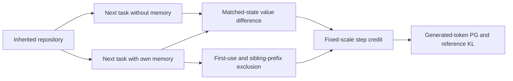
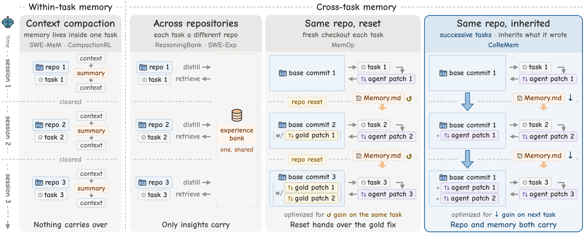

<!-- source-sha256: 928dc32cc32d12de7ca6c54a6ebb6b7568a1cd04a013a0b96f744deb9207b209 -->
# CoReMem: prospective memory value and step-local credit across coding tasks

[简体中文](README.md)

> **component_only / L1 mechanism diagnostics, not a coding-agent reproduction.** The full campaign is too costly and is not reproduced (review DONE). Only reward, provenance gates and genuine small-tensor training objectives execute locally.

## Paper information

| Field | Value |
| --- | --- |
| Paper | [CoReMem](https://arxiv.org/abs/2611.17316v1), [fixed v1](https://arxiv.org/html/2611.17316v1) |
| Institution | First author Peiwen Li, Yale University; collaboration does not replace the first affiliation |
| Original publication | **2026-11-12 18:58:22 UTC**; a new first release |
| Authors' code | The paper links an [anonymous source entry](https://anonymous.4open.science/r/CoReMem-F728/); access returned HTTP401 on November15. Contents, license and a fixed revision remain unverified; this is not a verified open-source release |
| Local adapter / key | `coremem`; `adapter=null`; no Evolve integration |
| Local code | `src/auto_research/agent_research/coremem.py` |

## Original paper

### Motivation and changes

Successive coding tasks inherit both repository changes and written memory. Memory is written before the next task arrives and valued on that future task, comparing memory/no-memory rollouts from the identical inherited repository state. Judging a summary's apparent usefulness or resetting to gold patches changes the problem.

Training compares own, empty and misplaced memories at a shared boundary. A success-first reward prevents saving steps by abandoning solutions. Exact repository/check anchors localize the overall memory-value difference to traceable first-use steps. Semantic extraction and real coding rollouts remain external.

### Architecture



<!-- paper-figure:start -->
### Key original figure



Official PNG bytes from [fixed v1 Figure2](https://arxiv.org/html/2611.17316v1#S1.F2); copyright remains with the authors. The rightmost setting inherits both repository and memory rather than resetting with gold patches.
<!-- paper-figure:end -->

### Core equations

$$
R_i=\begin{cases}W-n_i,&\text{resolved},\\\alpha f_i,&\text{otherwise},\end{cases}\quad W>n_{max}+\alpha.
$$

With empty/own means $\bar R_0,\bar R_m$ and $\widehat V=\bar R_m-\bar R_0$, own-memory step credit is

$$
A_{it}=(R_i-\bar R_m)/100+\omega_{it}\widehat V/100.
$$

The gate requires a memory anchor in the current assistant step, absent from prior history and the first eight steps of empty-memory siblings. Repeated use is not gated again; ungated steps retain outcome credit. This establishes traceable use, not causal contribution. Empty/misplaced arms use the empty-memory mean.

AppendixA uses fixed scale100, not within-group standard deviation. The27B recipe averages all generated tokens; the9B recipe averages tokens per session, then sessions. Reference KL has coefficient0.2; local code requires explicit KL rather than silently treating it as zero.

### Author results

The paper reports27B resolution21.0%→25.7%,17% fewer steps and11% fewer cache-aware tokens on repository-disjoint ChainSWE chains. These are offline author results, not local measurements or production A/B. The credit kernel cannot validate those gains.

## Local reproduction

### Protocol and code mapping

ReplayOutcome is trainer/evaluator-only. paired_step_saving rejects mismatched boundaries or inherited-state IDs; provenance_gates consumes external exact anchors without pretending to extract semantics. step_advantages executes Eq7. policy_gradient_loss differentiates actual log probabilities with explicit token/session reductions, detached advantages and padding masks. Callers must still form groups from one boundary; IDs do not implement Git-tree isolation.

```bash
PYTHONPATH=src python -c 'from auto_research.agent_research.coremem import diagnostic; print(diagnostic(42))'
PYTHONPATH=src python -m pytest tests/test_nov15_agent_components.py -q
```

### Evidence, controls and limits

Tests cover strict success-first ordering, state mismatches, first-use/sibling exclusions, fixed scale, retained outcome credit, distinct reductions, zero padding gradients and no gradients into evaluator rewards. [CPU metrics](metrics/component-cpu-seeds42-44.json) and [A100 mechanism evidence](../../gpu-validations/coremem-a100-20261115.json) concern only these operators, not coding capability or causal memory gains.

### Full experiment not reproduced

AppendicesA/B use9B/27B/31B and commercial actors,32K/49K sessions,20 LoRA updates, repeated boundary replays and1500–3600-second per-session budgets. These are source configurations, not measured local runtimes. **Too costly; not reproduced (review DONE)**. No checkpoints/data, cost probes or automatic retries. Memory generation, real repository replay, seven-segment leave-one-out valuation and full training are absent. Actors must not receive evaluator results or gold.
