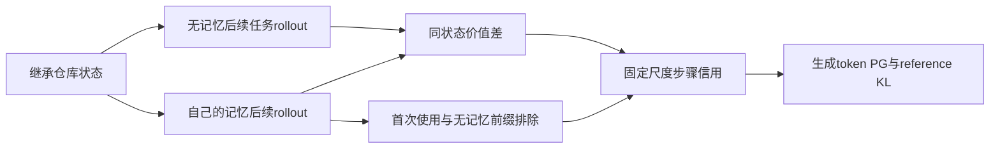
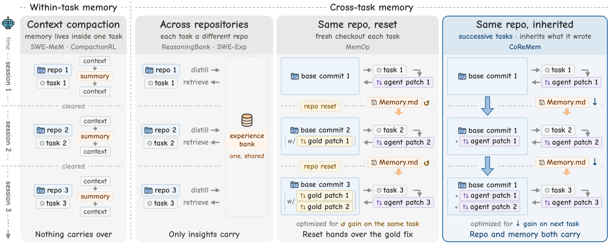

# CoReMem：跨连续编码任务的前瞻记忆价值与局部信用

[English](README-en.md)

> **component_only／L1机制诊断，不是编码Agent能力复现。** 完整实验成本过高，不复现（审查 DONE）；本地只实现reward、来源门控及真实小tensor训练目标。

## 论文信息

| 字段 | 内容 |
| --- | --- |
| 论文链接 | [CoReMem](https://arxiv.org/abs/2611.17316v1)，[固定v1原文](https://arxiv.org/html/2611.17316v1) |
| 公司 / 机构 | 一作 Peiwen Li，Yale University；合作署名不替代第一机构 |
| 首次公开日期 | **2026-11-12 18:58:22 UTC**；近期新首发 |
| 原作者代码 | [匿名代码入口](https://anonymous.4open.science/r/CoReMem-F728/)由原文给出；2026-11-15访问返回HTTP401，源码内容、许可和固定revision尚未核实，不能写成已验证开源 |
| 本地 adapter / key | `coremem`；`adapter=null`，未接入Evolve |
| 本地复现代码 | `src/auto_research/agent_research/coremem.py` |

## 原始论文总结

### 背景与主要改动

连续编码任务不是把独立SWE问题逐题重置：前一任务写入的代码和文本记忆都会影响下一任务。CoReMem要求在下一任务出现前写记忆，再从完全相同的继承仓库状态运行有／无记忆分支，以未来任务的解决率与工作量评价记忆，而不是评价摘要“看起来是否有用”。

训练把自己的记忆、无记忆与错配记忆放进同一边界组。成功优先reward防止模型只少做几步却不解决问题；首次使用的repo位置或可执行检查锚点，把记忆整体的价值差只归到可追踪使用的步骤。语义锚点抽取与真实coding rollout仍由外部模型和环境完成。

### 架构与流程



<!-- paper-figure:start -->
### 原论文关键图



图片来自[原论文](https://arxiv.org/html/2611.17316v1#S1.F2)固定v1 Figure 2，保留官方PNG原字节，版权归原作者所有。右侧强调仓库与记忆都继承；把仓库重置成带gold patch的状态会改变问题。
<!-- paper-figure:end -->

### 核心公式

$$
R_i=\begin{cases}W-n_i,&\text{resolved},\\\alpha f_i,&\text{otherwise},\end{cases}\quad W>n_{max}+\alpha.
$$

记无记忆和自己记忆的平均reward为 $\bar R_0,\bar R_m$，$\widehat V=\bar R_m-\bar R_0$。自己记忆的步骤优势为

$$
A_{it}=\frac{R_i-\bar R_m}{100}+\omega_{it}\frac{\widehat V}{100}.
$$

$\omega$ 要求当前assistant步骤出现记忆锚点，且此前历史未出现、无记忆兄弟轨迹前8步也未触达。后续重复不再获门控；无门控步骤仍保留结果信用。它是可追踪使用，不是因果贡献证明。无记忆／错配分支以 $\bar R_0$ 为baseline。

Appendix A固定尺度100，不是组内标准差；27B按全部生成token平均，9B先每session token平均再平均session。参考KL系数0.2；代码要求显式KL输入，不能默认为零却称完成原目标。

### 论文离线与线上效果

论文在repository-disjoint ChainSWE连续任务上报告27B解决率由21.0%到25.7%，步骤减少17%，cache-aware tokens减少11%。这是作者离线结果，未报告生产线上A/B；本地没有重跑该矩阵，也不能由步骤信用核验证这些提升。

## 本地复现

### 数据协议与代码映射

`ReplayOutcome`只供trainer/evaluator保存外部结果。`paired_step_saving`拒绝不同boundary或继承状态；`provenance_gates`接收外部精确锚点集合，不伪造语义抽取。`step_advantages`执行Eq7；`policy_gradient_loss`按明确的token／session归约反传真实log概率，detach reward与advantage，并屏蔽padding。组装batch时调用方仍须保证所有arm来自同一边界；类型检查不是Git树隔离实现。

```bash
PYTHONPATH=src python -c 'from auto_research.agent_research.coremem import diagnostic; print(diagnostic(42))'
PYTHONPATH=src python -m pytest tests/test_nov15_agent_components.py -q
```

### 结果、负控与边界

专测包含成功优先的严格不等式、错误继承状态拒绝、首次使用与兄弟轨迹排除、固定尺度与门控后保留结果信用、两种loss归约不同、padding零梯度及不对evaluator reward反传。关联[CPU机制指标](metrics/component-cpu-seeds42-44.json)与[A100机制验收](../../gpu-validations/coremem-a100-20261115.json)只说明这些算子执行，不能说明编码能力、实际记忆价值或因果效果。

### 高成本完整实验

Appendix A/B使用9B、27B、31B及商业模型、32K／49K会话、20次LoRA更新、多边界重复replay和每session 1500–3600秒预算。这些是原文配置，不是本地测得耗时。**成本过高，不复现（审查 DONE）**；未下载checkpoint／数据、试训估价或创建自动重试任务。记忆生成、真实仓库replay、七段leave-one-segment估值、完整模型训练均未实现。Actor不得读取本模块的结果对象或gold。
