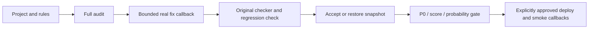
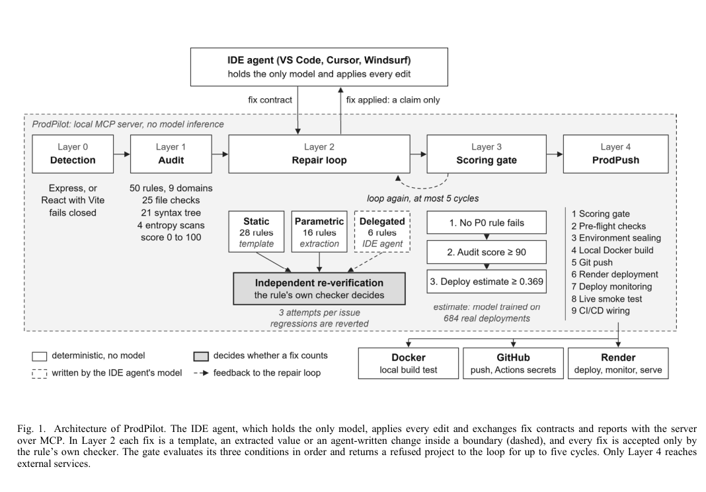

<!-- source-sha256: 9e9a180da749547e6c08391a63ec611eaecf3e8455fe5fd627003810e1ba16e5 -->

# ProdPilot: a repair is a claim until its independent checker accepts it

[简体中文](README.md)

> **component_only / L1 CPU repair and deploy-gate contract.** Real checker/fix callbacks operate on an in-memory file mapping. No cloud, Docker, GitHub or IDE model is called. This is neither a complete MCP server nor a production deployment reproduction.

## Paper information

| Field | Content |
| --- | --- |
| Paper | [ProdPilot](https://arxiv.org/abs/2611.17381v1), [fixed-v1 PDF](https://arxiv.org/pdf/2611.17381v1) |
| First-author affiliation | Muhammad Sudais Khalid; NLP Lab, AITeC, and Shifa Tameer-e-Millat University, Islamabad, Pakistan |
| Original publication | **2026-11-11 11:36:45 UTC**, arXiv v1 |
| Author code | The paper describes Python package 1.0.0rc1 but fixed v1 supplies no verifiable author-source repository URL. A package-version statement alone does not establish public source |
| Local adapter / key | `prodpilot-protocol`; `adapter=null`, not integrated into Evolve |
| Local code | `src/auto_research/agent_research/prodpilot_protocol.py` |

## Original paper

### Background and main changes

Locally runnable AI-written applications need not be production-ready. ProdPilot's five layers detect the stack, audit, repair, gate and deploy. Of 50 rules, 28 use fixed templates, 16 extract project values, and six delegate to the IDE agent. Thus 88% of **rule types** need no model-written content—not 88% of projects deploying without a model. Node/Express and React/Vite have different blueprints; unsupported or ambiguous stacks are not guessed.

Fix contracts bound files, anchors and invariants. Regardless of fix type, an applied report remains a claim until the original checker passes. Each issue gets at most three attempts per run and each run at most five cycles. A full post-change audit detects regressions; breaking a previously passing rule causes rollback and manual review. The deployment gate audits again rather than trusting repair success counters.

### Architecture and workflow



<!-- paper-figure:start -->
### Original paper figure



Fixed-v1 PDF p.8, Figure 1, including its caption. Docker, GitHub and Render belong to the author system; the local interface connects to none. [Original figure](https://arxiv.org/pdf/2611.17381v1#page=8), copyright belongs to the authors. [Provenance](assets/provenance.json).

Image from the [original paper](https://arxiv.org/pdf/2611.17381v1); copyright belongs to the original authors.
<!-- paper-figure:end -->

### Core equations

For priority $p\in\{0,\ldots,5\}$, use $w_p=2^{5-p}$ over applicable rules:

$$
score=100\frac{\sum_r w_{p_r}\mathbf1(pass_r)}{\sum_r w_{p_r}}.
$$

The sequential conditions are no failing P0 rule, $score\ge90$, and deployability $\hat p\ge0.369$. The model may veto but never overrule rejected rules; missing model inputs or an undetermined build close the gate. The paper's probability comes from a calibrated model trained on 684 actual Render deployments. **Locally, probability is an external interface, not a trained/copied estimator**; an audit score is not a probability.

### Author results

Of violations in 499 real repositories, 93.5% belong to template/extraction classes. Independent verification rejected 25 of 237 reported applied fixes in 23 full-chain samples. Those full-chain Render/GitHub APIs and live smoke responses were scripted substitutes, and delegated fixes were not executed; this is not 23 real cloud deployments. Separately, collecting 684 real Render outcomes took about 35 hours, with held-out AUC 0.909; one gated project completed real deployment, smoke and CI/CD in 82 seconds. None is randomized production A/B or a local result.

## Local implementation

### Data protocol and code mapping

`Rule` separates static, parametric and delegated types and carries actually executed checker/fix callbacks plus allowed files. `repair` gives callbacks copies, rejects out-of-bound changes and accepts only checker success. Regression/exception paths preserve the original snapshot. Missing executors go to manual review rather than fabricated model actions. Non-bool/None checker output and exceptions are errors; None is inapplicable, not passed.

`deploy_gate` reruns every checker and applies P0/90/0.369 in order. `gated_deploy` also requires explicit approval and calls injected deploy/smoke functions. A returned deploy handle is not a verified service. A deploy exception may follow external side effects: retain the attempt and return `deployed=null` / `deployment_status=unknown`, not an assertion that nothing deployed. Missing components include the 50 JavaScript-AST/secret rules, stack detector, MCP stdio, Docker builds, cloud providers and actual deployment model.

```bash
PYTHONPATH=src python -c 'from auto_research.agent_research.prodpilot_protocol import diagnostic; print(diagnostic(42))'
PYTHONPATH=src python -m pytest tests/test_nov18_agent_protocols.py -q
```

### Diagnostics and limits

[CPU mechanism metrics](metrics/component-cpu-seeds42-44.json) count real fix/deploy callbacks, audit score and rollback on synthetic projects. Controls include a success claim without edits, regressions, file-boundary violations, invalid checker types, absent approval/probability, smoke failure and idempotent reruns. Unlike [Harness²](../2610.14224-harness2/README.md)'s open execution contrasts, this contract relies on task-specific checkers; vulnerabilities outside their coverage may still pass. No general software-security claim follows.

### High-cost full experiment

The complete configuration requires 50 rules, real IDE agents, containers, credentials and 684 actual cloud deployments; data collection alone took about 35 hours and creates infrastructure side effects. **Full experiment not reproduced due to cost (review DONE).** No cloud creation, project push, model download or automatic retry. The CPU contract needs no GPU receipt and supplies no capability ranking or Evolve promotion evidence.
