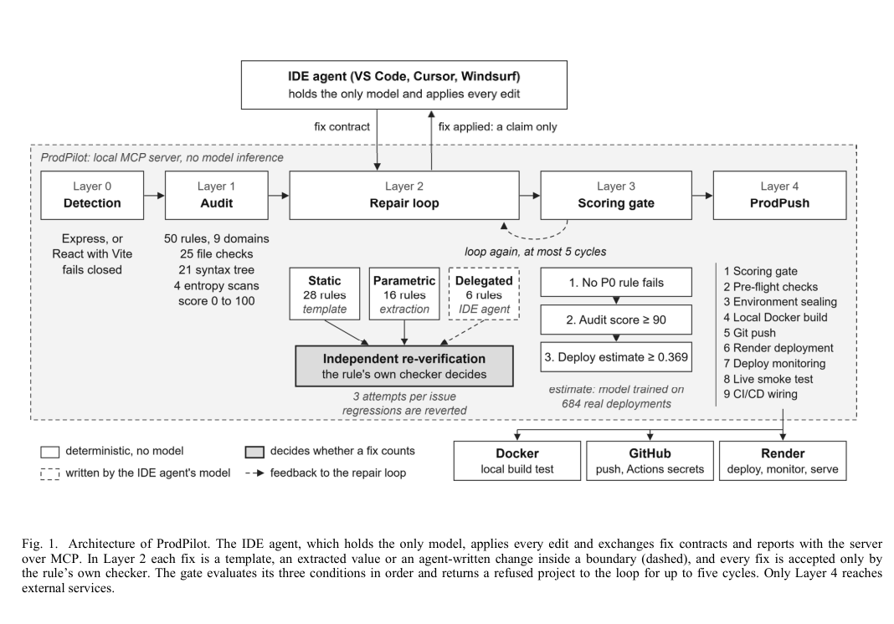

# ProdPilot：修复是提议，独立checker才决定是否接受

[English](README-en.md)

> **component_only／L1 CPU修复与部署门合同。** 本地只在内存文件映射上调用真实checker／fix回调，不连接云、Docker、GitHub或IDE模型；不是完整MCP服务器或生产部署复现。

## 论文信息

| 字段 | 内容 |
| --- | --- |
| 论文链接 | [ProdPilot](https://arxiv.org/abs/2611.17381v1)，[固定v1 PDF](https://arxiv.org/pdf/2611.17381v1) |
| 一作机构 / 公司 / 学校 | Muhammad Sudais Khalid；Natural Language Processing Lab, AITeC，及Shifa Tameer-e-Millat University，Islamabad, Pakistan |
| 首次公开日期 | **2026-11-11 11:36:45 UTC**（arXiv v1） |
| 原作者代码 | 原文称Python包1.0.0rc1，但固定v1未提供可核实作者源码仓库URL；本轮未验证本篇公开源码，不能把包版本叙述当已开源 |
| 本地 adapter / key | `prodpilot-protocol`；`adapter=null`，未接入Evolve |
| 本地复现代码 | `src/auto_research/agent_research/prodpilot_protocol.py` |

## 原始论文总结

### 背景与主要改动

AI生成应用能在本地运行，不代表生产配置正确。ProdPilot用五层MCP系统识别技术栈、审计、修复、评分门控和部署。50条规则中28条是固定模板、16条从项目取值、6条由IDE Agent生成，所以88%的**规则种类**不需要模型写内容；它不意味着88%的项目可无模型部署。Node／Express与React／Vite采用不同blueprint，无法识别或存在歧义时不猜。

修复合同限制可改文件／位置与必须不变的内容。不论静态、参数化还是委派生成，回报“已修复”只算声明，必须重跑原checker。每问题总计至多3次尝试、每run至多5个cycle；修改后全量审计，原来通过的规则变坏就回滚并转人工。部署门重新审计，不能信任循环中的成功计数。

### 架构与流程


<!-- paper-figure:start -->
### 原论文关键图



固定v1 PDF第8页Figure 1，包含原图注。图中Docker、GitHub、Render为作者系统，本地不连接这些服务。[原论文图](https://arxiv.org/pdf/2611.17381v1#page=8)版权归原作者；[资产出处](assets/provenance.json)。
<!-- paper-figure:end -->

### 核心公式

优先级$p\in\{0,\ldots,5\}$权重为$w_p=2^{5-p}$，只在适用规则集合上计算：

$$score=100\frac{\sum_r w_{p_r}\mathbf1(pass_r)}{\sum_r w_{p_r}}.$$

三条件依次为：无失败P0、$score\ge90$、部署概率$\hat p\ge0.369$。模型只能否决，不能越过规则批准；模型输入缺失／构建未确定则闭门。部署概率原文来自684次Render真实部署及其校准模型；**本地只接受外部概率接口，不训练或复制此估计器**，也不能把规则分数当概率。

### 论文离线与线上效果

499个真实repo中93.5%的违规属于模板／取值类；23个样例全链中独立复核拒绝了237次“已应用”中的25次。该全链的Render／GitHub API与线上smoke回复是脚本替身，委派合同未执行，不能称23次真实生产部署。另有684次真实Render部署约35小时，部署模型held-out AUC 0.909；一个门控项目完成真实部署、smoke和CI/CD用82秒。以上不是随机线上A/B，也不是本地结果。

## 本地复现

### 数据协议与代码映射

`Rule`显式区分static／parametric／delegated，持有真正执行的check与可选fix回调及可改文件集。`repair`传递项目副本，拒绝越界改动，checker失败不接受；回归和异常不改变原快照。没有fix回调就转人工，不伪造模型动作。任一规则输出非bool／None或异常记error，None为不适用，不算通过。

`deploy_gate`重新调用全套规则，按原文P0／90／0.369次序闭门；`gated_deploy`另需显式approval，只调用注入的deploy与smoke。返回deploy handle不等于服务通过smoke；deploy回调异常可能已有外部副作用，保留调用事件并返回`deployed=null`／`deployment_status=unknown`，不盲目认定从未部署。这里的文件映射／回调是局部合同；没有实现50条JS AST／secret规则、stack detector、MCP stdio、Docker构建、云provider或真实部署模型。

```bash
PYTHONPATH=src python -c 'from auto_research.agent_research.prodpilot_protocol import diagnostic; print(diagnostic(42))'
PYTHONPATH=src python -m pytest tests/test_nov18_agent_protocols.py -q
```

### 结果、负控与边界

[CPU机制指标](metrics/component-cpu-seeds42-44.json)统计合成项目的真实fix／deploy回调、审计分数和回滚。负控包含“只声明成功但不修改”、破坏已通过规则、超出文件白名单、checker类型错误、未批准部署、缺失概率、smoke失败及重复运行幂等。与[Harness²](../2610.14224-harness2/README.md)的开放执行对照不同，本协议依赖特定规则checker；checker自身覆盖不到的漏洞仍可能通过，不能宣称通用程序安全。

### 高成本完整实验

重建完整配置需要50条规则、IDE真实Agent、容器、云凭据和684次实际部署；原文仅数据收集约35小时，还涉及真实基础设施副作用。**高成本完整实验不复现（审查 DONE）**；不创建云服务、推项目或下载模型，不自动重试。CPU局部合同不要求GPU验收，不作能力排名或Evolve晋级证据。
