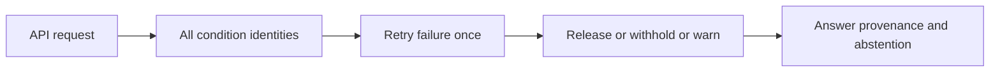
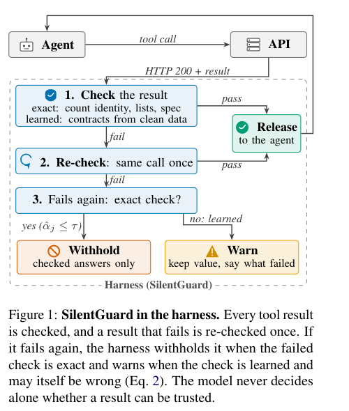

<!-- source-sha256: 7b65bd17259f9c4392abfdb9ca98ba7e0bdcbadbe4f3e34da25ef08880be7c9b -->

# Invariant-Aware Harness Enforcement to Protect LLM Agents from Silent API Failures

[简体中文](README.md)

> **component_only / l1_mechanism; not an agent-capability reproduction.** Full experiment not reproduced due to cost(review DONE); not Evolve promotion evidence.

## Paper information

| Field | Content |
| --- | --- |
| Paper | [silentguard](https://arxiv.org/abs/2611.20595v1), [fixedv1](https://arxiv.org/html/2611.20595v1) |
| First-author affiliation | Sajib Acharjee Dip, Virginia Tech / Genentech |
| Original publication | **2026-11-16 06:22:28 UTC**, arXivv1; announcement date is separate |
| Author code | [https://github.com/Sajib-006/silentguard/tree/748975cb3070a4661ff8ab689ed7fdfe55da0a47](https://github.com/Sajib-006/silentguard/tree/748975cb3070a4661ff8ab689ed7fdfe55da0a47); Apache-2.0 |
| Local adapter / key | `silentguard`; `adapter=null`, not integrated into Evolve |
| Local code | `src/auto_research/agent_research/silentguard.py` |

## Original paper

### Background and main changes

HTTP200 does not establish that an API applied the requested filters. SilentGuard moves checks from optional prompt advice into the execution harness. Results must satisfy invariants, a failing request is actually retried once, and repeated failures lead to withholding or warning according to check reliability. It never invents a repaired value.

For every conditioni, count checks testN(F)+N(F without i and not Ci)=N(F without i), requiring up to2k additional queries. Undocumented parameters can be rejected before execution. Exact checks have zero false-alarm estimate; learned contracts use1/(n+2) fromn clean examples and withhold only at a cutoff of1%. Final counts must originate from a sufficiently restrictive checked query; two rejected submissions are followed by abstention.

### Architecture and workflow



<!-- paper-figure:start -->
### Original paper figure



Fixedv1 PDFp.2, Figure1 and original caption. Only surrounding text/whitespace is cropped; scientific content is unchanged. [Original figure](https://arxiv.org/pdf/2611.20595v1#page=2) and [provenance](assets/provenance.json). Image from the [original paper](https://arxiv.org/html/2611.20595v1); copyright belongs to the original authors.
<!-- paper-figure:end -->

### Core equations

$$
N(F)+N(F_{\setminus i}\land\neg C_i)=N(F_{\setminus i}),\quad\widehat\alpha_j=1/(n_j+2),\quad failed\land\widehat\alpha_j\le .01\Rightarrow withhold.
$$

### Author results

On targeted faults, the paper reduces wrong answers from74.0% to1.7% over seven open models and from70.2% to0.5% over three frontier models. This trades queries and abstention for reliability; it does not recover truth. Consistent lies and faults preserving the identity can pass, and unseen-fault coverage remains limited. No production A/B is reported.

## Local implementation

### Data protocol and code mapping

guarded_count actually invokes the API and auxiliary queries, retries the original call once, and removes unverified counts rather than replacing them with zero. action_for_checks implements exact/learned cutoff decisions. AnswerGate tracks filter counts so a looser verified query cannot support a stricter request. The slice omits list checks, contract mining, value swaps, LLMs and training.

```bash
PYTHONPATH=src python -c 'from auto_research.agent_research.silentguard import diagnostic; print(diagnostic(42))'
PYTHONPATH=src python -m pytest tests/test_nov18_latest_agent.py -q
```

[CPU mechanism evidence](metrics/component-cpu-seeds42-44.json) contains executed synthetic controls, not model accuracy. CPU only; no CUDA capability is advertised.

### Diagnostics and limits

Controls include a consistent lie that correctly remains undetected, the97/98 clean-example cutoff, unknown-parameter rejection, API-error passthrough, loose-query provenance and bounded rejection. Unlike Harness² policy improvement, this component controls whether evidence may be used; verifiability is not an open-task capability score.

The representative [ harness2 ](../2610.14224-harness2/README.md) was read for the mechanism comparison; unmeasured superiority is not claimed.

### High-cost full experiment

The deterministic guard needs no extra LLM call, but the complete seven-open/three-frontier campaign and SFT/DAPO training are excluded. These are source configurations, not measured local runtime. Available resources are one A100/A30 or a local Mac, not multiple GPUs or free APIs. **Full experiment not reproduced due to cost(review DONE).** This is terminal and does not block the review watermark. No large download, full-matrix probe or automatic retry is launched.
