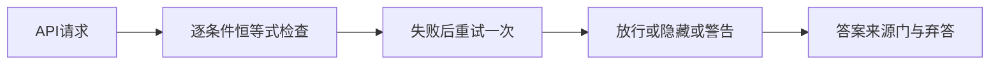
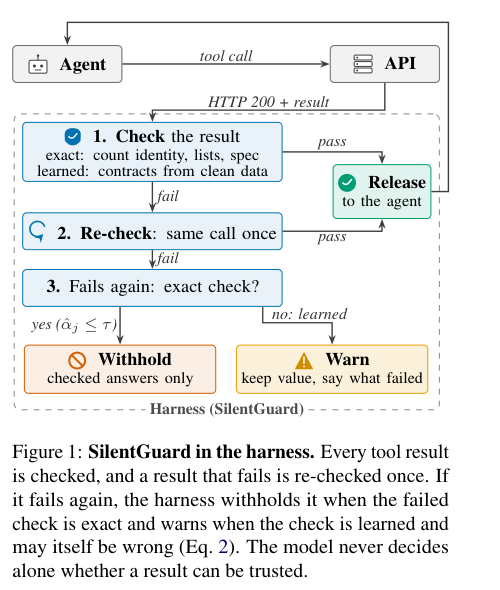

# SilentGuard：把API一致性检查变成强制执行门

[English](README-en.md)

> **component_only / l1_mechanism；不是Agent能力复现。** 完整实验成本过高，不复现（审查 DONE）；不作为Evolve晋级证据。

## 论文信息

| 字段 | 内容 |
| --- | --- |
| 论文链接 | [silentguard](https://arxiv.org/abs/2611.20595v1)，[固定v1正文](https://arxiv.org/html/2611.20595v1) |
| 一作机构 / 公司 / 学校 | Sajib Acharjee Dip，Virginia Tech / Genentech |
| 首次公开日期 | **2026-11-16 06:22:28 UTC**（arXiv v1；不以次日公告代替首发） |
| 原作者代码 | [https://github.com/Sajib-006/silentguard/tree/748975cb3070a4661ff8ab689ed7fdfe55da0a47](https://github.com/Sajib-006/silentguard/tree/748975cb3070a4661ff8ab689ed7fdfe55da0a47)；Apache-2.0 |
| 本地 adapter / key | `silentguard`；`adapter=null`，未接入Evolve |
| 本地复现代码 | `src/auto_research/agent_research/silentguard.py` |

## 原始论文总结

### 背景与主要改动

API返回HTTP200并不保证按请求过滤，静默忽略字段、把AND变OR或截断total都可能让Agent相信错误数据。SilentGuard把检查从提示中的建议移到执行harness：结果过确定性不变量才放行，失败真实重试一次，仍失败时按检查可信度隐藏值或警告，不自动生成“修复值”。

计数查询对每个条件i执行N(F)+N(F不含i且非Ci)=N(F不含i)，每次最多2k额外API查询。文档外参数可在执行前拒绝。精确检查误报估计0；learned contract从n条clean样本估1/(n+2)，不大于1%才强制隐藏。最终count必须来自足够严格且已通过检查的查询，否则拒绝最多两次再弃答。

### 架构与流程



<!-- paper-figure:start -->
### 原论文关键图



固定v1 PDF第2页Figure 1及原图注，仅裁剪页面留白／其他正文；不改变科学内容。[原图](https://arxiv.org/pdf/2611.20595v1#page=2)，[资产来源](assets/provenance.json)。图片来自[原论文](https://arxiv.org/html/2611.20595v1)，版权归原作者所有。
<!-- paper-figure:end -->

### 核心公式

$$
N(F)+N(F_{\setminus i}\land\neg C_i)=N(F_{\setminus i}),\quad\widehat\alpha_j=1/(n_j+2),\quad failed\land\widehat\alpha_j\le .01\Rightarrow withhold.
$$

### 论文离线与线上效果

作者在7个open模型上将目标fault的错误答复由74.0%降到1.7%，3个frontier由70.2%到0.5%。代价是更多查询和弃答，不是恢复真实值。逻辑一致的谎言、前缀匹配等可保持恒等式，不能被它保证检测；paper也报告域外fault覆盖不足。没有生产线上A/B。

## 本地复现

### 数据协议与代码映射

本地guarded_count实际调用API回调及辅助查询，失败真实重发原调用一次；无效count删去而不是返回0。action_for_checks实现learned/exact阈值；AnswerGate跟踪查询条件数，防止用宽松查询的verified count替代更严格请求。只支持计数切片，未实现列表验证、contract miner、值交换检查、模型或训练。

```bash
PYTHONPATH=src python -c 'from auto_research.agent_research.silentguard import diagnostic; print(diagnostic(42))'
PYTHONPATH=src python -m pytest tests/test_nov18_latest_agent.py -q
```

[CPU机制指标](metrics/component-cpu-seeds42-44.json)为实际合成控制结果，不是模型正确率。所有模块仅CPU，不广告CUDA能力。

### 结果、负控与边界

负控包含一致谎言确实放行、97/98个clean样本的阈值边界、documented参数拒绝、原API error透传、宽松count不能背书严格请求，以及两次拒绝后弃答。与Harness²改进执行策略不同，这里只限制结果能否被使用；判定“可验证”不等于开放任务能力。

同主题对照已实读：[ harness2 ](../2610.14224-harness2/README.md)；其机制与本文的区别不代表未经测量的优劣。

### 高成本完整实验

原文成本依据：Deterministic harness checks need no model call; full seven-open/three-frontier model matrix and SFT/DAPO are high cost。可用资源为单张A100/A30或本地Mac，不能假设多GPU或免费API。**成本过高，不复现（审查 DONE）**。此为终态，不阻塞审查水位；不下载大型资源、不试跑完整矩阵、不进入自动重试队列。
