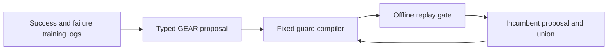
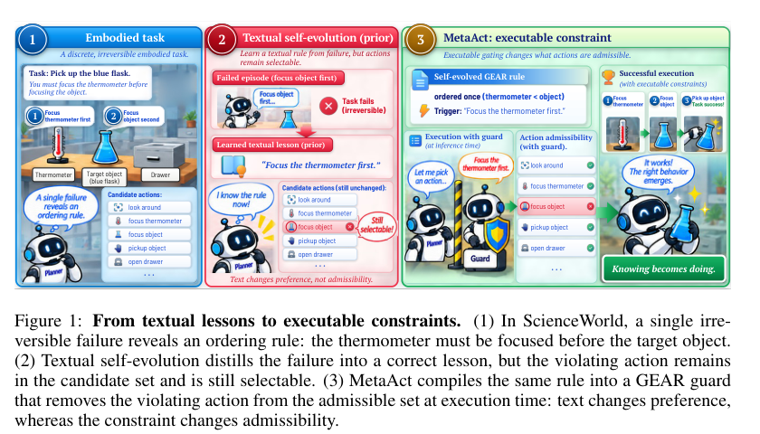

<!-- source-sha256: c9e5eda92aac988d4e393e2465bcbc64a8043b605f86ab1e65a289e593b01734 -->

# MetaAct: Self-Evolving Executable Action Constraints for Embodied Language Agents

[简体中文](README.md)

> **component_only / l1_mechanism; not an agent-capability reproduction.** Full experiment not reproduced due to cost(review DONE); not Evolve promotion evidence.

## Paper information

| Field | Content |
| --- | --- |
| Paper | [metaact](https://arxiv.org/abs/2611.20655v1), [fixedv1](https://arxiv.org/html/2611.20655v1) |
| First-author affiliation | Jiaxing Zhao, Jilin University |
| Original publication | **2026-11-16 07:11:07 UTC**, arXivv1; announcement date is separate |
| Author code | [https://github.com/BaiCubed/MetaAct/tree/d01b2924655aa7fed7be7d025bccfce196a9dafc](https://github.com/BaiCubed/MetaAct/tree/d01b2924655aa7fed7be7d025bccfce196a9dafc); MIT |
| Local adapter / key | `metaact`; `adapter=null`, not integrated into Evolve |
| Local code | `src/auto_research/agent_research/metaact.py` |

## Original paper

### Background and main changes

Natural-language lessons affect preference without guaranteeing that an irreversible action is blocked. MetaAct has an LLM write typed GEAR specifications, compiled by a fixed compiler into deterministic guards. Rejected actions return trigger messages for replanning. Guarantees are local to represented constraints, not full-task safety proofs.

Fixedv1 defines six primitives: ordered_once, no_op_repeat, idempotence_block, revisit_block, generic_deref and relevance_filter, with a fixed extractor menu. Offline training-log replay requires failure coverage≥0.3, effective-action blocking≤0.15 and successful-trajectory blocking≤0.10. The effective-action denominator uses successful and high-scoring failed safety references; intended no-op suppression is not counted as false blocking.

### Architecture and workflow



<!-- paper-figure:start -->
### Original paper figure



Fixedv1 PDFp.2, Figure1 and original caption. Only surrounding text/whitespace is cropped; scientific content is unchanged. [Original figure](https://arxiv.org/pdf/2611.20655v1#page=2) and [provenance](assets/provenance.json). Image from the [original paper](https://arxiv.org/html/2611.20655v1); copyright belongs to the original authors.
<!-- paper-figure:end -->

### Core equations

$$
cov\ge .3,\quad eff\le .15,\quad ok\le .10;\qquad J=.5\rho+.5cov-2eff-2ok.
$$

### Author results

Each round compares incumbent, proposal and their union. Union conjoins guards and must be replayed rather than assumed safe. The objective is0.5rho+0.5cov−2eff−2ok; early stopping also requires wasted recall≥0.8, with at most three rounds. Reported ScienceWorld/WebShop violations fall from70%/40% to0%/1%; these are restricted-environment results, not production A/B.

## Local implementation

### Data protocol and code mapping

The local independent slice implements two verified guards, no_op_repeat and idempotence_block, plus Eq2–5 replay scoring and union selection. It omits four primitives, goal extractors, LLM synthesis and online retirement. The safety-reference score threshold must be supplied explicitly; a teaching value of0.5 is not a paper-wide constant. Unknown primitives raise errors. The pinned upstream repository already has more primitives thanv1 and does not redefine the paper.

```bash
PYTHONPATH=src python -c 'from auto_research.agent_research.metaact import diagnostic; print(diagnostic(42))'
PYTHONPATH=src python -m pytest tests/test_nov18_latest_agent.py -q
```

[CPU mechanism evidence](metrics/component-cpu-seeds42-44.json) contains executed synthetic controls, not model accuracy. CPU only; no CUDA capability is advertised.

### Diagnostics and limits

Synthetic logs verify restoration after observation changes, blocking already-effective options, rejection for harmful effective/success blocking and refusal to score without positive/negative references. Success and score labels belong only to the replay evaluator; guards receive pre-action View. Unlike Harness² open execution composition, this selects scoped executable constraints. Passing replay does not establish environment benefit.

The representative [ harness2 ](../2610.14224-harness2/README.md) was read for the mechanism comparison; unmeasured superiority is not claimed.

### High-cost full experiment

Replay and compiled guards are cheap CPU mechanisms. The complete four-environment agent campaign and487K-token ScienceWorld synthesis study are excluded. These are source configurations, not measured local runtime. Available resources are one A100/A30 or a local Mac, not multiple GPUs or free APIs. **Full experiment not reproduced due to cost(review DONE).** This is terminal and does not block the review watermark. No large download, full-matrix probe or automatic retry is launched.
