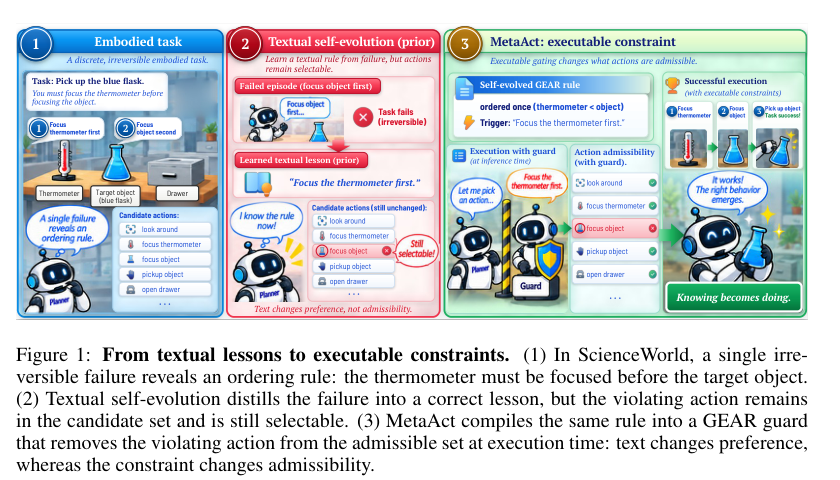

# MetaAct：类型化动作约束与离线回放验证

[English](README-en.md)

> **component_only / l1_mechanism；不是Agent能力复现。** 完整实验成本过高，不复现（审查 DONE）；不作为Evolve晋级证据。

## 论文信息

| 字段 | 内容 |
| --- | --- |
| 论文链接 | [metaact](https://arxiv.org/abs/2611.20655v1)，[固定v1正文](https://arxiv.org/html/2611.20655v1) |
| 一作机构 / 公司 / 学校 | Jiaxing Zhao，Jilin University |
| 首次公开日期 | **2026-11-16 07:11:07 UTC**（arXiv v1；不以次日公告代替首发） |
| 原作者代码 | [https://github.com/BaiCubed/MetaAct/tree/d01b2924655aa7fed7be7d025bccfce196a9dafc](https://github.com/BaiCubed/MetaAct/tree/d01b2924655aa7fed7be7d025bccfce196a9dafc)；MIT |
| 本地 adapter / key | `metaact`；`adapter=null`，未接入Evolve |
| 本地复现代码 | `src/auto_research/agent_research/metaact.py` |

## 原始论文总结

### 背景与主要改动

自然语言教训改变偏好，却不能保证不可逆动作不执行。MetaAct让LLM输出类型化GEAR规格，由固定编译器转成确定性guard；运行时拒绝违反约束的动作并返触发消息，模型需要重新规划。保证只覆盖规格表达的局部规则，不是全任务安全证明。

v1提出ordered_once、no_op_repeat、idempotence_block、revisit_block、generic_deref、relevance_filter六类primitive及固定extractor菜单。候选用训练日志反事实回放，要求失败轨迹覆盖至少0.3、有效动作误拦不高于0.15、成功轨迹被拦不高于0.10。有效动作分母来自成功及高分失败的安全参考，不把本来无效的重复动作充成误拦。

### 架构与流程


<!-- paper-figure:start -->
### 原论文关键图



固定v1 PDF第2页Figure 1及原图注，仅裁剪页面留白／其他正文；不改变科学内容。[原图](https://arxiv.org/pdf/2611.20655v1#page=2)，[资产来源](assets/provenance.json)。图片来自[原论文](https://arxiv.org/html/2611.20655v1)，版权归原作者所有。
<!-- paper-figure:end -->

### 核心公式

$$
cov\ge .3,\quad eff\le .15,\quad ok\le .10;\qquad J=.5\rho+.5cov-2eff-2ok.
$$

### 论文离线与线上效果

每轮比较incumbent、proposal与union；union是guard合取，必须重新回放，不能假设安全率不变。目标为0.5rho+0.5cov−2eff−2ok；通过门且wasted recall至少0.8才提前停，最多3轮。作者报告ScienceWorld/WebShop违规由70%/40%降至0%/1%，是受限环境结果，不是生产A/B。

## 本地复现

### 数据协议与代码映射

本地独立实现已核的no_op_repeat和idempotence_block两种guard，以及Eq2–5回放评分／union选择；明确不含其余四primitive、goal extractor、LLM综合和在线retirement。安全参考score阈值必须显式提供，不把教学0.5当论文统一常数。未知primitive严格拒绝，不静默跳过；上游当前repo比v1多primitive，不能据此改写原论文事实。

```bash
PYTHONPATH=src python -c 'from auto_research.agent_research.metaact import diagnostic; print(diagnostic(42))'
PYTHONPATH=src python -m pytest tests/test_nov18_latest_agent.py -q
```

[CPU机制指标](metrics/component-cpu-seeds42-44.json)为实际合成控制结果，不是模型正确率。所有模块仅CPU，不广告CUDA能力。

### 结果、负控与边界

合成日志验证观察变化后动作恢复可用、已生效选项被拦、有效动作误拦和成功轨迹误拦会拒绝、缺正负参考时不打虚假零率。成功和score标签只供离线evaluator，guard只能见动作前View。与Harness²基于开放执行对照组合不同，这里选择有明确作用域的可执行约束，回放通过并不证明真实环境收益。

同主题对照已实读：[ harness2 ](../2610.14224-harness2/README.md)；其机制与本文的区别不代表未经测量的优劣。

### 高成本完整实验

原文成本依据：Offline replay and guards are cheap CPU; full ScienceWorld/WebShop/ALFWorld/TextCraft agent study and 487k-token ScienceWorld synthesis are not run。可用资源为单张A100/A30或本地Mac，不能假设多GPU或免费API。**成本过高，不复现（审查 DONE）**。此为终态，不阻塞审查水位；不下载大型资源、不试跑完整矩阵、不进入自动重试队列。
