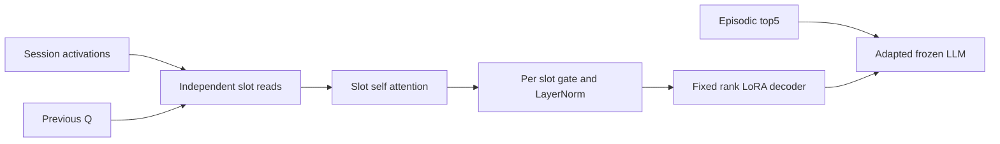
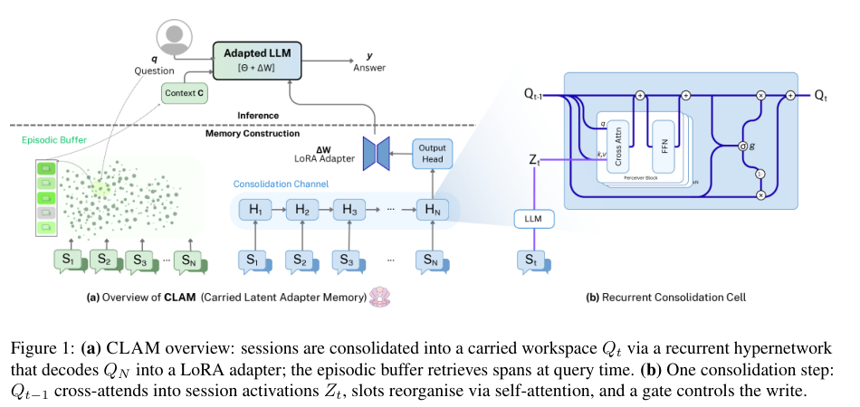

<!-- source-sha256: 2498570013ef8dd02107142113500affe63d865299686419b948181fbaf1f125 -->

# Instant Weight-Space Consolidation for Long-Term Memory in LLMs

[简体中文](README.md)

> **review_only / deferred_high_cost; not an agent-capability reproduction.** Full experiment not reproduced due to cost(review DONE); not Evolve promotion evidence.

## Paper information

| Field | Content |
| --- | --- |
| Paper | [clam-memory](https://arxiv.org/abs/2611.20759v1), [fixedv1](https://arxiv.org/html/2611.20759v1) |
| First-author affiliation | Manan Suri, University of Maryland, College Park |
| Original publication | **2026-11-16 09:09:55 UTC**, arXivv1; announcement date is separate |
| Author code | No verified paper-specific author source repository in this bounded review. Referenced dependencies and project pages are not equivalent to a verified release. |
| Local adapter / key | `clam-memory`; `adapter=null`, not integrated into Evolve |
| Local code | No executable reproduction code(review-only; no adapter) |

## Original paper

### Background and main changes

CLAM separates accumulative parametric memory from verbatim episodic retrieval. A frozen LLM supplies per-layer session activations; a hypernetwork emits down_proj LoRA weights without test-time gradient descent, supplemented by top-five session pieces at query time. No extraction calls does not mean no prior training: capability comes from offline context distillation.

Read uses nine Perceiver cross-attention blocks with eight latent slots, each reading only session tokens. Carry applies one eight-head slot self-attention block, then one sigmoid gate per slot mixes oldQ with newx and LayerNorm stabilizes it. Decode uses one query per layer/rank pair to produce fixed rank-eight adapters plus a learned fixed bias. Adapter size does not grow with sessions; mean pooling is not a substitute.

### Architecture and workflow

<!-- paper-figure:start -->
### Original paper figure

Fixedv1 PDFp.3, Figure1 and original caption. Only surrounding text/whitespace is cropped; scientific content is unchanged. [Original figure](https://arxiv.org/pdf/2611.20759v1#page=3) and [provenance](assets/provenance.json). Image from the [original paper](https://arxiv.org/html/2611.20759v1); copyright belongs to the original authors.
<!-- paper-figure:end -->

### Core equations

$$
g_t=\sigma(W_g[x_t;Q_{t-1}]+b_g),\quad Q_t=LN((1-g_t)Q_{t-1}+g_tx_t),\quad \Delta W_\ell=\alpha B_\ell A_\ell.
$$

### Author results

Experiments use1,540 answerable LoCoMo questions and173 sampled answerable LongMemEval-S questions over three2–7B bases. Seven abstention items are excluded, so full abstention capability is not established. Some comparison intervals cross zero. A70B primary judge shares a generator family; three additional judges audit independence. No production A/B is reported.

## Local implementation

### Data protocol and code mapping

This is review-only: no executable adapter, metrics or GPU receipt, and no weight/corpus downloads. The record preserves read/carry/decode, two-stage training, rank and retrieval protocols. A forward pass through an untrained random hypernetwork would not reproduce consolidation capability.

No local experimental metrics. A terminal high-cost review requires neither invented metrics nor a GPU receipt. No automatic retry or implementation queue.

### Diagnostics and limits

CoReMem values memory by future same-repository with/without-memory replay and trains provenance credit. CLAM distills full-history teacher behavior into weights. Prospective utility and a parametric memory channel are different; neither is validated by static summary similarity. Full experiment not reproduced due to cost(reviewDONE).

The representative [ coremem ](../2611.17316-coremem/README.md) was read for the mechanism comparison; unmeasured superiority is not claimed.

### High-cost full experiment

The paper uses900K synthetic trajectories generated by a70B model,8K–25K hypernetwork training steps on one A100-80GB, three2–7B backbones and70B judges. These are source configurations, not measured local runtime. Available resources are one A100/A30 or a local Mac, not multiple GPUs or free APIs. **Full experiment not reproduced due to cost(review DONE).** This is terminal and does not block the review watermark. No large download, full-matrix probe or automatic retry is launched.
