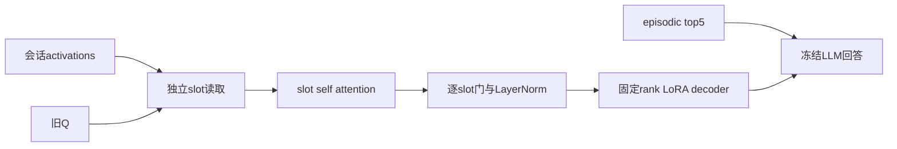
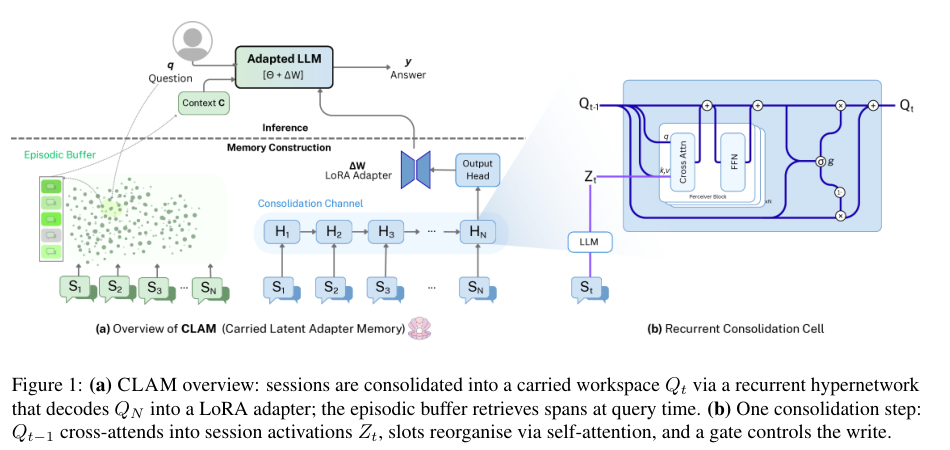

# CLAM：会话流压缩到固定大小的参数记忆

[English](README-en.md)

> **review_only / deferred_high_cost；不是Agent能力复现。** 完整实验成本过高，不复现（审查 DONE）；不作为Evolve晋级证据。

## 论文信息

| 字段 | 内容 |
| --- | --- |
| 论文链接 | [clam-memory](https://arxiv.org/abs/2611.20759v1)，[固定v1正文](https://arxiv.org/html/2611.20759v1) |
| 一作机构 / 公司 / 学校 | Manan Suri，University of Maryland, College Park |
| 首次公开日期 | **2026-11-16 09:09:55 UTC**（arXiv v1；不以次日公告代替首发） |
| 原作者代码 | No paper-specific author code or CLAM checkpoint link found in fixed v1; cited document-to-adapter checkpoint is not CLAM release |
| 本地 adapter / key | `clam-memory`；`adapter=null`，未接入Evolve |
| 本地复现代码 | 无可执行复现代码（review-only，不提供adapter） |

## 原始论文总结

### 背景与主要改动

CLAM把可积累的参数记忆与逐字检索缓冲分开：冻结LLM提供每层会话activation，hypernetwork在不做测试时梯度下降的情况下写出down_proj LoRA，查询时再配top5会话片段。没有提取调用不等于没有前置训练；能力来自离线context distillation。

Read用9层Perceiver cross-attention、每层8slots，slots只看当前会话。Carry先对slots做一次8头self-attention，再对每slot产生一个sigmoid门混合旧Q与新x，并LayerNorm。Decode用每层每rank一个query生成rank8 adapter，大小不随会话数增加；合成模型还含固定bias。顺序和门不能被普通均值池化替代。

### 架构与流程

<!-- paper-figure:start -->
### 原论文关键图

固定v1 PDF第3页Figure 1及原图注，仅裁剪页面留白／其他正文；不改变科学内容。[原图](https://arxiv.org/pdf/2611.20759v1#page=3)，[资产来源](assets/provenance.json)。图片来自[原论文](https://arxiv.org/html/2611.20759v1)，版权归原作者所有。
<!-- paper-figure:end -->

### 核心公式

$$
g_t=\sigma(W_g[x_t;Q_{t-1}]+b_g),\quad Q_t=LN((1-g_t)Q_{t-1}+g_tx_t),\quad \Delta W_\ell=\alpha B_\ell A_\ell.
$$

### 论文离线与线上效果

作者在LoCoMo1540个可答问题和LongMemEval-S173个可答抽样问题上比较3种2–7B模型；后者排除了7个弃答问题，不能外推完整abstention能力。部分对照区间跨0，不应宣称所有设置显著领先。Judge主要为70B，同族生成器独立性另用三judge复核。未报告线上A/B。

## 本地复现

### 数据协议与代码映射

本轮review-only，不提供可执行adapter、metrics或GPU验证，不下载权重／合成语料。只把v1的read/carry/decode、两阶段训练、rank与检索协议记录为可核对方法；把随机初始化hypernetwork跑一次不能算完成记忆巩固。

本篇无本地实验指标；高成本审查结案不要求虚构metrics或GPU收据。无自动重试／实现队列。

### 结果、负控与边界

CoReMem通过未来同仓库任务的有／无记忆差估值并训练写入信用；CLAM通过全历史teacher蒸馏把history压进权重。前者是前瞻效用，后者是参数通道，两者都不能用静态摘要相似度冒充任务收益。完整实验成本过高，不复现（审查DONE）。

同主题对照已实读：[ coremem ](../2611.17316-coremem/README.md)；其机制与本文的区别不代表未经测量的优劣。

### 高成本完整实验

原文成本依据：900K synthetic trajectories generated by 70B; single A100-80GB hypernetwork training 8K–25K steps, three 2–7B backbones and 70B judges。可用资源为单张A100/A30或本地Mac，不能假设多GPU或免费API。**成本过高，不复现（审查 DONE）**。此为终态，不阻塞审查水位；不下载大型资源、不试跑完整矩阵、不进入自动重试队列。
