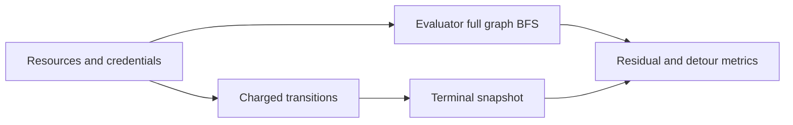
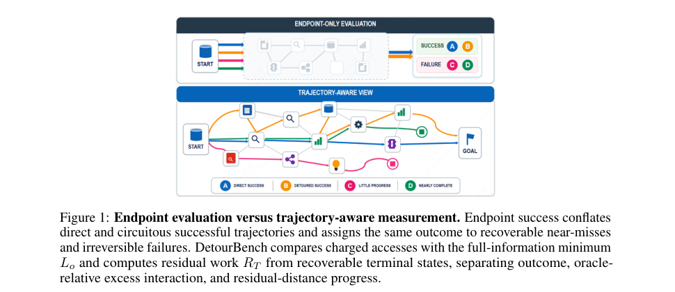

<!-- source-sha256: d3f433dedc487579b8d0106c158234ba8171e0146625c25dcbabb1cb2d5f0bd3 -->

# DetourBench: Trajectory-Level Evaluation of Interactive Agents with Exact Minimum-Action Bounds

[简体中文](README.md)

> **component_only / l1_mechanism; not an agent-capability reproduction.** Full experiment not reproduced due to cost(review DONE); not Evolve promotion evidence.

## Paper information

| Field | Content |
| --- | --- |
| Paper | [detourbench](https://arxiv.org/abs/2611.20844v1), [fixedv1](https://arxiv.org/html/2611.20844v1) |
| First-author affiliation | Hanlin Tian, Datagrids.ai |
| Original publication | **2026-11-16 10:22:21 UTC**, arXivv1; announcement date is separate |
| Author code | [https://github.com/DatagridsAI/DetourBench/tree/801db471da2e177b04fe57566be8f51093bb596a](https://github.com/DatagridsAI/DetourBench/tree/801db471da2e177b04fe57566be8f51093bb596a); No repository license found in API metadata; independently implement equations, do not vendor code |
| Local adapter / key | `detourbench`; `adapter=null`, not integrated into Evolve |
| Local code | `src/auto_research/agent_research/detourbench.py` |

## Original paper

### Background and main changes

Endpoint success conflates direct execution, circuitous success and recoverable near misses. DetourBench restricts tasks to finite deterministic partially observed resource/credential systems. Discovered identifiers remain globally addressable, with no current-location or backtracking charge. An evaluator with the complete graph uses BFS to compute a minimum charged-access reference and replayable witness. This is not the optimal partially observed policy.

Every access dispatched to the environment costs one, including invalid, disabled and duplicate calls. Model replies without accesses are free but bounded separately by a turn cap. Batches stop at a terminal state or the fixed budget. Resources and credentials grow monotonically while active. Wrong commitment is absorbing and has no finite residual distance. Conditional attainment must accompany success; successful-subset efficiency alone cannot rank models.

### Architecture and workflow



<!-- paper-figure:start -->
### Original paper figure



Fixedv1 PDFp.2, Figure1 and original caption. Only surrounding text/whitespace is cropped; scientific content is unchanged. [Original figure](https://arxiv.org/pdf/2611.20844v1#page=2) and [provenance](assets/provenance.json). Image from the [original paper](https://arxiv.org/html/2611.20844v1); copyright belongs to the original authors.
<!-- paper-figure:end -->

### Core equations

$$
L_o=\min_{\tau:s_0\to G}C_\tau,\quad A=L_o/C_\tau\ (success),\quad P=1-R_T/L_o,\quad NDR=(C_\tau+R_T-L_o)/L_o.
$$

### Author results

The integrated study has25 frozen tasks×5 endpoints×3 repeats=375 episodes: success58.7%–96.0%, conditional attainment0.803–0.890. The separate controlled study has960 episodes. Only four tasks have executed semantic counterfactuals; other audits establish structural necessity or document roles. Some development used model behavior, so freezing does not establish an untouched test set. No production A/B is reported.

## Local implementation

### Data protocol and code mapping

FiniteTask executes resource/credential prerequisites, charged batches and exact BFS witnesses. Metrics retain success, wrong terminals, residual distance and efficiency separately. Synthetic graphs test the mechanism, not an LLM; BFS answers are not passed to any policy. Exceeding100,000 states raises an error rather than returning an approximate bound labeled exact. Official source corpora, endpoints and the complete hash-freeze pipeline are absent.

```bash
PYTHONPATH=src python -c 'from auto_research.agent_research.detourbench import diagnostic; print(diagnostic(42))'
PYTHONPATH=src python -m pytest tests/test_nov18_latest_agent.py -q
```

[CPU mechanism evidence](metrics/component-cpu-seeds42-44.json) contains executed synthetic controls, not model accuracy. CPU only; no CUDA capability is advertised.

### Diagnostics and limits

Controls cover charged invalid/duplicate accesses, terminal batch truncation, partial progress, undefined wrong-terminal measures and the search cap. Three seeds repeat deterministic boundary checks, not independent capability trials. Unlike Harness², this uses a full-information exact evaluator; Harness² performs rubric-free execution contrasts and its selector is not a shortest-path oracle.

The representative [ harness2 ](../2610.14224-harness2/README.md) was read for the mechanism comparison; unmeasured superiority is not claimed.

### High-cost full experiment

The25 published exact-oracle graphs require at most13,541 states,273ms and24MiB. The full960+375 multi-endpoint episode campaign is excluded. These are source configurations, not measured local runtime. Available resources are one A100/A30 or a local Mac, not multiple GPUs or free APIs. **Full experiment not reproduced due to cost(review DONE).** This is terminal and does not block the review watermark. No large download, full-matrix probe or automatic retry is launched.
