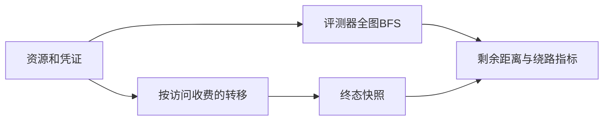
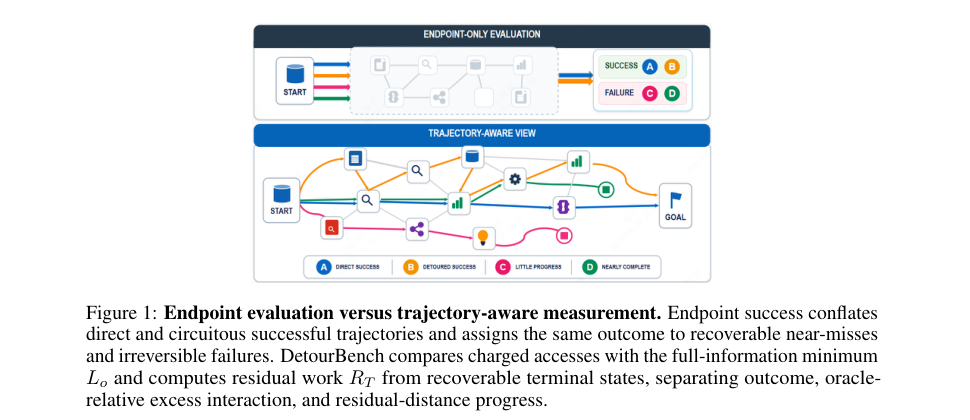

# DetourBench：把成功、绕路和不可逆失败分开

[English](README-en.md)

> **component_only / l1_mechanism；不是Agent能力复现。** 完整实验成本过高，不复现（审查 DONE）；不作为Evolve晋级证据。

## 论文信息

| 字段 | 内容 |
| --- | --- |
| 论文链接 | [detourbench](https://arxiv.org/abs/2611.20844v1)，[固定v1正文](https://arxiv.org/html/2611.20844v1) |
| 一作机构 / 公司 / 学校 | Hanlin Tian，Datagrids.ai |
| 首次公开日期 | **2026-11-16 10:22:21 UTC**（arXiv v1；不以次日公告代替首发） |
| 原作者代码 | [https://github.com/DatagridsAI/DetourBench/tree/801db471da2e177b04fe57566be8f51093bb596a](https://github.com/DatagridsAI/DetourBench/tree/801db471da2e177b04fe57566be8f51093bb596a)；No repository license found in API metadata; independently implement equations, do not vendor code |
| 本地 adapter / key | `detourbench`；`adapter=null`，未接入Evolve |
| 本地复现代码 | `src/auto_research/agent_research/detourbench.py` |

## 原始论文总结

### 背景与主要改动

只看最终成功会把最短路线、绕路成功和接近完成的失败混成同一结果。DetourBench把环境限制为有限、确定、部分可观察的资源／凭证状态机，资源标识发现后全局可寻址，没有当前位置或回退路费。离线评测器知道全图，用BFS给出最少收费访问数和可回放见证；这不是部分可观察条件下的最优策略。

每次真正送达dispatcher的访问都收费，包括无效、禁用和重复动作；不产生访问的模型回复不收费，另有turn上限。batch按顺序执行，达到终态或固定预算便停止。活跃状态下资源与凭证只增不减，错误承诺是吸收终态，不给它编造一个有限剩余距离。成功率必须与条件attainment一起报告，不能用只在成功子集上定义的效率排整个模型名次。

### 架构与流程



<!-- paper-figure:start -->
### 原论文关键图



固定v1 PDF第2页Figure 1及原图注，仅裁剪页面留白／其他正文；不改变科学内容。[原图](https://arxiv.org/pdf/2611.20844v1#page=2)，[资产来源](assets/provenance.json)。图片来自[原论文](https://arxiv.org/html/2611.20844v1)，版权归原作者所有。
<!-- paper-figure:end -->

### 核心公式

$$
L_o=\min_{\tau:s_0\to G}C_\tau,\quad A=L_o/C_\tau\ (success),\quad P=1-R_T/L_o,\quad NDR=(C_\tau+R_T-L_o)/L_o.
$$

### 论文离线与线上效果

作者Integrated Suite是25个冻结任务、5模型、3重复共375轮，成功率58.7%–96.0%，条件attainment为0.803–0.890；Controlled Suite另有960轮，不混池。语义必要性仅4任务有执行反事实，其余为结构移除与角色说明；部分任务开发受模型行为影响，不能宣称完全未触碰测试集。未报告生产线上A/B。

## 本地复现

### 数据协议与代码映射

FiniteTask执行资源／凭证前置条件、收费batch和BFS精确见证；metrics分别保留成功、错误终态、剩余距离和效率。合成图只验证算子，不运行LLM，也不把BFS答案喂给策略。100,000状态上限触发时明确报错，绝不退成近似下界冒充exact。未实现官方任务源语料、远程端点或哈希冻结全链。

```bash
PYTHONPATH=src python -c 'from auto_research.agent_research.detourbench import diagnostic; print(diagnostic(42))'
PYTHONPATH=src python -m pytest tests/test_nov18_latest_agent.py -q
```

[CPU机制指标](metrics/component-cpu-seeds42-44.json)为实际合成控制结果，不是模型正确率。所有模块仅CPU，不广告CUDA能力。

### 结果、负控与边界

负控覆盖重复／无效都收费、batch终态截断、部分进展、不可逆失败的null指标与状态上限。三seed是同一确定性边界测试的重复，不是三次独立能力实验。与Harness²相比，这里有全信息exact evaluator；Harness²是无rubric的执行对照改进，不能把其选择器当最短路oracle。

同主题对照已实读：[ harness2 ](../2610.14224-harness2/README.md)；其机制与本文的区别不代表未经测量的优劣。

### 高成本完整实验

原文成本依据：25 published oracle graphs max 13,541 states, 273 ms and 24 MiB; full 960+375 multi-API episodes are high cost。可用资源为单张A100/A30或本地Mac，不能假设多GPU或免费API。**成本过高，不复现（审查 DONE）**。此为终态，不阻塞审查水位；不下载大型资源、不试跑完整矩阵、不进入自动重试队列。
