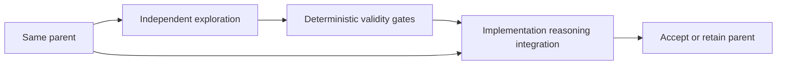
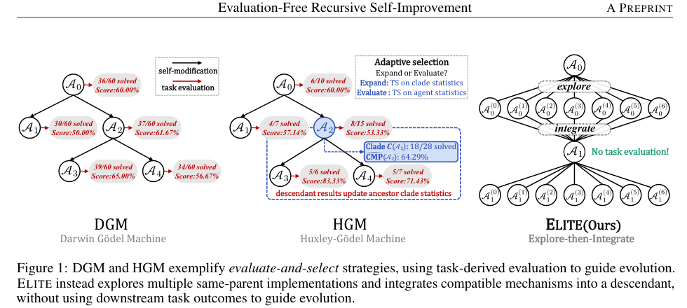

<!-- source-sha256: e461588b1e600cd62354b245fdfce3157c54a69aebbd6468d5726a45d1e516b6 -->

# Evaluation-Free Recursive Self-Improvement for Coding Agents

[简体中文](README.md)

> **component_only / l0_interface; not an agent-capability reproduction.** Full experiment not reproduced due to cost(review DONE); not Evolve promotion evidence.

## Paper information

| Field | Content |
| --- | --- |
| Paper | [elite-eval-free](https://arxiv.org/abs/2611.21056v1), [fixedv1](https://arxiv.org/html/2611.21056v1) |
| First-author affiliation | Zhe Ren, Jilin University |
| Original publication | **2026-11-16 13:05:46 UTC**, arXivv1; announcement date is separate |
| Author code | No verified paper-specific author source repository in this bounded review. Referenced dependencies and project pages are not equivalent to a verified release. |
| Local adapter / key | `elite-eval-free`; `adapter=null`, not integrated into Evolve |
| Local code | `src/auto_research/agent_research/elite_eval_free.py` |

## Original paper

### Background and main changes

ELITE questions the cost and adaptation bias of repeated downstream evaluate-and-select. With a frozen model, it evolves executable scaffold code: multiple focused hypotheses are independently implemented from one parent and deterministic-valid children are passed to an LLM integrator. It does not select the highest-scoring child.

The integrator examines code, hypotheses and gate evidence, reasons about complementarity, redundancy, conflict, complexity and missing pieces, then reimplements a combined patch against the original parent. It neither concatenates patches nor uses an already sequentially modified child as the common root. Exploration and stricter acceptance gates check operational validity; downstream solving trajectories and benchmark results never guide evolution.

### Architecture and workflow



<!-- paper-figure:start -->
### Original paper figure



Fixedv1 PDFp.2, Figure1 and original caption. Only surrounding text/whitespace is cropped; scientific content is unchanged. [Original figure](https://arxiv.org/pdf/2611.21056v1#page=2) and [provenance](assets/provenance.json). Image from the [original paper](https://arxiv.org/html/2611.21056v1); copyright belongs to the original authors.
<!-- paper-figure:end -->

### Core equations

$$
children_i=Explore(parent,h_i),\qquad next=\begin{cases}Integrate(parent,valid\ children),&acceptance\ passes,\\parent,&otherwise.\end{cases}
$$

### Author results

The paper improves its initial agent from60.0% to85.6% on60 SWE-bench Pro tasks, versus86.7%/88.3% for DGM/HGM. Observed8.8×/3.2× runtime reductions depend on different concurrency and budgets and are not equal-compute speed claims. Post-hoc benchmark outcomes must not be fed back into evaluation-free integration. No production A/B is reported.

## Local implementation

### Data protocol and code mapping

The L0 generation protocol actually calls independent explorer, exploration gate, integrator and acceptance-gate callbacks. A shared parent is immutable; empty/out-of-scope patches and non-Boolean gates are rejected. IntegrationRequest contains only parent and valid children, not scores or solving traces. Failed acceptance or no valid children retains the original parent. Compilation of teaching code is not an LLM, SWE container or security sandbox.

```bash
PYTHONPATH=src python -c 'from auto_research.agent_research.elite_eval_free import diagnostic; print(diagnostic(42))'
PYTHONPATH=src python -m pytest tests/test_nov18_latest_agent.py -q
```

[CPU mechanism evidence](metrics/component-cpu-seeds42-44.json) contains executed synthetic controls, not model accuracy. CPU only; no CUDA capability is advertised.

### Diagnostics and limits

Controls verify identical parent inputs, independent children, edit-scope enforcement, acceptance rollback and strict gate types. Both ELITE and Harness² avoid task rubrics, but Harness² uses task-execution contrasts whereas ELITE excludes downstream outcomes. Ordinary validation elitism must not be relabeled ELITE.

The representative [ harness2 ](../2610.14224-harness2/README.md) was read for the mechanism comparison; unmeasured superiority is not claimed.

### High-cost full experiment

The complete experiment uses ten generations, seven children, three runs,1,800-second container timeouts and multi-benchmark API agents. Only callback orchestration is run. These are source configurations, not measured local runtime. Available resources are one A100/A30 or a local Mac, not multiple GPUs or free APIs. **Full experiment not reproduced due to cost(review DONE).** This is terminal and does not block the review watermark. No large download, full-matrix probe or automatic retry is launched.
