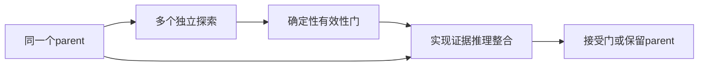
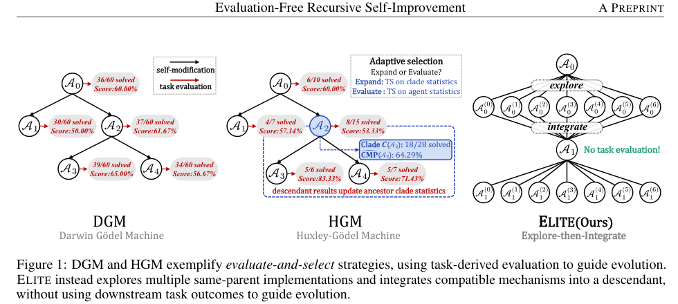

# ELITE：同父探索后按实现证据整合，不做任务分数选择

[English](README-en.md)

> **component_only / l0_interface；不是Agent能力复现。** 完整实验成本过高，不复现（审查 DONE）；不作为Evolve晋级证据。

## 论文信息

| 字段 | 内容 |
| --- | --- |
| 论文链接 | [elite-eval-free](https://arxiv.org/abs/2611.21056v1)，[固定v1正文](https://arxiv.org/html/2611.21056v1) |
| 一作机构 / 公司 / 学校 | Zhe Ren，Jilin University |
| 首次公开日期 | **2026-11-16 13:05:46 UTC**（arXiv v1；不以次日公告代替首发） |
| 原作者代码 | No verifiable paper-specific author source repository found in fixed v1; mini-swe-agent is a cited dependency |
| 本地 adapter / key | `elite-eval-free`；`adapter=null`，未接入Evolve |
| 本地复现代码 | `src/auto_research/agent_research/elite_eval_free.py` |

## 原始论文总结

### 背景与主要改动

ELITE质疑反复在固定下游任务上evaluate-and-select的成本与适应偏差。冻结模型，演化可执行scaffold代码：同一parent先给出多个聚焦改进假设，每条假设独立实现，经过确定性有效性检查后交给LLM integrator。它不是从得分最高子代里挑一个。

integrator查看实现、hypothesis与gate结果，推理互补、冗余、冲突、复杂度或缺失，再对原parent重新实现一个组合patch。不能简单拼接所有patch，也不能把已串联修改的子代当共同起点。compile/import/tool-load/scope等exploration gate与更严格call-return/message-order/main-flow acceptance gate只验证操作有效性；下游解题轨迹和benchmark结果都不进入演化。

### 架构与流程



<!-- paper-figure:start -->
### 原论文关键图



固定v1 PDF第2页Figure 1及原图注，仅裁剪页面留白／其他正文；不改变科学内容。[原图](https://arxiv.org/pdf/2611.21056v1#page=2)，[资产来源](assets/provenance.json)。图片来自[原论文](https://arxiv.org/html/2611.21056v1)，版权归原作者所有。
<!-- paper-figure:end -->

### 核心公式

$$
children_i=Explore(parent,h_i),\qquad next=\begin{cases}Integrate(parent,valid\ children),&acceptance\ passes,\\parent,&otherwise.\end{cases}
$$

### 论文离线与线上效果

作者原agent在SWE-bench Pro60题上从60.0%到85.6%；DGM/HGM为86.7%/88.3%。观察运行时间降低8.8×/3.2×受不同并发与预算影响，不是严格相同计算量的速度结论。结果是事后benchmark评估，不可反向用于eval-free整合。未报告线上A/B。

## 本地复现

### 数据协议与代码映射

本地L0 generation真实调用独立explore、exploration_gate、integrate、acceptance_gate；共同parent映射不可变，越界／空patch和非bool门结果拒绝。IntegrationRequest只有parent与有效children，不接收任务成绩／轨迹。失败acceptance或无有效子代保留原parent，不选择“次优分数”。回调可编译示例源码但没有LLM、SWE容器或安全沙箱。

```bash
PYTHONPATH=src python -c 'from auto_research.agent_research.elite_eval_free import diagnostic; print(diagnostic(42))'
PYTHONPATH=src python -m pytest tests/test_nov18_latest_agent.py -q
```

[CPU机制指标](metrics/component-cpu-seeds42-44.json)为实际合成控制结果，不是模型正确率。所有模块仅CPU，不广告CUDA能力。

### 结果、负控与边界

负控验证两次explorer确实看到相同parent、integrator收到独立子代、严格范围拒绝、acceptance失败回滚和无效gate不被truthiness放行。与Harness²相比，两者都不依赖任务rubric，但Harness²按任务执行对照改框架，ELITE刻意不看下游执行结局，不能把普通validation elitism写成ELITE。

同主题对照已实读：[ harness2 ](../2610.14224-harness2/README.md)；其机制与本文的区别不代表未经测量的优劣。

### 高成本完整实验

原文成本依据：Full 10 generations×7 children×three runs with 1,800-second container timeouts and multi-benchmark APIs are high cost; callback protocol itself cheap。可用资源为单张A100/A30或本地Mac，不能假设多GPU或免费API。**成本过高，不复现（审查 DONE）**。此为终态，不阻塞审查水位；不下载大型资源、不试跑完整矩阵、不进入自动重试队列。
