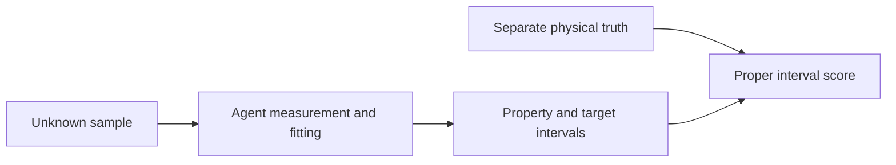
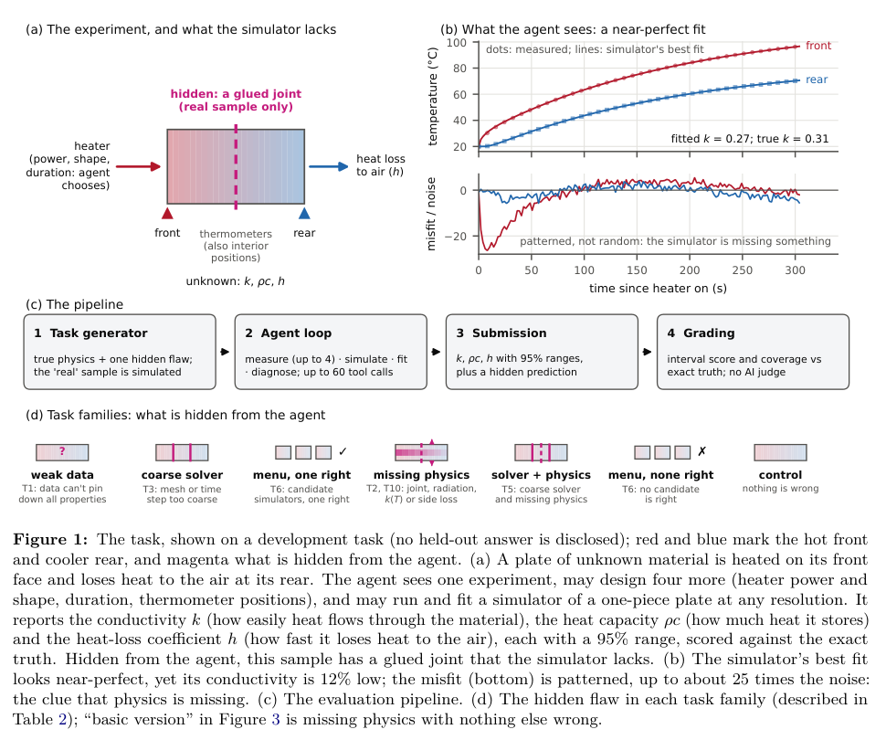

<!-- source-sha256: 884c2c315ed5d8fd7be486f16373e6faea73d48c52ba22be9d594c29f820ee55 -->

# SciResearch-Eval: Evaluating Scientific Judgment in Autonomous Experimental Agents

[简体中文](README.md)

> **component_only / l1_mechanism; not an agent-capability reproduction.** Full experiment not reproduced due to cost(review DONE); not Evolve promotion evidence.

## Paper information

| Field | Content |
| --- | --- |
| Paper | [sciresearch-eval](https://arxiv.org/abs/2611.21541v1), [fixedv1](https://arxiv.org/html/2611.21541v1) |
| First-author affiliation | Brian T. Weston, Lawrence Livermore National Laboratory |
| Original publication | **2026-11-16 18:27:09 UTC**, arXivv1; announcement date is separate |
| Author code | [https://github.com/Btwestyo/sciresearch-eval/tree/9d391b3aa8daf8d0b944acda12c7f8b089a1d8e0](https://github.com/Btwestyo/sciresearch-eval/tree/9d391b3aa8daf8d0b944acda12c7f8b089a1d8e0); CC-BY-4.0 |
| Local adapter / key | `sciresearch-eval`; `adapter=null`, not integrated into Evolve |
| Local code | `src/auto_research/agent_research/sciresearch_eval.py` |

## Original paper

### Background and main changes

An agent designs heating experiments for an unknown material, fits a supplied heat-conduction simulator that may be under-resolved or physically incomplete, and submits95% property intervals plus a hidden-experiment prediction. Small residuals need not imply a correct model: missing physics can yield precise but biased estimates. A richer hidden simulator supplies exact evaluator truth; the actor receives tools, measurements and budgets only.

Physical-property intervals use a proper interval score on log10 values: width is penalized and miscoverage adds40 times the missed distance. Hidden temperature predictions are separately normalized by sensor sigma and true temperature rise. These are not one accuracy metric. Missing submissions remain explicit and count as coverage misses in the paper; dropping them would bias evaluation.

### Architecture and workflow



<!-- paper-figure:start -->
### Original paper figure



Fixedv1 PDFp.2, Figure1 and original caption. Only surrounding text/whitespace is cropped; scientific content is unchanged. [Original figure](https://arxiv.org/pdf/2611.21541v1#page=2) and [provenance](assets/provenance.json). Image from the [original paper](https://arxiv.org/html/2611.21541v1); copyright belongs to the original authors.
<!-- paper-figure:end -->

### Core equations

$$
IS_{.05}(l,u;y)=(u-l)+40\max(l-y,0)+40\max(y-u,0),\qquad Score_{param}=mean_j IS_{.05}(\log_{10}l_j,\log_{10}u_j;\log_{10}y_j).
$$

### Author results

Across93 held-out tasks,9 models and2,511 episodes, missing physics often produces overconfident intervals. Procedural tool competence does not establish scientific validity. Tasks and grader are frozen atv0.2.0 with manifest digest9a6f53f8d8aba81e. A strategy hint was initially designed after inspecting test outcomes; its later fresh-split replication must be distinguished. No production A/B is reported.

## Local implementation

### Data protocol and code mapping

The local slice runs interval_score and parameter_score. Positive physical quantities are converted to log10; endpoints, finiteness and exact parameter keys are checked. evaluator_truth has no actor callback path and belongs only to the scorer. No thermal solver, design selection, fitting, scientist LLM or missing-submission aggregation is implemented. This is not a scientific-capability reproduction.

```bash
PYTHONPATH=src python -c 'from auto_research.agent_research.sciresearch_eval import diagnostic; print(diagnostic(42))'
PYTHONPATH=src python -m pytest tests/test_nov18_latest_agent.py -q
```

[CPU mechanism evidence](metrics/component-cpu-seeds42-44.json) contains executed synthetic controls, not model accuracy. CPU only; no CUDA capability is advertised.

### Diagnostics and limits

Controls verify the narrow-miss penalty, nonfree widening, invariance to multiplicative unit changes, and rejection of nonpositive/NaN/missing parameters. AskALCF uses answer-blind evidence scopes for attribution; this benchmark scores uncertainty against independent physical truth. Both isolate evaluation references, but their judgments are not interchangeable.

The representative [ askalcf-protocol ](../2611.15700-askalcf-protocol/README.md) was read for the mechanism comparison; unmeasured superiority is not claimed.

### High-cost full experiment

The full study has2,511 episodes across nine models,27B–31B open models on four RTX PRO6000 GPUs, plus paid API studies. Only scalar scoring is run locally. These are source configurations, not measured local runtime. Available resources are one A100/A30 or a local Mac, not multiple GPUs or free APIs. **Full experiment not reproduced due to cost(review DONE).** This is terminal and does not block the review watermark. No large download, full-matrix probe or automatic retry is launched.
