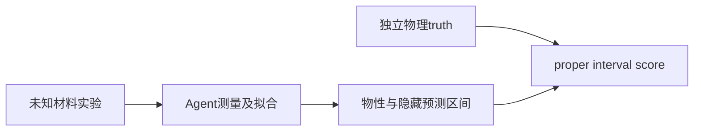
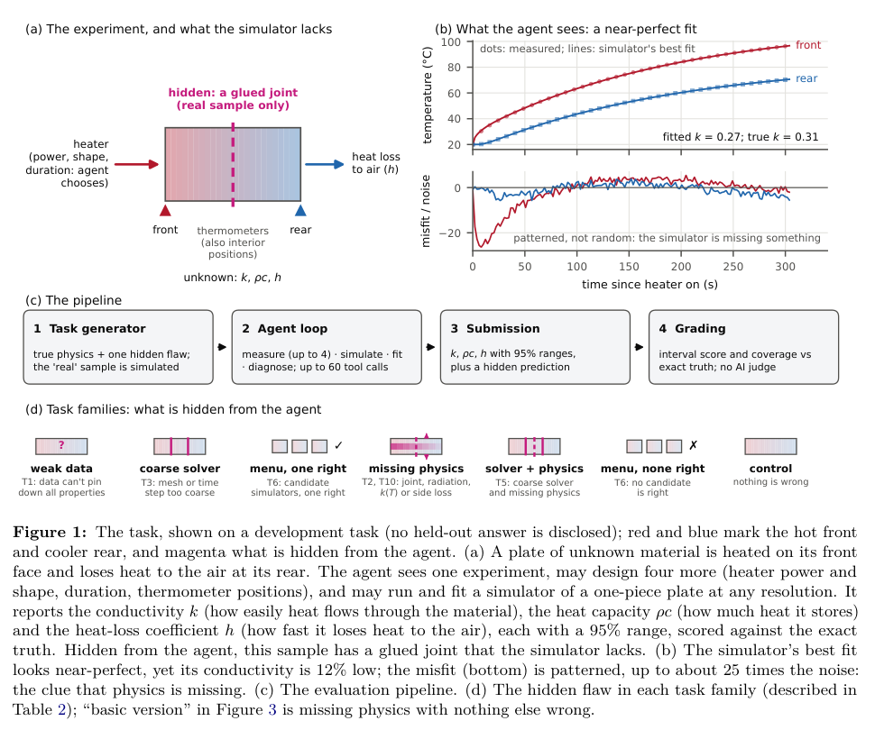

# SciResearch-Eval：用正确区间评分检验科学判断

[English](README-en.md)

> **component_only / l1_mechanism；不是Agent能力复现。** 完整实验成本过高，不复现（审查 DONE）；不作为Evolve晋级证据。

## 论文信息

| 字段 | 内容 |
| --- | --- |
| 论文链接 | [sciresearch-eval](https://arxiv.org/abs/2611.21541v1)，[固定v1正文](https://arxiv.org/html/2611.21541v1) |
| 一作机构 / 公司 / 学校 | Brian T. Weston，Lawrence Livermore National Laboratory |
| 首次公开日期 | **2026-11-16 18:27:09 UTC**（arXiv v1；不以次日公告代替首发） |
| 原作者代码 | [https://github.com/Btwestyo/sciresearch-eval/tree/9d391b3aa8daf8d0b944acda12c7f8b089a1d8e0](https://github.com/Btwestyo/sciresearch-eval/tree/9d391b3aa8daf8d0b944acda12c7f8b089a1d8e0)；CC-BY-4.0 |
| 本地 adapter / key | `sciresearch-eval`；`adapter=null`，未接入Evolve |
| 本地复现代码 | `src/auto_research/agent_research/sciresearch_eval.py` |

## 原始论文总结

### 背景与主要改动

Agent需要给未知材料设计加热实验，用可能粗糙或缺物理项的热传导模拟器估计物性，再报告95%区间与隐藏实验的预测。拟合残差小不代表模型正确：错误物理可给出看似精确但偏置的参数。环境让“真实样品”由更丰富模拟器生成，评测器有精确truth，Agent只得到工具、初始测量和预算。

物性区间在log10尺度上使用proper interval score：区间越宽承担宽度代价，错过truth另以40倍距离处罚。隐藏温度预测另按传感噪声sigma及真实温升归一化，不能和物性log评分混成一个accuracy。无提交单独保存，论文覆盖率把它算miss；不能只统计按时提交的成功子集。

### 架构与流程



<!-- paper-figure:start -->
### 原论文关键图



固定v1 PDF第2页Figure 1及原图注，仅裁剪页面留白／其他正文；不改变科学内容。[原图](https://arxiv.org/pdf/2611.21541v1#page=2)，[资产来源](assets/provenance.json)。图片来自[原论文](https://arxiv.org/html/2611.21541v1)，版权归原作者所有。
<!-- paper-figure:end -->

### 核心公式

$$
IS_{.05}(l,u;y)=(u-l)+40\max(l-y,0)+40\max(y-u,0),\qquad Score_{param}=mean_j IS_{.05}(\log_{10}l_j,\log_{10}u_j;\log_{10}y_j).
$$

### 论文离线与线上效果

作者对93 held-out任务、9模型、2511轮发现缺失物理时区间常过度自信；工具程序陷阱不代表科学有效性。任务与grader冻结v0.2.0、manifest digest为9a6f53f8d8aba81e。策略hint最初看过测试结果，后续新split复制需分开解读。未报告生产线上A/B。

## 本地复现

### 数据协议与代码映射

本地只执行interval_score与parameter_score：正值物性先取log10，检查端点有序、有限与key完全一致。evaluator_truth没有Actor回调入口；它是评分器专用参数，不是给被评策略的信息。未实现热求解器、实验选择、拟合、科学家LLM或无提交聚合，不据此宣称科学任务复现。

```bash
PYTHONPATH=src python -c 'from auto_research.agent_research.sciresearch_eval import diagnostic; print(diagnostic(42))'
PYTHONPATH=src python -m pytest tests/test_nov18_latest_agent.py -q
```

[CPU机制指标](metrics/component-cpu-seeds42-44.json)为实际合成控制结果，不是模型正确率。所有模块仅CPU，不广告CUDA能力。

### 结果、负控与边界

负控验证过窄错误区间代价、区间加宽不免费、单位倍数变换不改log区间评分，以及非正值／NaN／漏参数拒绝。AskALCF用回答盲的两范围证据定位检索责任；本篇用独立物理truth评分置信区间。二者都要求评测参考不能进入被评Agent，但不能互换judgment。

同主题对照已实读：[ askalcf-protocol ](../2611.15700-askalcf-protocol/README.md)；其机制与本文的区别不代表未经测量的优劣。

### 高成本完整实验

原文成本依据：Full 2,511-episode nine-model campaign; 27B–31B open models on four RTX PRO 6000 plus paid API studies; only scalar scorer is cheap。可用资源为单张A100/A30或本地Mac，不能假设多GPU或免费API。**成本过高，不复现（审查 DONE）**。此为终态，不阻塞审查水位；不下载大型资源、不试跑完整矩阵、不进入自动重试队列。
