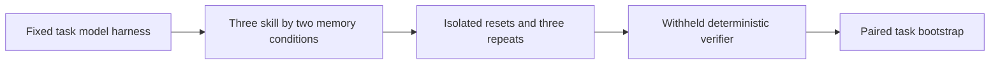
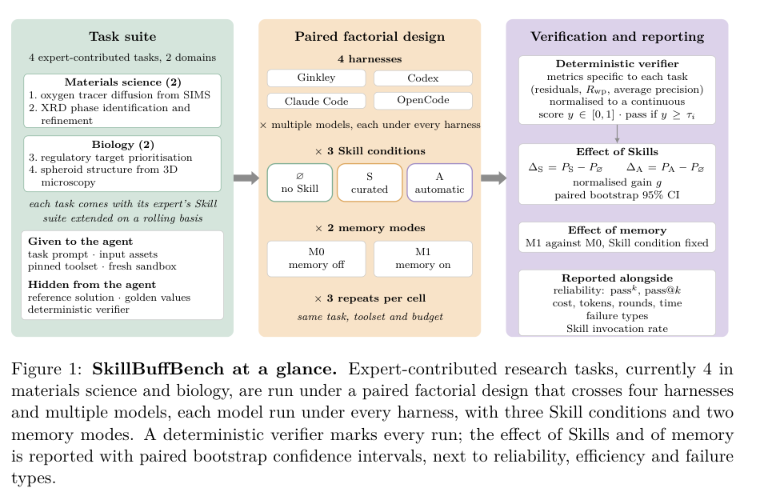

<!-- source-sha256: df4d09939056e7a05da8ee532fe713d96c2b2c490555035f45904b3adb4249d8 -->

# SkillBuffBench: Measuring What Agent Skills Contribute across Harnesses, Models, Skill Access Modes and Memory

[简体中文](README.md)

> **review_only / deferred_high_cost; not an agent-capability reproduction.** Full experiment not reproduced due to cost(review DONE); not Evolve promotion evidence.

## Paper information

| Field | Content |
| --- | --- |
| Paper | [skillbuffbench](https://arxiv.org/abs/2611.22017v1), [fixedv1](https://arxiv.org/html/2611.22017v1) |
| First-author affiliation | Gengyue Dong, University of Oxford, Department of Engineering Science |
| Original publication | **2026-11-17 00:12:40 UTC**, arXivv1; announcement date is separate |
| Author code | No verified paper-specific author source repository in this bounded review. Referenced dependencies and project pages are not equivalent to a verified release. |
| Local adapter / key | `skillbuffbench`; `adapter=null`, not integrated into Evolve |
| Local code | No executable reproduction code(review-only; no adapter) |

## Original paper

### Background and main changes

Hand-picking the right skill measures a curated upper bound, not deployed discovery. SkillBuffBench crosses three access levels(none, curated, automatic) with two memory modes under fixed task/model/harness configurations, separating content benefit, discovery loss and memory interactions. Exact model and harness versions belong to each result cell.

M0 resets workspace, session and memory namespace for every run; caches and history are not shared. API credentials may be reused. Prompts do not name skills, and gold values, references and verifiers are withheld. Network access defaults to model APIs with task-specific service allowlists. Unreleased skill contents cannot be reconstructed from purpose descriptions and called equivalent.

### Architecture and workflow

<!-- paper-figure:start -->
### Original paper figure

Fixedv1 PDFp.2, Figure1 and original caption. Only surrounding text/whitespace is cropped; scientific content is unchanged. [Original figure](https://arxiv.org/pdf/2611.22017v1#page=2) and [provenance](assets/provenance.json). Image from the [original paper](https://arxiv.org/html/2611.22017v1); copyright belongs to the original authors.
<!-- paper-figure:end -->

### Core equations

$$
P_c=N^{-1}\sum_i R^{-1}\sum_r y_{cir},\quad\Delta_c=P_c-P_\varnothing,\quad g_c=(P_c-P_\varnothing)/(1-P_\varnothing).
$$

### Author results

Scores average repeats within tasks then macro-average tasks, with paired task bootstrap for gains. pass^3 means all three attempts pass; pass@3 means at least one. The protocol covers four expert tasks, eleven models and four harnesses. A16.2-point number cited from related work must not be reported as this paper’s measured gain. No production A/B is reported.

## Local implementation

### Data protocol and code mapping

Review-only: no model matrix, task reconstruction or metrics. The full3,168 API runs and partly proprietary collaborator skills prevent cheap faithful reproduction. Protocol and availability limits are reviewDONE; skill-purpose descriptions are not skill implementations.

No local experimental metrics. A terminal high-cost review requires neither invented metrics nor a GPU receipt. No automatic retry or implementation queue.

### Diagnostics and limits

Harness² generates and improves execution harnesses. SkillBuffBench measures paired differences across harness, model, access and memory conditions. Exposing test verifiers to improvement changes their information boundaries. Curated access must not be advertised as automatic discovery capability.

The representative [ harness2 ](../2610.14224-harness2/README.md) was read for the mechanism comparison; unmeasured superiority is not claimed.

### High-cost full experiment

The full matrix contains11 models×288=3,168 agent runs. Some collaborator skills and expert assets are not public, preventing faithful cheap reconstruction. These are source configurations, not measured local runtime. Available resources are one A100/A30 or a local Mac, not multiple GPUs or free APIs. **Full experiment not reproduced due to cost(review DONE).** This is terminal and does not block the review watermark. No large download, full-matrix probe or automatic retry is launched.
