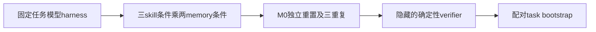
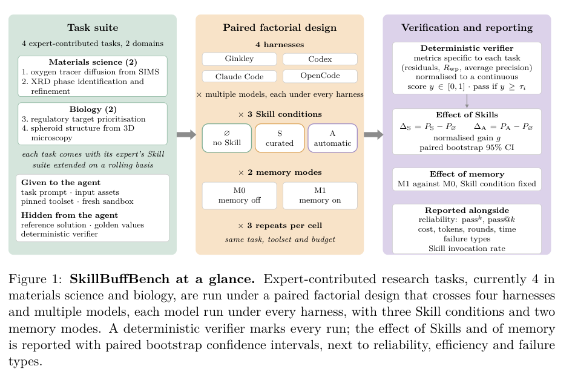

# SkillBuffBench：把精选技能、自动发现与记忆分开评测

[English](README-en.md)

> **review_only / deferred_high_cost；不是Agent能力复现。** 完整实验成本过高，不复现（审查 DONE）；不作为Evolve晋级证据。

## 论文信息

| 字段 | 内容 |
| --- | --- |
| 论文链接 | [skillbuffbench](https://arxiv.org/abs/2611.22017v1)，[固定v1正文](https://arxiv.org/html/2611.22017v1) |
| 一作机构 / 公司 / 学校 | Gengyue Dong，University of Oxford, Department of Engineering Science |
| 首次公开日期 | **2026-11-17 00:12:40 UTC**（arXiv v1；不以次日公告代替首发） |
| 原作者代码 | No author source repository verified in fixed v1; some contributed skill contents explicitly withheld |
| 本地 adapter / key | `skillbuffbench`；`adapter=null`，未接入Evolve |
| 本地复现代码 | 无可执行复现代码（review-only，不提供adapter） |

## 原始论文总结

### 背景与主要改动

手工给Agent正确skill测的是精选上界，不等于部署时能从库里找到它。SkillBuffBench在同一任务／模型／harness下交叉三种skill访问（无、精选、自动）与两种memory模式，单独测内容收益、发现损失和记忆交互。模型池和harness版本应固定到每次结果，不能把更新后版本混进同一格。

M0每轮新workspace、session和memory namespace，缓存／历史不跨轮；只有API凭据可复用。任务prompt不点名skill，golden值、reference solution和verifier不给Agent。网络默认只开模型API，必要外部工具逐任务allowlist；私有技能正文不能靠摘要重写成声称同等的benchmark。

### 架构与流程

<!-- paper-figure:start -->
### 原论文关键图

固定v1 PDF第2页Figure 1及原图注，仅裁剪页面留白／其他正文；不改变科学内容。[原图](https://arxiv.org/pdf/2611.22017v1#page=2)，[资产来源](assets/provenance.json)。图片来自[原论文](https://arxiv.org/html/2611.22017v1)，版权归原作者所有。
<!-- paper-figure:end -->

### 核心公式

$$
P_c=N^{-1}\sum_i R^{-1}\sum_r y_{cir},\quad\Delta_c=P_c-P_\varnothing,\quad g_c=(P_c-P_\varnothing)/(1-P_\varnothing).
$$

### 论文离线与线上效果

每任务重复均值再按task macro-average，gain在配对task上bootstrap；pass^3与pass@3分别表示全3次通过和至少1次。它是4个expert任务、11模型、4harness的协议，当前固定原文不能据相关工作的16.2个百分点写成本篇实测提升。未报告生产A/B。

## 本地复现

### 数据协议与代码映射

本轮review-only，无模型矩阵／task复刻／metrics。完整3168轮API执行及部分未公开collaborator技能不适合低成本忠实复现；保留协议与资产可用边界为审查DONE，不把私有skill目的描述冒充技能实现。

本篇无本地实验指标；高成本审查结案不要求虚构metrics或GPU收据。无自动重试／实现队列。

### 结果、负控与边界

Harness²会产生与改进执行框架；SkillBuffBench评估框架、模型、skill access和memory条件的配对差异。让改进过程看测试任务的verifier会同时改变二者的信息边界。精选skill不应被写成自动发现能力。

同主题对照已实读：[ harness2 ](../2610.14224-harness2/README.md)；其机制与本文的区别不代表未经测量的优劣。

### 高成本完整实验

原文成本依据：11 models×288=3168 agent runs; proprietary skill content and domain expert assets prevent faithful cheap reconstruction。可用资源为单张A100/A30或本地Mac，不能假设多GPU或免费API。**成本过高，不复现（审查 DONE）**。此为终态，不阻塞审查水位；不下载大型资源、不试跑完整矩阵、不进入自动重试队列。
