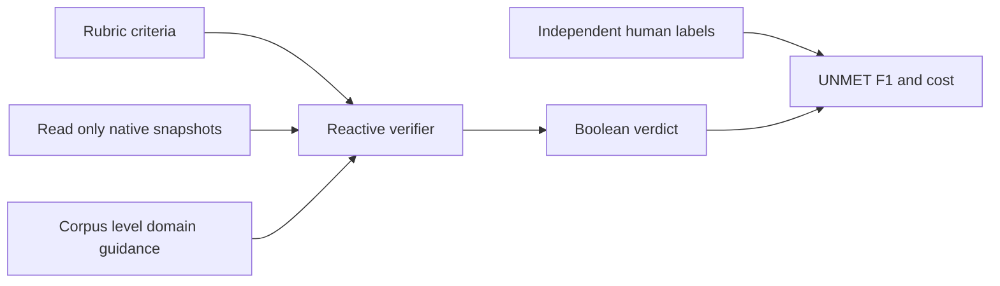
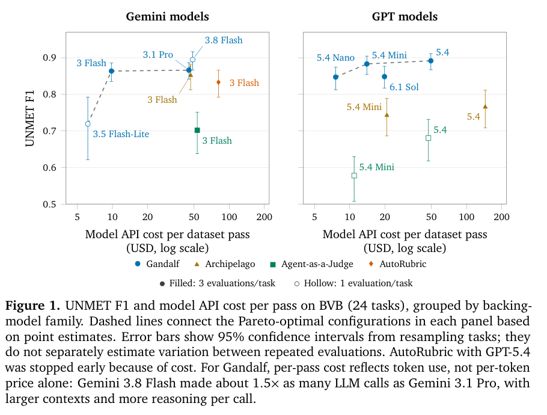

<!-- source-sha256: ea278263b25393ee13cb9b750e67ae2b77a904e1a44b7f8593cebc80a84e06bd -->

# Verifying Agents in Rubric-Graded Environments

[简体中文](README.md)

> **review_only / deferred_high_cost; not an agent-capability reproduction.** Full experiment not reproduced due to cost(review DONE); not Evolve promotion evidence.

## Paper information

| Field | Content |
| --- | --- |
| Paper | [gandalf-bvb](https://arxiv.org/abs/2611.22841v1), [fixedv1](https://arxiv.org/pdf/2611.22841v1) |
| First-author affiliation | Markus Dücker, Handshake AI Research |
| Original publication | **2026-11-17 14:21:38 UTC**, arXivv1; announcement date is separate |
| Author code | [https://github.com/Handshake-AI-Research/gandalf-the-grader](https://github.com/Handshake-AI-Research/gandalf-the-grader); Author repository linked in fixedv1; full code not executed |
| Local adapter / key | `gandalf-bvb`; `adapter=null`, not integrated into Evolve |
| Local code | No executable reproduction code(review-only; no adapter) |

## Original paper

### Background and main changes

Complex deliverables include spreadsheets, slides and application state. Flattening them loses formulas, layout and cross-file links. This paper studies verifiers rather than a new task-solving actor. BVB contains2,464 human-labeled criteria over24 investment-banking tasks to meta-evaluate verifier judgments.

Gandalf reactively chooses native artifacts and tools needed for each rubric criterion until it returns a Boolean verdict. Environment alignment supplies read-only frozen-snapshot tools; corpus-wide domain guidance supplies banking conventions, not task answers. The judge must not mutate the artifact and then pass its own repaired result.

### Architecture and workflow

<!-- paper-figure:start -->
### Original paper figure

Fixedv1 PDFp.7, Figure1 and original caption. Only surrounding text/whitespace is cropped; scientific content is unchanged. [Original figure](https://arxiv.org/pdf/2611.22841v1#page=7) and [provenance](assets/provenance.json). Image from the [original paper](https://arxiv.org/pdf/2611.22841v1); copyright belongs to the original authors.
<!-- paper-figure:end -->

### Core equations

$$
F1_{UNMET}=2PR/(P+R),\qquad cost\ne quality,\qquad judge\ tools\subseteq read\ only\ snapshots.
$$

### Author results

With Gemini3Flash the paper reports UNMET F10.864 at$9.81/pass, versus Archipelago0.852/$46.73. Other model families and OpenClaw are separate comparisons. F1 measures detection of unmet criteria, not actor task success. Some plotted configurations use one evaluation per task, so Pareto lines and intervals require their original interpretation. No production A/B is reported.

## Local implementation

### Data protocol and code mapping

Review-only: no empty schema is offered as a reactive verifier, no paid model is called and no native banking environment is rebuilt. Official Gandalf and BVBv1.0 repositories support a future explicitly budgeted study, but their complete runtime permissions were not audited or executed here.

No local experimental metrics. A terminal high-cost review requires neither invented metrics nor a GPU receipt. No automatic retry or implementation queue.

### Diagnostics and limits

AskALCF separates answer quality from retrieval sufficiency for attribution. Gandalf judges completed deliverables against rubrics. Both need independent evidence but their roles differ. Judge snapshots must not become actor-visible gold, and judges must not write artifacts. Full multi-task/API evaluation is not reproduced due to cost(reviewDONE).

The representative [ askalcf-protocol ](../2611.15700-askalcf-protocol/README.md) was read for the mechanism comparison; unmeasured superiority is not claimed.

### High-cost full experiment

BVB has2,464 human judgments over24 banking tasks; experiments use three repeats, paid frontier judges, native artifact tools and verifier sessions up to1,740seconds. These are source configurations, not measured local runtime. Available resources are one A100/A30 or a local Mac, not multiple GPUs or free APIs. **Full experiment not reproduced due to cost(review DONE).** This is terminal and does not block the review watermark. No large download, full-matrix probe or automatic retry is launched.
