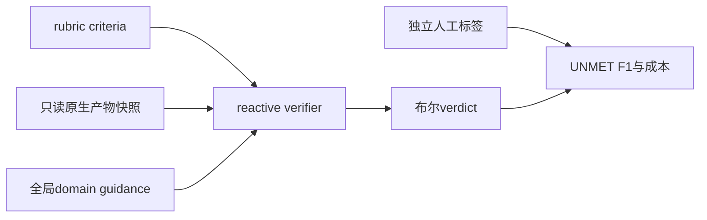
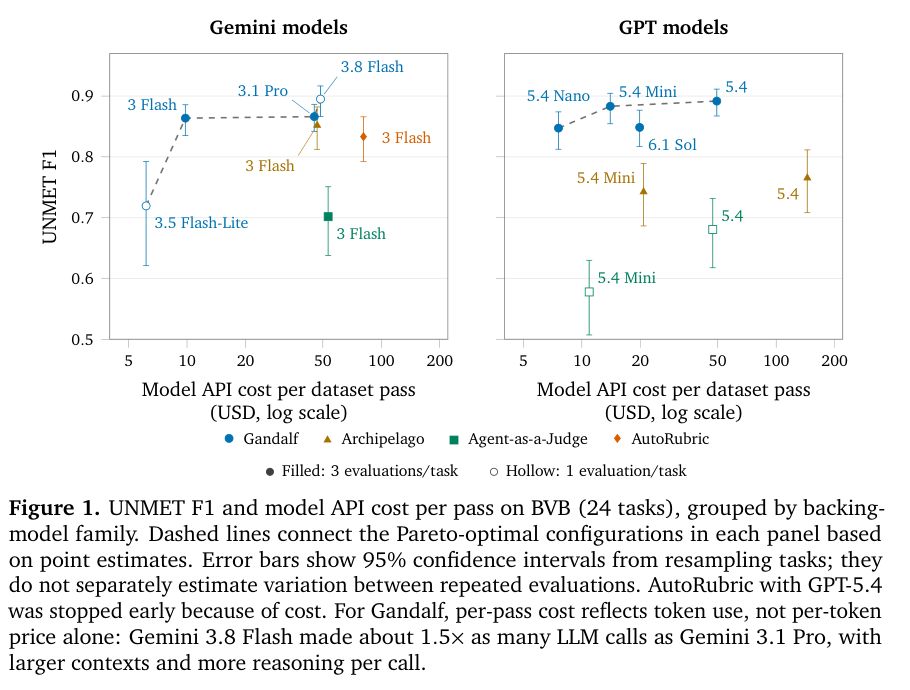

# Gandalf / BVB：检验rubric验证器本身是否可靠

[English](README-en.md)

> **review_only / deferred_high_cost；不是Agent能力复现。** 完整实验成本过高，不复现（审查 DONE）；不作为Evolve晋级证据。

## 论文信息

| 字段 | 内容 |
| --- | --- |
| 论文链接 | [gandalf-bvb](https://arxiv.org/abs/2611.22841v1)，[固定v1正文](https://arxiv.org/pdf/2611.22841v1) |
| 一作机构 / 公司 / 学校 | Markus Dücker，Handshake AI Research |
| 首次公开日期 | **2026-11-17 14:21:38 UTC**（arXiv v1；不以次日公告代替首发） |
| 原作者代码 | [https://github.com/Handshake-AI-Research/gandalf-the-grader](https://github.com/Handshake-AI-Research/gandalf-the-grader)；作者仓库已由固定v1给出，未执行其完整代码 |
| 本地 adapter / key | `gandalf-bvb`；`adapter=null`，未接入Evolve |
| 本地复现代码 | 无可执行复现代码（review-only，不提供adapter） |

## 原始论文总结

### 背景与主要改动

复杂任务产物可能是Excel、PowerPoint或应用状态，单纯把文件转成文本会丢公式、布局与跨文件关系。本文不是新做任务的Agent，而是研究判断Agent产物的verifier：BVB包含24投资银行任务、2464个人工判定criteria，用来评测验证器的判断。

Gandalf把rubric转成reactive检查任务，自行决定读什么原生文件／工具，直到得出布尔verdict；环境对齐让judge使用只读固定快照工具，domain guidance给全语料通用银行惯例，不含任务答案。mutation权限不交给judge，不能让评测器修好产物后再判它通过。

### 架构与流程

<!-- paper-figure:start -->
### 原论文关键图

固定v1 PDF第7页Figure 1及原图注，仅裁剪页面留白／其他正文；不改变科学内容。[原图](https://arxiv.org/pdf/2611.22841v1#page=7)，[资产来源](assets/provenance.json)。图片来自[原论文](https://arxiv.org/pdf/2611.22841v1)，版权归原作者所有。
<!-- paper-figure:end -->

### 核心公式

$$
F1_{UNMET}=2PR/(P+R),\qquad cost\ne quality,\qquad judge\ tools\subseteq read\ only\ snapshots.
$$

### 论文离线与线上效果

作者Gemini3Flash配置UNMET F1为0.864、每pass9.81美元，Archipelago为0.852／46.73美元；其他模型和OpenClaw另报，不合并为统一优势。F1判断的是未满足criterion检测，而不是Agent任务成功率；有些配置仅1次／任务，虚线Pareto与置信区间需按原图解读。未报告线上A/B。

## 本地复现

### 数据协议与代码映射

本轮review-only，不提供一个空JSON接口冒充reactive verifier，不调用付费模型，也不重建native banking环境。官方Gandalf与BVBv1.0仓库可供后续显式预算实验，但本轮没有运行或审计其全部运行权限。

本篇无本地实验指标；高成本审查结案不要求虚构metrics或GPU收据。无自动重试／实现队列。

### 结果、负控与边界

AskALCF把回答质量与检索充分性分开归因，Gandalf检查已完成工作是否满足rubric；二者都依赖独立证据但不能互换。judge拥有的固定workspace和文件权限不能泄漏给actor作为gold，judge也不能有写权限。完整API／多任务评测成本过高，不复现（审查DONE）。

同主题对照已实读：[ askalcf-protocol ](../2611.15700-askalcf-protocol/README.md)；其机制与本文的区别不代表未经测量的优劣。

### 高成本完整实验

原文成本依据：2464 human-judged criteria across24 banking tasks, three repeats, proprietary frontier judges, native document/tool environment and up to1740-second verifier sessions。可用资源为单张A100/A30或本地Mac，不能假设多GPU或免费API。**成本过高，不复现（审查 DONE）**。此为终态，不阻塞审查水位；不下载大型资源、不试跑完整矩阵、不进入自动重试队列。
