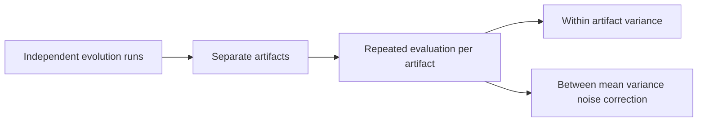
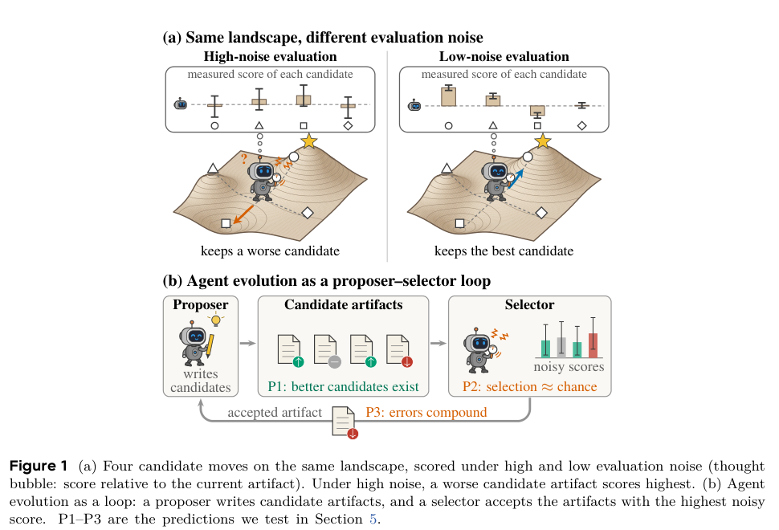

<!-- source-sha256: 0ee23a347e88ae9d82299104015387bf3f6ff7d09dc74e22a09344f2d994dbf5 -->

# The Resolution Hypothesis: Agent Evolution's Key Is Identifying Improvements

[简体中文](README.md)

> **component_only / l1_mechanism; not an agent-capability reproduction.** Full experiment not reproduced due to cost(review DONE); not Evolve promotion evidence.

## Paper information

| Field | Content |
| --- | --- |
| Paper | [resolution-hypothesis](https://arxiv.org/abs/2611.23068v1), [fixedv1](https://arxiv.org/html/2611.23068v1) |
| First-author affiliation | Yuanhao Zeng, ShanghaiTech University / ByteDance / BIGAI |
| Original publication | **2026-11-17 16:57:03 UTC**, arXivv1; announcement date is separate |
| Author code | No verified paper-specific author source repository in this bounded review. Referenced dependencies and project pages are not equivalent to a verified release. |
| Local adapter / key | `resolution-hypothesis`; `adapter=null`, not integrated into Evolve |
| Local code | `src/auto_research/agent_research/resolution_hypothesis.py` |

## Original paper

### Background and main changes

Evolution can stall because a noisy evaluation cannot recognize useful candidates, not because proposals lack improvements. The paper separates repeated-evaluation noise for one artifact from true-quality variation across artifacts produced by independent evolution runs. Fixed-artifact comparisons face the former; method rankings face both.

ForR independent artifacts evaluatedM times each, sigma² is the average within-row sample variance. The unbiased moment estimate of tau² subtracts sigma²/M from the sample variance of row means. It can be negative and must be retained; only the displayed run standard deviation clips to zero. Flattening allRM observations destroys the hierarchy, and more evaluations of one artifact do not replace independent evolution runs.

### Architecture and workflow



<!-- paper-figure:start -->
### Original paper figure



Fixedv1 PDFp.2, Figure1 and original caption. Only surrounding text/whitespace is cropped; scientific content is unchanged. [Original figure](https://arxiv.org/pdf/2611.23068v1#page=2) and [provenance](assets/provenance.json). Image from the [original paper](https://arxiv.org/html/2611.23068v1); copyright belongs to the original authors.
<!-- paper-figure:end -->

### Core equations

$$
\widehat\sigma^2=R^{-1}\sum_r s_r^2,\qquad \widehat\tau^2=Var_r(\overline Y_r)-\widehat\sigma^2/M,\qquad \widehat\tau=\sqrt{\max(0,\widehat\tau^2)}.
$$

### Author results

The study covers seven methods, six models, four primary benchmarks and nine additional gain audits, consuming over10M LLM calls and400K CPU-core hours. Large gains may exploit evaluation shortcuts. Lower-noise process checks do not themselves establish task-success improvement. No production A/B is reported, and observations are not a theorem that all agent evolution fails.

## Local implementation

### Data protocol and code mapping

variance_components implements AppendixB.2, returning the negative unbiased run-variance estimate alongside a clipped run SD. It requires a balanced finite matrix of at least2×2. Inputs must be already measured and provenance-backed. The module neither creates agent trajectories, selects candidates, invents variance intervals nor establishes powered superiority.

```bash
PYTHONPATH=src python -c 'from auto_research.agent_research.resolution_hypothesis import diagnostic; print(diagnostic(42))'
PYTHONPATH=src python -m pytest tests/test_nov18_latest_agent.py -q
```

[CPU mechanism evidence](metrics/component-cpu-seeds42-44.json) contains executed synthetic controls, not model accuracy. CPU only; no CUDA capability is advertised.

### Diagnostics and limits

Controls cover noisy identical rows yielding negative tau², noiseless but different run means yielding positive tau², translation invariance and invalid ragged/NaN/Boolean data. Harness² execution contrasts can also be stochastic. These estimators diagnose resolution and are not an automatic promotion gate.

The representative [ harness2 ](../2610.14224-harness2/README.md) was read for the mechanism comparison; unmeasured superiority is not claimed.

### High-cost full experiment

The paper reports over10M LLM calls and400K CPU-core hours. Only array-based AppendixB.2 estimation is run. These are source configurations, not measured local runtime. Available resources are one A100/A30 or a local Mac, not multiple GPUs or free APIs. **Full experiment not reproduced due to cost(review DONE).** This is terminal and does not block the review watermark. No large download, full-matrix probe or automatic retry is launched.
