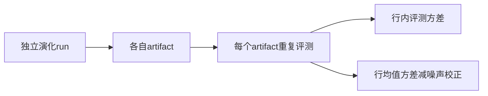
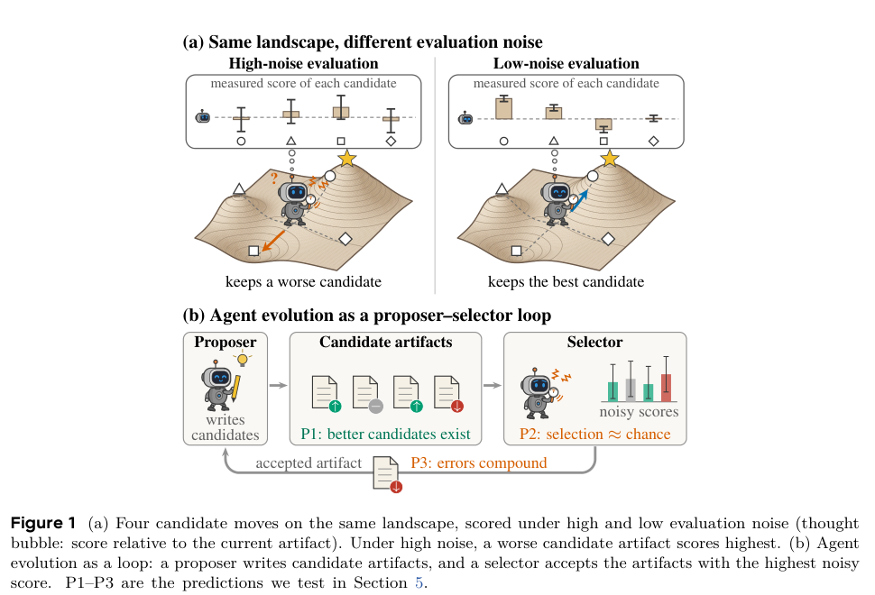

# Resolution Hypothesis：区分评测噪声与演化run方差

[English](README-en.md)

> **component_only / l1_mechanism；不是Agent能力复现。** 完整实验成本过高，不复现（审查 DONE）；不作为Evolve晋级证据。

## 论文信息

| 字段 | 内容 |
| --- | --- |
| 论文链接 | [resolution-hypothesis](https://arxiv.org/abs/2611.23068v1)，[固定v1正文](https://arxiv.org/html/2611.23068v1) |
| 一作机构 / 公司 / 学校 | Yuanhao Zeng，ShanghaiTech University / ByteDance / BIGAI |
| 首次公开日期 | **2026-11-17 16:57:03 UTC**（arXiv v1；不以次日公告代替首发） |
| 原作者代码 | Project page https://lineshogan.github.io/resolution-hypothesis/ verified in paper; no paper-specific author source repository verified in fixed v1 |
| 本地 adapter / key | `resolution-hypothesis`；`adapter=null`，未接入Evolve |
| 本地复现代码 | `src/auto_research/agent_research/resolution_hypothesis.py` |

## 原始论文总结

### 背景与主要改动

自进化停滞不一定是提案不够好，可能是一次嘈杂评分分不清候选改进。本文把“同一artifact反复测”的评测噪声与“不同演化run产出不同artifact”的真实质量波动分开。固定artifact的对照只受前者限制，方法排名同时受两者限制。

在R个独立artifact、每个M次重复评测的平衡矩阵中，sigma²用每行sample variance再平均，tau²用行均值sample variance减sigma²/M。tau²的无偏矩估计可以为负；不能删掉负结果，论文只在显示标准差时截成0。把所有RM项拉平会破坏层级，不能用更多同artifact重复代替更多独立演化run。

### 架构与流程



<!-- paper-figure:start -->
### 原论文关键图



固定v1 PDF第2页Figure 1及原图注，仅裁剪页面留白／其他正文；不改变科学内容。[原图](https://arxiv.org/pdf/2611.23068v1#page=2)，[资产来源](assets/provenance.json)。图片来自[原论文](https://arxiv.org/html/2611.23068v1)，版权归原作者所有。
<!-- paper-figure:end -->

### 核心公式

$$
\widehat\sigma^2=R^{-1}\sum_r s_r^2,\qquad \widehat\tau^2=Var_r(\overline Y_r)-\widehat\sigma^2/M,\qquad \widehat\tau=\sqrt{\max(0,\widehat\tau^2)}.
$$

### 论文离线与线上效果

作者比较7种方法、6模型、4主benchmark及额外9项gain audit，耗费超过10M LLM调用和400K CPU core hours。大提升可能由评分捷径导致；细粒度过程检查更低噪声也不保证任务成功率提高。未报告生产线上A/B，本文不把其观察当作所有自进化方法都无效的定理。

## 本地复现

### 数据协议与代码映射

variance_components执行附录B.2的两个估计，返回负的run_variance_unbiased与仅截断的run_sd，要求至少2×2平衡有限数值矩阵。输入必须是已经测量且来源明确的结果；模块不生成agent轨迹、不选择候选，也不伪造方差置信区间或powered superiority。

```bash
PYTHONPATH=src python -c 'from auto_research.agent_research.resolution_hypothesis import diagnostic; print(diagnostic(42))'
PYTHONPATH=src python -m pytest tests/test_nov18_latest_agent.py -q
```

[CPU机制指标](metrics/component-cpu-seeds42-44.json)为实际合成控制结果，不是模型正确率。所有模块仅CPU，不广告CUDA能力。

### 结果、负控与边界

负控用相同行的嘈杂数据得到负tau²、无行内噪声但均值不同得到正tau²，并检验整体平移不改变方差、ragged/NaN/bool拒绝。Harness²的执行对照也会有随机性；本估计器只是诊断测量分辨率，不把其输出直接变成自动晋级门。

同主题对照已实读：[ harness2 ](../2610.14224-harness2/README.md)；其机制与本文的区别不代表未经测量的优劣。

### 高成本完整实验

原文成本依据：Full >10M LLM calls and 400K CPU-core hours explicitly excluded; array-only estimators cheap。可用资源为单张A100/A30或本地Mac，不能假设多GPU或免费API。**成本过高，不复现（审查 DONE）**。此为终态，不阻塞审查水位；不下载大型资源、不试跑完整矩阵、不进入自动重试队列。
