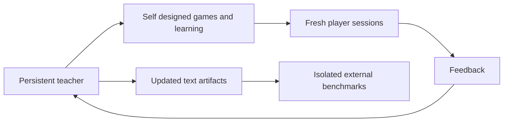
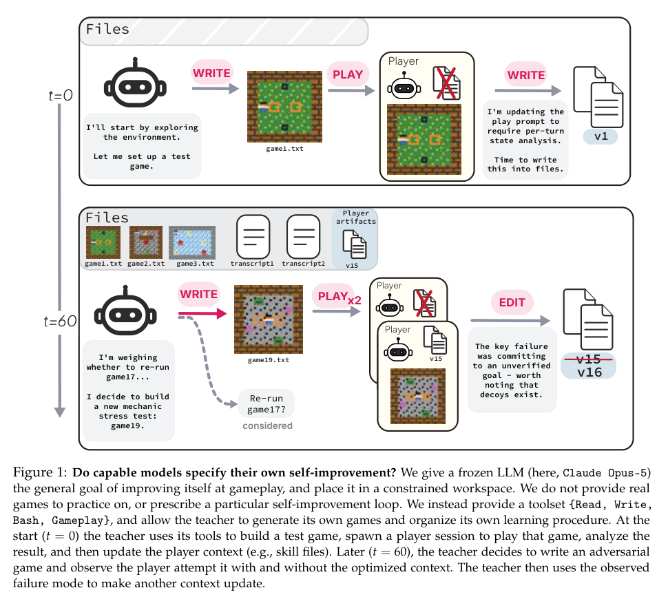

<!-- source-sha256: be8ffb4eba75bdc378c02e5c26add928c39461fb08103615cdb1d6f74f552e7a -->

# Do LLM Agents Still Need to Be Told How to Self-Improve?

[简体中文](README.md)

> **review_only / deferred_high_cost; not an agent-capability reproduction.** Full experiment not reproduced due to cost(review DONE); not Evolve promotion evidence.

## Paper information

| Field | Content |
| --- | --- |
| Paper | [self-organized-learning](https://arxiv.org/abs/2611.23219v1), [fixedv1](https://arxiv.org/pdf/2611.23219v1) |
| First-author affiliation | Shobhita Sundaram, MIT CSAIL |
| Original publication | **2026-11-17 18:57:10 UTC**, arXivv1; announcement date is separate |
| Author code | No verified paper-specific author source repository in this bounded review. Referenced dependencies and project pages are not equivalent to a verified release. |
| Local adapter / key | `self-organized-learning`; `adapter=null`, not integrated into Evolve |
| Local code | No executable reproduction code(review-only; no adapter) |

## Original paper

### Background and main changes

Instead of prescribing a GEPA-style optimization loop, this study gives a frozen teacher a general improvement goal, file/Bash/gameplay primitives and resource budgets. It may create games, inspect ephemeral players and edit text artifacts, choosing when to explore, compare and update. Real games and external benchmark labels are excluded from teacher training access.

A teacher organizes learning within a persistent session; each player uses a fresh session and current text artifacts. Weights remain fixed. The paper analyzes emergent curricula, difficulty selection and A/B testing and tests transfer across game horizons, mechanics and3D navigation. Feedback on self-generated games is not access to final external test labels.

### Architecture and workflow

<!-- paper-figure:start -->
### Original paper figure

Fixedv1 PDFp.2, Figure1 and original caption. Only surrounding text/whitespace is cropped; scientific content is unchanged. [Original figure](https://arxiv.org/pdf/2611.23219v1#page=2) and [provenance](assets/provenance.json). Image from the [original paper](https://arxiv.org/pdf/2611.23219v1); copyright belongs to the original authors.
<!-- paper-figure:end -->

### Core equations

$$
teacher\ tools=\{read/write,bash,gameplay\},\qquad weights\ frozen,\quad update\ budget=20,\quad gameplay\ budget=150.
$$

### Author results

Each model has three teacher sessions,20 updates and150 gameplay budget; the canonical player gets20 turns and25K tokens/game. External PuzzleScript, ARC-AGI-3Level1 and MazeBench splits and filters differ. Some capable models improve autonomously, while other versions do not. No production A/B is reported.

## Local implementation

### Data protocol and code mapping

Review-only. A scripted curriculum or fixed-answer game is not substituted for self-organized behavior; no Bash agent or paid gameplay is launched. The fixedv1 method, budgets, permissions and official project are recorded, while an unverified source repository remains explicitly unverified.

No local experimental metrics. A terminal high-cost review requires neither invented metrics nor a GPU receipt. No automatic retry or implementation queue.

### Diagnostics and limits

ELITE prescribes explore-then-integrate while excluding downstream outcomes; this study deliberately omits an imposed optimization loop and lets the teacher choose learning actions. Harness² has its own predefined Propose–Probe–Compose. A scaffold protocol can support research without reproducing emergent learning capability. Full multi-model long-rollout evaluation is not reproduced due to cost(reviewDONE).

The representative [ harness2 ](../2610.14224-harness2/README.md) was read for the mechanism comparison; unmeasured superiority is not claimed.

### High-cost full experiment

Each model uses three teacher sessions with20 updates,150 gameplay budget and up to25K tokens per game, plus multiple external game and3D-navigation evaluations. These are source configurations, not measured local runtime. Available resources are one A100/A30 or a local Mac, not multiple GPUs or free APIs. **Full experiment not reproduced due to cost(review DONE).** This is terminal and does not block the review watermark. No large download, full-matrix probe or automatic retry is launched.
