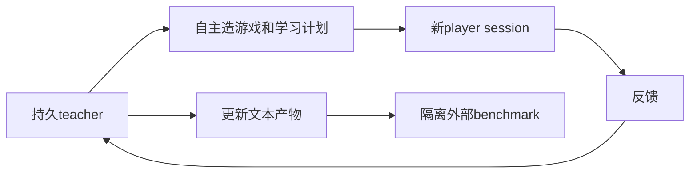
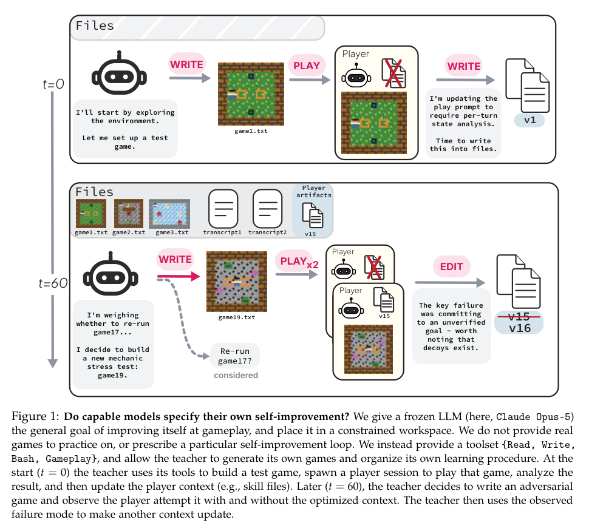

# Self-Organized Learning：只给原语，观察Agent如何设计自学过程

[English](README-en.md)

> **review_only / deferred_high_cost；不是Agent能力复现。** 完整实验成本过高，不复现（审查 DONE）；不作为Evolve晋级证据。

## 论文信息

| 字段 | 内容 |
| --- | --- |
| 论文链接 | [self-organized-learning](https://arxiv.org/abs/2611.23219v1)，[固定v1正文](https://arxiv.org/pdf/2611.23219v1) |
| 一作机构 / 公司 / 学校 | Shobhita Sundaram，MIT CSAIL |
| 首次公开日期 | **2026-11-17 18:57:10 UTC**（arXiv v1；不以次日公告代替首发） |
| 原作者代码 | Official project https://ssundaram21.github.io/self-org/ cited; source repository not yet verified |
| 本地 adapter / key | `self-organized-learning`；`adapter=null`，未接入Evolve |
| 本地复现代码 | 无可执行复现代码（review-only，不提供adapter） |

## 原始论文总结

### 背景与主要改动

本文不先指定GEPA式优化循环，而是给冻结teacher通用自改进目标、文件读写／Bash／gameplay原语与资源预算。teacher可自己造游戏、观察短生命周期player、编辑文本产物，自行决定何时探索、比较和更新。真实游戏与外部benchmark不在teacher训练访问范围。

teacher在持久session内组织算法，player每次新session只读取当前文本产物；权重不变。论文分析自发课程、难度选择和A/B测试行为，并在不同游戏horizon／机制／3D导航上检验迁移。teacher看到自己生成任务的结果不等于能看最终外部测试标签。

### 架构与流程

<!-- paper-figure:start -->
### 原论文关键图

固定v1 PDF第2页Figure 1及原图注，仅裁剪页面留白／其他正文；不改变科学内容。[原图](https://arxiv.org/pdf/2611.23219v1#page=2)，[资产来源](assets/provenance.json)。图片来自[原论文](https://arxiv.org/pdf/2611.23219v1)，版权归原作者所有。
<!-- paper-figure:end -->

### 核心公式

$$
teacher\ tools=\{read/write,bash,gameplay\},\qquad weights\ frozen,\quad update\ budget=20,\quad gameplay\ budget=150.
$$

### 论文离线与线上效果

原文对每模型3个teacher session、20次update、150gameplay预算，主gameplay20turn／25K token。外部PuzzleScript、ARC-AGI-3Level1和MazeBench切分与过滤各不同；强模型能自发改进不说明所有模型都能，部分版本没有获益。未报告生产线上A/B。

## 本地复现

### 数据协议与代码映射

本轮review-only，不用预写课程／固定答案脚本替代自组织行为，不启动Bash工具Agent或付费gameplay。保留官方project入口和固定v1方法、预算及允许权限，未验证作者源仓库时明确记未核实。

本篇无本地实验指标；高成本审查结案不要求虚构metrics或GPU收据。无自动重试／实现队列。

### 结果、负控与边界

ELITE预设explore-then-integrate程序且不读下游任务结果，本篇刻意不给外部优化loop、让teacher自行选择学习动作；Harness²又有预定义Propose–Probe–Compose。固定脚手架协议可支持研究，但不等于复现自发学习能力。完整多模型多benchmark长rollout成本过高，不复现（审查DONE）。

同主题对照已实读：[ harness2 ](../2610.14224-harness2/README.md)；其机制与本文的区别不代表未经测量的优劣。

### 高成本完整实验

原文成本依据：Three independent teacher sessions per model,20 updates and150 gameplay budget,25K tokens per game, multi-frontier backbones and external ARC/3D navigation evaluation。可用资源为单张A100/A30或本地Mac，不能假设多GPU或免费API。**成本过高，不复现（审查 DONE）**。此为终态，不阻塞审查水位；不下载大型资源、不试跑完整矩阵、不进入自动重试队列。
