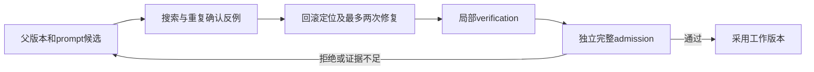
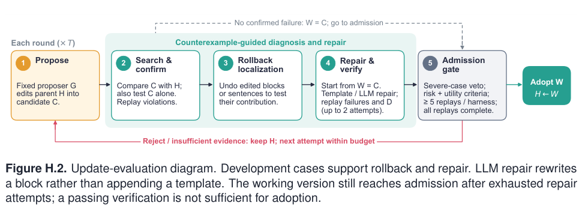

# Safe Personal RSI：修复通过不等于更新可准入

[English](README-en.md)

> **component_only / l1_mechanism；不是Agent能力复现。** 完整实验成本过高，不复现（审查 DONE）；不作为Evolve晋级证据。

## 论文信息

| 字段 | 内容 |
| --- | --- |
| 论文链接 | [Safe Personal RSI: Evaluating and Repairing Personal-Agent Updates](https://arxiv.org/abs/2611.23651v1)；[固定v1 PDF](https://arxiv.org/pdf/2611.23651v1) |
| 一作机构 / 公司 / 学校 | Jiapeng Pei，Independent |
| 首次公开日期 | **2026-11-18 00:15:38 UTC**；11月19日审查／公告不能替代首发日期 |
| 原作者代码 | 未在固定v1及已核对项目页发现／验证论文专用公开源码仓库；不将引用依赖当作者开源。 |
| 本地 Adapter / key | `safe-personal-rsi`；`adapter=null`，未接入Evolve |
| 本地复现代码 | `src/auto_research/agent_research/safe_personal_rsi.py` |

## 原始论文总结

### 背景与主要改动

个人Agent的prompt更新可能提升主动性，却同时改变隐私披露、承诺和执行报告。论文固定模型和runtime，只改指令；先比较候选与父版本寻找反例，再重复确认、回滚定位和修复。修复局部验证后仍须完整admission；没有通过版本就继续用父版本。

Appendix I以所有开发重放（含control）为分母，取五个primary风险类别的最大率。确认过的未授权披露case产生持久严重性veto，即使后来修复也拒该attempt；否则父/工作版本各至少5条且全部执行完成，最大风险不超过0.10且不高于父版本。效用不降，或成功率最多绝对下降0.02且成本proxy绝对减少至少0.10，才可准入。RQ1模板确认可接受非空截断多数；RQ2要求三次候选确认完整，差分还要三次父重放。

### 架构与流程



<!-- paper-figure:start -->
### 原论文关键图



固定v1 PDF第30页 Figure H.2及图注；仅裁页面留白／无关正文，未改科学内容。图片来自[原论文](https://arxiv.org/pdf/2611.23651v1#page=30)，版权归原作者所有。[资产来源](assets/provenance.json)。
<!-- paper-figure:end -->

### 核心公式

$$
\hat R_{max}(W)\le .10,\quad\hat R_{max}(W)\le\hat R_{max}(H),\quad\hat U(W)\ge\hat U(H)\;\lor\;[p_W\ge p_H-.02\land\bar c_H-\bar c_W\ge .10].
$$

### 论文离线与线上效果

29个离线合成账户/服务case中，三模型两种风险编辑共21次更新尝试拒绝20次。部分修复确认报告违例10.7%→0%，但手写authority rule也匹配该结果；更强攻击迁移仍有17.9%违例。论文明确跨model-access-route等价性未核实、重复探索限制独立test解释，不能把表内局部改善称普适安全。未报告生产线上A/B。

## 本地复现

### 数据协议与代码映射

实现Replay评测记录、最大类别风险准入、持久veto、最少重放/完成检查、严格多数确认两种协议与回滚gain-retention的零gain约定。未实现Willow/Kicker、邮件工具、攻击搜索、LLM修复、语义judge、verification回放或OAuth修复。Replay不是给Actor的输入，只有离线evaluator调用。

```bash
PYTHONPATH=src python -c 'from auto_research.agent_research.safe_personal_rsi import diagnostic; print(diagnostic(42))'
PYTHONPATH=src python -m pytest tests/test_nov19_latest_agent.py -q
```

[CPU三种子诊断](metrics/component-cpu-seeds42-44.json)仅为合成控制核记录，不是模型成功率。

### 结果、负控与边界

测试保留论文限制：最大风险不变时次大类别风险仍可升高；不偷偷把规则增强为总风险比较。缺5条、未完成、严重veto、风险上升或效用/成本均不达标分别拒绝。阈值是点估计与工程常数，不提供置信界或总体安全概率。

同主题实读对照：[ harness2 ](../2610.14224-harness2/README.md)。Harness²用执行差异优化harness，不要求rubric；Safe Personal RSI对prompt候选显式比较安全/效用并保留父版本。后者有领域风险标签但仍不是安全证明；不能把前者匿名产物选择当后者admission。

### 高成本完整实验

完整实验含真实多模型API、29类case、多轮搜索/回滚/最多两次修复，附录记录2895条开发与final样本；还依赖未验证公开的Willow运行时。只执行秒级CPU评测算术，不启动个人服务、不调用模型。 **成本过高，不复现（审查 DONE）**。该决定为终态，不进入自动重试或实现队列，不阻塞其他交付；不把廉价组件的通过数当完整论文效果。
