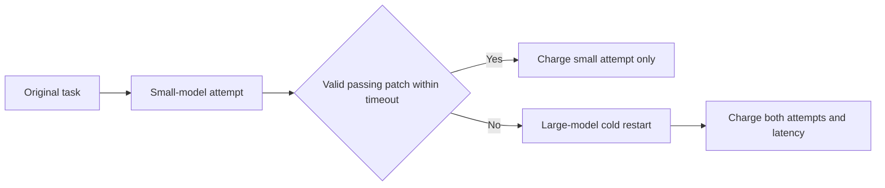
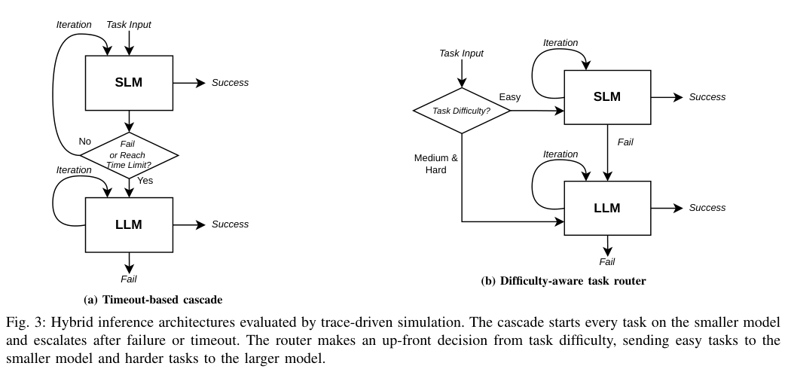

# Reducing Inference Cost of Coding Agents with Timeout Cascades

<!-- source-sha256: e4e1d470ae241339015b9319f26777e243003f8361cc914a5042ee4471a75c5c -->

[简体中文](README.md)

> **component_only / l1_mechanism; not an agent capability reproduction.** Full experiments are too costly and not reproduced (review DONE). Not evidence for evolve promotion.

## Paper information

| Field | Value |
| --- | --- |
| Paper link | [Reducing Inference Cost of Coding Agents with Timeout Cascades](https://arxiv.org/abs/2611.24324v1); [fixed v1 PDF](https://arxiv.org/pdf/2611.24324v1) |
| First-author institution / company / school | Boxi Zhou, AMD Singapore |
| Original publication date | **2026-11-18 12:26:42 UTC**; November19 review/announcement is not the first-release date |
| Original source code | No paper-specific public source repository verified in fixed v1 or the reviewed project page; cited dependencies are not an author release. |
| Local adapter / key | `timeout-cascades`; `adapter=null`, not integrated with evolve |
| Local reproduction code | `src/auto_research/agent_research/timeout_cascades.py` |

## Original paper summary

### Background and main changes

Every coding task first uses a small model. It stops only when a valid patch passes tests within the timeout. Timeout, an empty patch, syntax error or failing tests trigger a large model. The fallback restarts from the original task, without inheriting small-model edits, tool outputs or reasoning.

The paper simulates policies from fixed mini-swe-agent single-model traces rather than rerunning a cascade. Model-capability plots use 500 tasks, but only 466 have complete matched traces for both models. Effective GPU hours multiply each task runtime by its exclusive GPU allocation without amortizing actual batch concurrency; this is not metered physical cluster cost.

### Architecture and flow



### Original paper figure



Fixed v1 PDF page5, Figure 3 with original caption. Only whitespace/unrelated text is cropped; scientific content is unchanged. Copyright belongs to the original authors. [Original paper](https://arxiv.org/pdf/2611.24324v1#page=5) · [Provenance](assets/provenance.json).

### Core equations

$$
C=\frac{n_s\min(t_s,\tau)+\mathbf1_{fallback}\,n_l t_l}{3600},\quad T=\min(t_s,\tau)+\mathbf1_{fallback}t_l.
$$

### Reported offline and online results

At a 120-minute first-stage timeout, GLM-4.7-Flash→GLM-4.7 reduces effective GPU hours from 2585 to 2160 (16.4%); easy-task cost falls from 821 to 546 (33.5%). These are matched-trace simulations. Each model/task runs once, so slight success complementarity may reflect variance. Sequential cascading can increase wall-clock latency. No production A/B is reported.

## Local reproduction

### Data protocol and code mapping

Trace stores nonnegative duration, GPU count, patch validity and evaluator test labels. cascade computes capped first-stage cost, cold-restart fallback and sequential latency. evaluate accepts complete matched pairs only. It handles synthetic trace arithmetic, not models, SWE-bench, a live timeout router or the paper's hidden-difficulty oracle router.

```bash
PYTHONPATH=src python -c 'from auto_research.agent_research.timeout_cascades import diagnostic; print(diagnostic(42))'
PYTHONPATH=src python -m pytest tests/test_nov19_latest_agent.py -q
```

[Three-seed CPU diagnostics](metrics/component-cpu-seeds42-44.json) are synthetic control-kernel records, not model success rates.

### Results, negative controls and limits

Controls cover completion exactly at the deadline, zero timeout, early failure, failed tests, both models failing and invalid GPU counts. Negative controls prevent charging only fallback time or amortizing GPU count. Success labels are offline evaluator metadata, never actor-visible input.

Reviewed same-topic comparison: [ bats ](../2511.17006-bats/README-en.md). BATS tracks per-tool budgets within a task and uses an external verifier to continue or pivot. Timeout Cascades uses attempt duration and verification to trigger a cold-start fallback between models. Their budgets, cost units and capability evidence differ.

### High-cost full experiments

The complete campaign uses 36 models ×500 SWE-bench tasks, up to250 steps/two hours per task, MI300X multi-GPU serving and long contexts. It exceeds a single-GPU budget. Only seconds-scale CPU trace accounting runs, with no checkpoint or dataset downloads. **Too costly; not reproduced (review DONE).** This is terminal, not an automatic retry or implementation queue. It does not block other delivery. Passing a cheap component does not establish the full paper's results.
