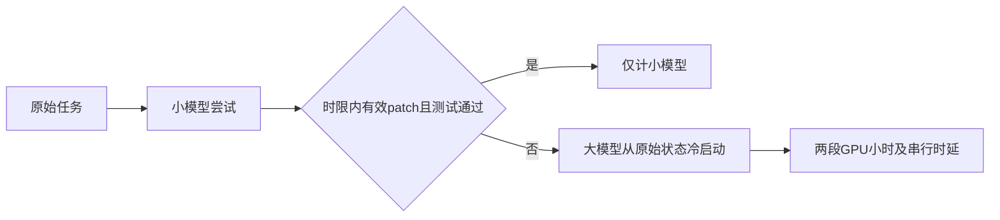
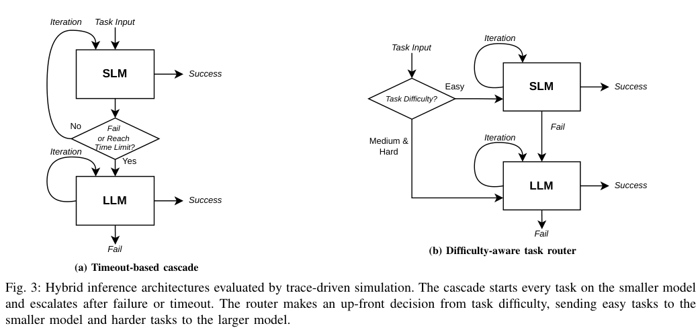

# Timeout Cascades：先试小模型，再从原始任务冷启动大模型

[English](README-en.md)

> **component_only / l1_mechanism；不是Agent能力复现。** 完整实验成本过高，不复现（审查 DONE）；不作为Evolve晋级证据。

## 论文信息

| 字段 | 内容 |
| --- | --- |
| 论文链接 | [Reducing Inference Cost of Coding Agents with Timeout Cascades](https://arxiv.org/abs/2611.24324v1)；[固定v1 PDF](https://arxiv.org/pdf/2611.24324v1) |
| 一作机构 / 公司 / 学校 | Boxi Zhou，AMD Singapore |
| 首次公开日期 | **2026-11-18 12:26:42 UTC**；11月19日审查／公告不能替代首发日期 |
| 原作者代码 | 未在固定v1及已核对项目页发现／验证论文专用公开源码仓库；不将引用依赖当作者开源。 |
| 本地 Adapter / key | `timeout-cascades`；`adapter=null`，未接入Evolve |
| 本地复现代码 | `src/auto_research/agent_research/timeout_cascades.py` |

## 原始论文总结

### 背景与主要改动

小模型先做所有编程题；只有在时限内产生有效且通过测试的patch才直接结束。超时、空patch、语法错误或测试失败，都转给大模型。大模型从原始任务状态重新开始，不继承小模型的编辑、工具输出或推理。

作者从固定mini-swe-agent的单模型运行轨迹模拟策略，不重新跑级联。500题用于模型能力图；只有466题有两模型完整匹配轨迹，供级联模拟。有效GPU小时按每题runtime乘独占GPU数，即使真实批量有并发也不摊销；它不是集群实际电表成本。

### 架构与流程



<!-- paper-figure:start -->
### 原论文关键图



固定v1 PDF第5页 Figure 3及图注；仅裁页面留白／无关正文，未改科学内容。图片来自[原论文](https://arxiv.org/pdf/2611.24324v1#page=5)，版权归原作者所有。[资产来源](assets/provenance.json)。
<!-- paper-figure:end -->

### 核心公式

$$
C=\frac{n_s\min(t_s,\tau)+\mathbf1_{fallback}\,n_l t_l}{3600},\quad T=\min(t_s,\tau)+\mathbf1_{fallback}t_l.
$$

### 论文离线与线上效果

GLM-4.7-Flash→GLM-4.7在120分钟小模型时限下，有效GPU小时从2585降到2160（16.4%），easy子集821→546（33.5%）。这是匹配轨迹上的模拟；每模型每题仅一次，轻微成功率互补可能是随机性。顺序级联可增加wall-clock，不能只宣传省GPU小时。未报告生产线上A/B。

## 本地复现

### 数据协议与代码映射

Trace严格保存非负时长、GPU数量、有效patch与evaluator测试标签；cascade计算截断小模型费用、冷启动fallback和串行时延，evaluate仅接收完整匹配对。这里只处理合成轨迹数值，不调用模型、不运行SWE-bench、不做真实wall-clock路由，也不实现基于隐藏难度标签的oracle router。

```bash
PYTHONPATH=src python -c 'from auto_research.agent_research.timeout_cascades import diagnostic; print(diagnostic(42))'
PYTHONPATH=src python -m pytest tests/test_nov19_latest_agent.py -q
```

[CPU三种子诊断](metrics/component-cpu-seeds42-44.json)仅为合成控制核记录，不是模型成功率。

### 结果、负控与边界

边界覆盖时限恰好完成、零时限、早失败、失败测试、双模型失败及非正GPU数。负控确认不能只计大模型时长或摊销GPU数；success标签只在离线评测器，绝不作为真实Agent可见输入。

同主题实读对照：[ bats ](../2511.17006-bats/README.md)。BATS在任务内显式维护逐工具预算并由外部verifier决定继续或换路；Timeout Cascades在模型尝试级别用完成时长与验证结果决定冷启动fallback。二者的预算、费用和能力证据不相同。

### 高成本完整实验

完整36模型×500 SWE-bench任务、每题最高250步/2小时，MI300X多GPU与长上下文配置，远超单卡预算；只做秒级CPU trace核算，无checkpoint或数据下载。 **成本过高，不复现（审查 DONE）**。该决定为终态，不进入自动重试或实现队列，不阻塞其他交付；不把廉价组件的通过数当完整论文效果。
