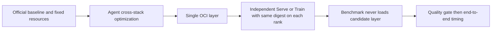
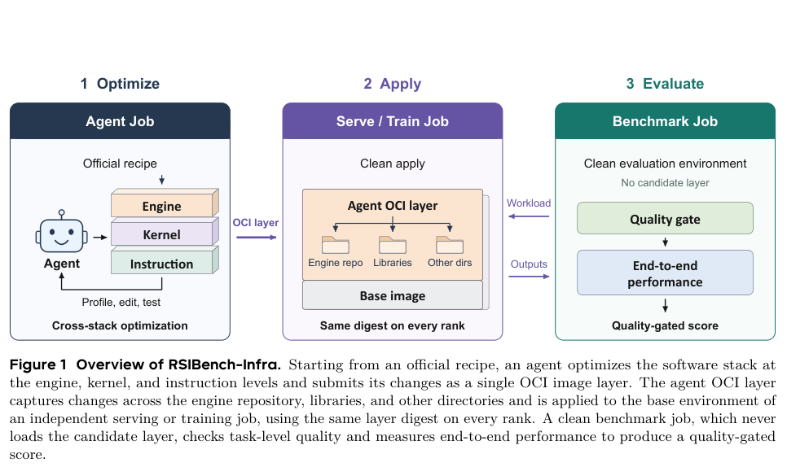

# RSIBench-Infra: Can Agents Optimize Their Own Training and Inference Infrastructure at Production Scale?

<!-- source-sha256: 9ce9d7f25932e5f3ba0970c5b3b4a37182166cd3ec9eec52bc3bee4695ce6fe0 -->

[简体中文](README.md)

> **deferred_high_cost / review-only; not an agent capability reproduction.** Full experiments are too costly and not reproduced (review DONE). Not evidence for evolve promotion.

## Paper information

| Field | Value |
| --- | --- |
| Paper link | [RSIBench-Infra: Can Agents Optimize Their Own Training and Inference Infrastructure at Production Scale?](https://arxiv.org/abs/2611.24395v1); [fixed v1 PDF](https://arxiv.org/pdf/2611.24395v1) |
| First-author institution / company / school | Hanlin Wu, ByteDance Seed / Tsinghua University AIR / SIA-Lab |
| Original publication date | **2026-11-18 13:29:44 UTC**; November19 review/announcement is not the first-release date |
| Original source code | No paper-specific public source repository verified in fixed v1 or the reviewed project page; cited dependencies are not an author release. |
| Local adapter / key | `rsibench-infra`; `adapter=null`, not integrated with evolve |
| Local reproduction code | None; review-only, no training/inference implementation. |

## Original paper summary

### Background and main changes

A faster kernel need not make training or serving faster end to end. RSIBench-Infra starts agents from runnable official baselines and permits changes across engine, kernel and instruction layers, submitted as one OCI filesystem layer. Independent Serve/Train jobs apply the same digest on every rank. The Benchmark Job never loads that layer and separately checks quality and end-to-end timing.

A task specifies the model, environment, resources and independent verifier. Sixteen inference and four training tasks span1–32 accelerators and up to four nodes; inference models range from1.7B to2.8T. Training replays frozen inputs and compares stepwise loss/global-gradient norms; VLM GRPO additionally checks policy/KL losses, forwards and an isolated KL-gradient probe. Speed counts only after the task quality gate, and microbenchmarks cannot replace end-to-end timing.

### Architecture and flow

### Original paper figure

Fixed v1 PDF page2, Figure 1 with original caption. Only whitespace/unrelated text is cropped; scientific content is unchanged. Copyright belongs to the original authors. [Original paper](https://arxiv.org/pdf/2611.24395v1#page=2) · [Provenance](assets/provenance.json).

### Core equations

$$
validated\_speedup=\frac{T_{baseline}}{T_{candidate}}\quad\text{only if }quality\_gate=pass;\qquad Faster=\mathbf1[validated\_speedup>1.10].
$$

### Reported offline and online results

Of130 formally scored results,86 (66.2%) exceed1.10× validated speedup. Each agent run has an eight-hour budget. Claude has only10 formally scored tasks because API safety errors prevent the rest; its denominator is not a complete20-task suite. Production-scale workloads are not randomized business-traffic A/B evidence.

## Local reproduction

### Data protocol and code mapping

Only primary review, cost assessment, bilingual documentation and learning material are delivered. An OCI schema stub, arbitrary microbenchmark or small single-GPU model is not labeled an RSIBench-Infra integration. local_operator=null and no executable evolve operator is advertised. The project page https://rsibench-infra.github.io is verified, but no paper-specific public source repository was verified.

No experiment was executed; no fabricated metrics or GPU receipt is generated.

### Results, negative controls and limits

Review distinguishes Agent, Serve/Train and Benchmark environments, deployment digests and quality gates rather than fabricating local pass metrics. No official task, OCI submission, model training or inference runs. Consequently there are no local CPU/GPU capability scores and no GPU receipt is required.

Reviewed same-topic comparison: [ harness2 ](../2610.14224-harness2/README-en.md). Harness² improves model-external harnesses through task execution contrasts and accumulated experience. RSIBench-Infra evaluates cross-stack training/inference optimization with independently quality-gated end-to-end speed. Harness pass counts and validated throughput are different outcomes; the former cannot substitute the latter's hardware pipeline.

### High-cost full experiments

Twenty tasks require1–32 accelerators/up to four nodes,1.7B–2.8T inference models and7B–30B BF16 full-parameter training. Each agent run allows eight hours, followed by quality replay and measurement. These configurations already exceed a single A100/A30 budget; no costly probe is launched to establish that fact. **Too costly; not reproduced (review DONE).** This is terminal, not an automatic retry or implementation queue. It does not block other delivery. Passing a cheap component does not establish the full paper's results.
