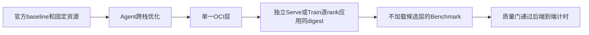
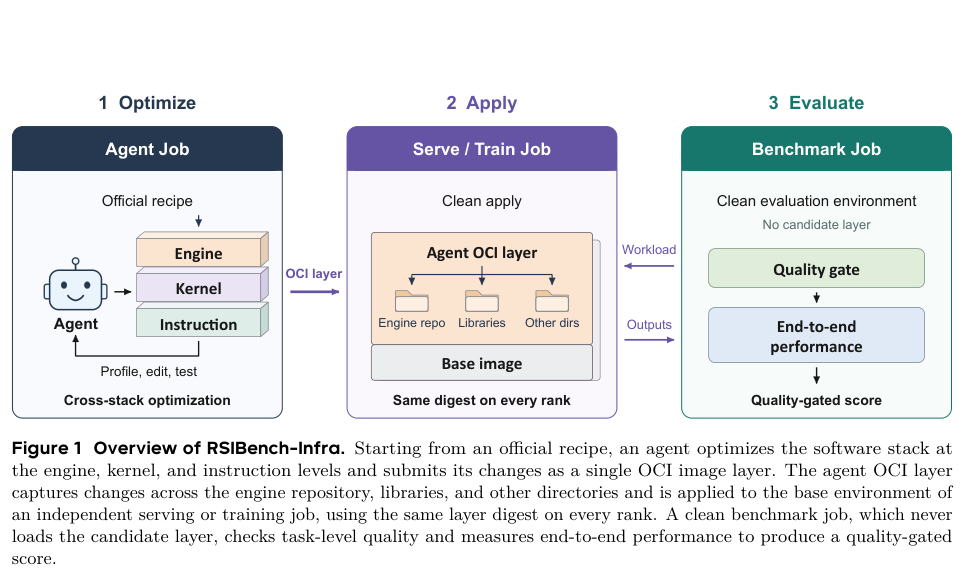

# RSIBench-Infra：把生产级基础设施优化与独立质量验证分开

[English](README-en.md)

> **deferred_high_cost / review-only；不是Agent能力复现。** 完整实验成本过高，不复现（审查 DONE）；不作为Evolve晋级证据。

## 论文信息

| 字段 | 内容 |
| --- | --- |
| 论文链接 | [RSIBench-Infra: Can Agents Optimize Their Own Training and Inference Infrastructure at Production Scale?](https://arxiv.org/abs/2611.24395v1)；[固定v1 PDF](https://arxiv.org/pdf/2611.24395v1) |
| 一作机构 / 公司 / 学校 | Hanlin Wu，ByteDance Seed / Tsinghua University AIR / SIA-Lab |
| 首次公开日期 | **2026-11-18 13:29:44 UTC**；11月19日审查／公告不能替代首发日期 |
| 原作者代码 | 未在固定v1及已核对项目页发现／验证论文专用公开源码仓库；不将引用依赖当作者开源。 |
| 本地 Adapter / key | `rsibench-infra`；`adapter=null`，未接入Evolve |
| 本地复现代码 | 无；仅审查收录，未实现训练／推理代码。 |

## 原始论文总结

### 背景与主要改动

单算子快不代表端到端训练或服务变快。RSIBench-Infra让Agent从官方可运行baseline出发，跨engine、kernel、instruction修改，但只提交一个OCI filesystem layer。独立Serve/Train Job把同一digest应用到每个rank；Benchmark Job绝不加载候选层，单独做质量门和端到端计时。

任务定义含模型、环境、资源和独立verifier。16推理+4训练任务覆盖1–32个加速器、最多4节点；推理模型1.7B–2.8T。训练固定输入，比较逐步loss和全局梯度范数；VLM GRPO还检查policy/KL loss、forward及隔离KL梯度。性能得分只有通过任务质量门才有效，microbenchmark不能替代端到端计时。

### 架构与流程

<!-- paper-figure:start -->
### 原论文关键图

固定v1 PDF第2页 Figure 1及图注；仅裁页面留白／无关正文，未改科学内容。图片来自[原论文](https://arxiv.org/pdf/2611.24395v1#page=2)，版权归原作者所有。[资产来源](assets/provenance.json)。
<!-- paper-figure:end -->

### 核心公式

$$
validated\_speedup=\frac{T_{baseline}}{T_{candidate}}\quad\text{only if }quality\_gate=pass;\qquad Faster=\mathbf1[validated\_speedup>1.10].
$$

### 论文离线与线上效果

130个正式计分结果中86个（66.2%）超过1.10倍已验证加速。主模型配置每项Agent预算8小时；Claude只正式计10项，API安全错误其余不混进20项完整suite。生产规模工作负载不是随机线上业务A/B，不能写成线上收益。

## 本地复现

### 数据协议与代码映射

仅做原文审查、成本评估、中英文说明和学习材料。没有把OCI字段stub、任意microbenchmark或单卡小模型标成RSIBench-Infra已接入；local_operator=null，不提供可执行Evolve算子。项目页https://rsibench-infra.github.io已核对，未验证论文专用源码仓库公开。

未执行实验，不生成虚假metrics或GPU回执。

### 结果、负控与边界

审查明确隔离Agent环境、Serve/Train环境和Benchmark环境，比较部署digest与质量门，而不是伪造本地通过指标。没有运行正式任务、提交OCI、训练或测试模型；所以没有CPU/GPU能力分数，也不要求GPU回执。

同主题实读对照：[ harness2 ](../2610.14224-harness2/README.md)。Harness²改模型外执行框架并以任务执行对照积累经验；RSIBench-Infra评价跨栈训练/推理优化，以独立质量门约束端到端加速。优化harness通过数和已验证吞吐收益不是同一个结果，前者不能代替后者硬件链路。

### 高成本完整实验

20任务覆盖1–32加速器/最多4节点、1.7B–2.8T推理模型及7B–30B BF16全参训练；每个Agent run上限8小时，另有质量重放与测量。已有配置足以判断单A100/A30预算不适合，不为证明昂贵再试跑。 **成本过高，不复现（审查 DONE）**。该决定为终态，不进入自动重试或实现队列，不阻塞其他交付；不把廉价组件的通过数当完整论文效果。
