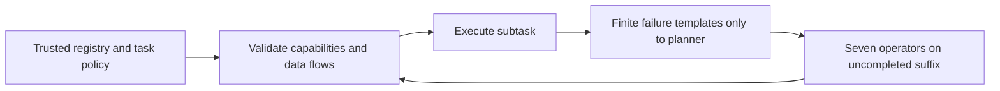
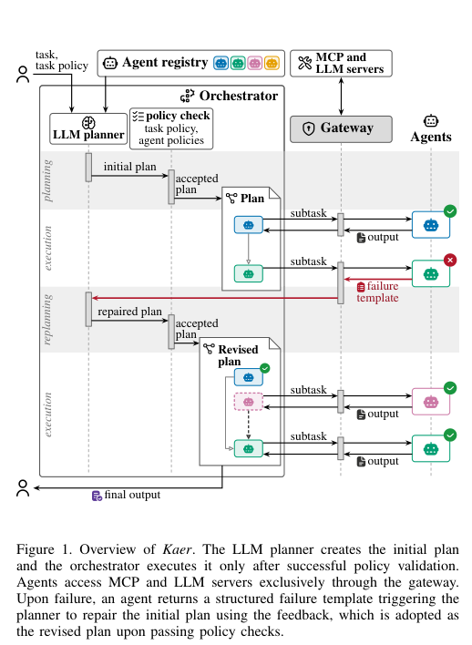

# Kaer: Security-Aware Replanning for Multi-Agent Systems

<!-- source-sha256: f2ce108d5063cfb918ab4dac79b497d36dd802b651b71312a51d01d04f47560a -->

[简体中文](README.md)

> **component_only / l1_mechanism; not an agent capability reproduction.** Full experiments are too costly and not reproduced (review DONE). Not evidence for evolve promotion.

## Paper information

| Field | Value |
| --- | --- |
| Paper link | [Kaer: Security-Aware Replanning for Multi-Agent Systems](https://arxiv.org/abs/2611.24839v1); [fixed v1 PDF](https://arxiv.org/pdf/2611.24839v1) |
| First-author institution / company / school | Tushin Mallick, Northeastern University |
| Original publication date | **2026-11-18 18:05:47 UTC**; November19 review/announcement is not the first-release date |
| Original source code | No paper-specific public source repository verified in fixed v1 or the reviewed project page; cited dependencies are not an author release. |
| Local adapter / key | `kaer`; `adapter=null`, not integrated with evolve |
| Local reproduction code | `src/auto_research/agent_research/kaer.py` |

## Original paper summary

### Background and main changes

An untrusted subagent may inject instructions through failure feedback to induce new privileges or task changes. Kaer sends only a deployment-fixed failure-template vocabulary to the planner, not free-text failure reports. The planner repairs uncompleted subtasks with seven deterministic operators, then revalidates task and agent policies.

Each step's capabilities must be allowed by both its agent and task policy. Dependencies come only from earlier steps; recipients must satisfy producer output-flow policies; every nonfinal output needs a later consumer. RE-EXECUTE, REVISE-DIRECTIVE, RESCOPE, REASSIGN, INSERT, PRUNE and REWIRE apply sequentially to a copy, preserving the completed prefix. Successful outputs and progress reports do not reach the planner but can affect executing agents; this is not end-to-end content security.

### Architecture and flow



### Original paper figure



Fixed v1 PDF page4, Figure 1 with original caption. Only whitespace/unrelated text is cropped; scientific content is unchanged. Copyright belongs to the original authors. [Original paper](https://arxiv.org/pdf/2611.24839v1#page=4) · [Provenance](assets/provenance.json).

### Core equations

$$
C_j\subseteq C_{A_j},\quad C_j\subseteq C_T,\quad i\in deps(j)\Rightarrow i<j\land A_j\in AP_{A_i}.
$$

### Reported offline and online results

The paper constructs Cintra with14 tasks requiring replanning and14 attack objectives, comparing Kaer, Magentic-One, ControlValve and ablations under three models. It reports stronger attack robustness with utility comparable to ControlValve. This is simulated-tool evaluation, not production A/B. It does not establish open-ended output correctness or prevent misuse internal to an authorized agent.

## Local reproduction

### Data protocol and code mapping

The local slice deduplicates13 template IDs, validates four plan conditions, and applies all seven operators with dependency renumbering after INSERT/PRUNE. Repairs are transactional and return only a valid final plan. Indices are zero based (paper k maps to k−1). Capabilities outside task policy are rejected; the separate explicit-user-grant extension, LLM planner, MCP gateway, retry scheduler and Cintra environment are absent.

```bash
PYTHONPATH=src python -c 'from auto_research.agent_research.kaer import diagnostic; print(diagnostic(42))'
PYTHONPATH=src python -m pytest tests/test_nov19_latest_agent.py -q
```

[Three-seed CPU diagnostics](metrics/component-cpu-seeds42-44.json) are synthetic control-kernel records, not model success rates.

### Results, negative controls and limits

Tests reject instructions appended to template IDs, agent-asserted no-close-out, edits to completed steps, forward/self dependencies, unused outputs, forbidden data flows and capability escalation. Insertion needs suitable rewiring to pass. An agent can still lie by choosing an allowed template; influence is bounded, not eliminated. Rejecting an unsafe plan does not prove task completion.

Reviewed same-topic comparison: [ react ](../2210.03629-react/README-en.md). ReAct interleaves free-text reasoning with observations to choose actions. Kaer narrows the replanning channel for multi-agent failures and constrains revisions with static policies. Removing ReAct observations alone does not implement Kaer, and Kaer does not judge successful-output truth.

### High-cost full experiments

The full multi-model ×14-task ×14-attack and ablation campaign needs real planners, gateways and multi-agent inference. One GPU cannot faithfully substitute the frontier-service matrix. Only seconds-scale deterministic CPU controls run, without APIs or model downloads. **Too costly; not reproduced (review DONE).** This is terminal, not an automatic retry or implementation queue. It does not block other delivery. Passing a cheap component does not establish the full paper's results.
