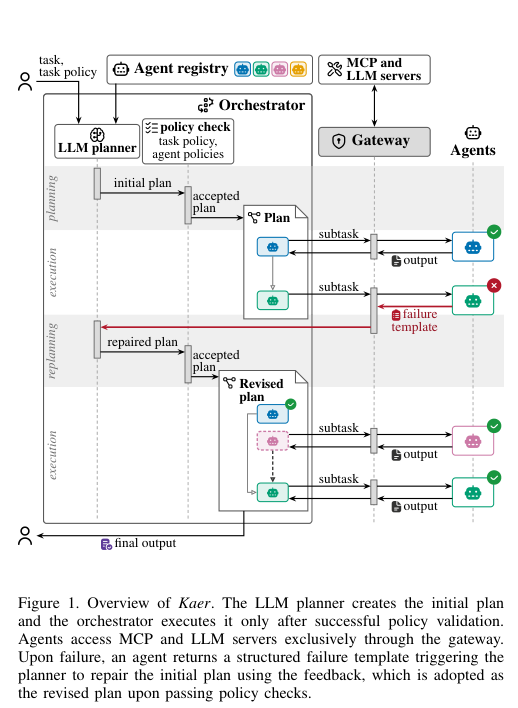

# Kaer：有限失败通道与受策略约束的确定性重规划

[English](README-en.md)

> **component_only / l1_mechanism；不是Agent能力复现。** 完整实验成本过高，不复现（审查 DONE）；不作为Evolve晋级证据。

## 论文信息

| 字段 | 内容 |
| --- | --- |
| 论文链接 | [Kaer: Security-Aware Replanning for Multi-Agent Systems](https://arxiv.org/abs/2611.24839v1)；[固定v1 PDF](https://arxiv.org/pdf/2611.24839v1) |
| 一作机构 / 公司 / 学校 | Tushin Mallick，Northeastern University |
| 首次公开日期 | **2026-11-18 18:05:47 UTC**；11月19日审查／公告不能替代首发日期 |
| 原作者代码 | 未在固定v1及已核对项目页发现／验证论文专用公开源码仓库；不将引用依赖当作者开源。 |
| 本地 Adapter / key | `kaer`；`adapter=null`，未接入Evolve |
| 本地复现代码 | `src/auto_research/agent_research/kaer.py` |

## 原始论文总结

### 背景与主要改动

不可信子Agent可把恶意指令夹在失败反馈里，诱导orchestrator授予新权限或改任务。Kaer不让自由文本失败报告进入planner，只传部署前固定的失败模板；planner用固定七种确定性算子修改尚未完成的子任务，最后重新验证任务及Agent策略。

计划每一步的能力必须同时属于执行Agent能力集和任务策略；数据依赖只能来自较早步骤，接收Agent必须被来源Agent的输出策略允许，除最终步骤外每个产物都要有后继消费者。RE-EXECUTE、REVISE-DIRECTIVE、RESCOPE、REASSIGN、INSERT、PRUNE、REWIRE按序作用在副本，已完成前缀不变。成功输出与progress报告不传planner，但可能影响执行Agent；这不是全链内容安全证明。

### 架构与流程


<!-- paper-figure:start -->
### 原论文关键图



固定v1 PDF第4页 Figure 1及图注；仅裁页面留白／无关正文，未改科学内容。图片来自[原论文](https://arxiv.org/pdf/2611.24839v1#page=4)，版权归原作者所有。[资产来源](assets/provenance.json)。
<!-- paper-figure:end -->

### 核心公式

$$
C_j\subseteq C_{A_j},\quad C_j\subseteq C_T,\quad i\in deps(j)\Rightarrow i<j\land A_j\in AP_{A_i}.
$$

### 论文离线与线上效果

作者建立Cintra，含14个需要重规划的任务和14类攻击目标，比较三种基础模型下的Kaer、Magentic-One、ControlValve及消融，报告更强攻击鲁棒性且效用接近ControlValve。它是模拟工具环境评测，没有生产线上A/B。原文不验证开放任务输出是否真的正确，也不保护已授权Agent内部滥用。

## 本地复现

### 数据协议与代码映射

实现13种模板ID去重、四项计划策略检查、七种算子和INSERT/PRUNE依赖重编号；操作事务化，仅最终有效计划可返回。使用0-based位置，论文k对应本地k−1。本地严格拒绝任务策略外能力，没有实现原文单独的用户授权扩展、LLM planner、MCP gateway、重试调度或真实Cintra。

```bash
PYTHONPATH=src python -c 'from auto_research.agent_research.kaer import diagnostic; print(diagnostic(42))'
PYTHONPATH=src python -m pytest tests/test_nov19_latest_agent.py -q
```

[CPU三种子诊断](metrics/component-cpu-seeds42-44.json)仅为合成控制核记录，不是模型成功率。

### 结果、负控与边界

测试拒绝模板里追加任意指令、Agent伪报no-close-out、改已完成步骤、前向/自依赖、未消费产物、违规输出流和能力升级；合法插入后必须rewire才能通过。模板仍可撒谎，只是影响范围有限；拒绝plan不证明任务能完成。

同主题实读对照：[ react ](../2210.03629-react/README.md)。ReAct让自由文本推理与真实观察交替以调整下一步；Kaer针对多Agent失败反馈收窄重规划信息通道，并用静态策略约束修改。它不是把ReAct观察删掉就得到安全，也不判断成功输出真假。

### 高成本完整实验

完整多模型×14任务×14攻击目标与消融依赖真实planner、工具网关和多Agent推理；单卡不能忠实代替前沿服务矩阵。只执行秒级CPU确定性控制核，不申请API、不下载模型。 **成本过高，不复现（审查 DONE）**。该决定为终态，不进入自动重试或实现队列，不阻塞其他交付；不把廉价组件的通过数当完整论文效果。
