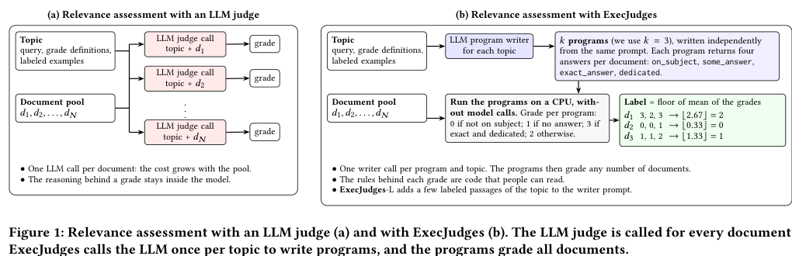

<!-- source-sha256: c5aacad03190f07aa14abc86eff5e3808aa8f4f1689f8e358419c706904e117e -->
# Can Programs Replace LLM Judges? Executable Program Judges for Scalable and Efficient Relevance Labeling

[简体中文](README.md)

> l0_interface: bounded component/interface diagnostic, not complete capability evidence or Evolve promotion.

## Paper information

| Field | Content |
| --- | --- |
| Paper | [arXiv fixed v1](https://arxiv.org/abs/2611.24849v1); [full text](https://arxiv.org/html/2611.24849v1) |
| Institution | First author Eugene Agichtein: Emory University |
| First publication | 2026-11-18 18:09:16 UTC; separate from announcement/directory dates |
| Original source code | No accessible paper-specific author implementation found in fixed v1 and linked sources; dependency repositories do not count as this paper code. |
| Local adapter / key | `execjudges`; adapter=null, independent component only |
| Local implementation | `src/auto_research/agent_research/execjudges_components.py` |

## Paper summary

### Motivation and changes

For each topic, three independently generated lightweight programs answer on-subject/some-answer/exact/dedicated evidence questions. A fixed function maps answers to grades, then floors the mean of the three grades. The LLM writes programs once rather than judging every document, and generated code must run in isolation. Local code never executes network- or LLM-generated code.

<!-- paper-figure:start -->
### Original figure



From the [original paper](https://arxiv.org/pdf/2611.24849v1); copyright belongs to the original authors. Original asset/PDF crop, not local results. [Provenance](assets/provenance.json).
<!-- paper-figure:end -->

### Core formulas

$$
g=\begin{cases}0&\neg on\\1&on\land\neg some\\3&on\land some\land exact\land dedicated\\2&otherwise\end{cases},\qquad label=\left\lfloor k^{-1}\sum_i g_i\right\rfloor.
$$

Section3.2 uses separate0–3 and0–2 scales. Other booleans cannot override absent subject/answer evidence. Consensus floors rather than rounds or votes; k=3 and the rule were fixed before test evaluation. ExecJudges-L may use a small labeled training subset, but evaluation must separate it and never give test qrels to the writer. Local APIs accept explicit booleans/grades, not a pretend LLM writer, NLP toolkit or hostile-code sandbox.

### Author results

Across seven TREC collections, the authors report system-ranking Kendall tau0.87–0.94, program-writing cost about$0.17–$0.49 per topic and CPU grading below one second. Results depend on collection and label budget, not universal superiority to LLM judges. Training labels are not evidence of local answer accuracy. No production A/B is reported.

## Local implementation and boundaries

### Data protocol and code mapping

Only the fixed grade mapping and floor aggregation run as L0 interfaces. No program generation/execution, TREC download or model call occurs, and no relevance accuracy is reported. Evidence must be strict booleans; integers0/1 are not silently accepted.

```bash
PYTHONPATH=src python -c 'from auto_research.agent_research.execjudges_components import diagnostic; print(diagnostic(42, device="cpu"))'
```

### Results, controls and limits

Seeds42/43/44 check arithmetic, protocols, negative controls and gradients, not independent capability trials. [CPU diagnostics](metrics/component-cpu-seeds42-44.json). CPU-only protocols need no GPU or fabricated CUDA record.

### High-cost full experiments

The full seven-collection generation/repair/multiple-label-budget campaign needs a paid frontier writer and large TREC pools plus a secure execution sandbox; it is outside this batch budget. **Not reproduced due to high cost; review DONE.** No automatic retry/training queue. Passing the small component does not change that disposition.

### Same-topic comparison

FUSE evaluates social reasoning against hidden motives and verifiable simulated state; ExecJudges maps retrieval evidence to explicit grades. Deterministic aggregation improves inspectability but supplies neither correct evidence judgments nor hidden-state evaluation.
