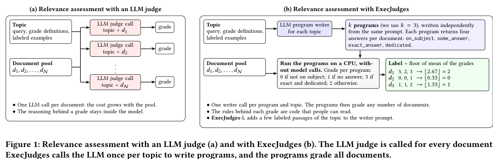

# ExecJudges：显式证据等级与向下取整共识

[English](README-en.md)

> l0_interface：低成本组件/接口诊断，不是完整模型能力证据，不接入Evolve晋级。

## 论文信息

| 字段 | 内容 |
| --- | --- |
| 论文链接 | [Can Programs Replace LLM Judges? Executable Program Judges for Scalable and Efficient Relevance Labeling](https://arxiv.org/abs/2611.24849v1)；[固定v1全文](https://arxiv.org/html/2611.24849v1) |
| 公司 / 作者机构 | 一作 Eugene Agichtein：Emory University；按固定v1及正文核验，不由同名作者/前作推断 |
| 首次公开日期 | 2026-11-18 18:09:16 UTC（arXiv v1；与公告/目录更新时间分开） |
| 原作者开源代码 | 固定v1及关联来源未找到可获取的本论文专用作者代码；依赖仓库不计为本篇开源。 |
| 本地adapter / 稳定键 | `execjudges`；adapter=null，仅独立组件 |
| 本地复现代码目录 | `src/auto_research/agent_research/execjudges_components.py` |

## 原始论文总结

### 背景与主要改动

对每个topic独立生成三个轻量Python评审程序，程序回答on-subject/some-answer/exact/dedicated四个证据问题，固定评分函数映射为等级，再对三个分数均值向下取整。LLM负责一次性的程序编写而不是逐文档调用，生成代码必须隔离执行。本地不执行来自网络或LLM的代码。

<!-- paper-figure:start -->
### 原论文关键图



图片来自[原论文](https://arxiv.org/pdf/2611.24849v1)，版权归原作者所有。原始图/PDF裁剪，不是本地结果；[出处与SHA256](assets/provenance.json)。
<!-- paper-figure:end -->

### 核心公式

$$
g=\begin{cases}0&\neg on\\1&on\land\neg some\\3&on\land some\land exact\land dedicated\\2&otherwise\end{cases},\qquad label=\left\lfloor k^{-1}\sum_i g_i\right\rfloor.
$$

§3.2：0–3和0–2量表分别实现；没有证据不能由其他布尔项抬高等级。共识是floor不是round或多数票；k=3与取整规则在测试前固定。ExecJudges-L可看少量训练标签，评测必须分开这些样本，不能把gold测试qrels送给生成器。本地只接受显式布尔证据/分数，没有假装实现LLM writer、NLP toolkit或恶意代码沙箱。

### 论文离线与线上效果

七个TREC集合；作者报告系统排名Kendall tau为0.87–0.94，写程序每topic约$0.17–$0.49，标注CPU小于1秒。不同集合/标签预算对应不同比较，不概括为全面优于LLM。上下文中出现训练标签并非本地回答准确率的证据；本文没有生产A/B。

## 本地复现与边界

### 数据协议与代码映射

只运行固定grade mapping和floor聚合的L0接口，未生成或执行评审程序、未下载TREC、未调用模型，不输出相关性准确率。布尔值必须严格bool，整数0/1不会静默当证据。

```bash
PYTHONPATH=src python -c 'from auto_research.agent_research.execjudges_components import diagnostic; print(diagnostic(42, device="cpu"))'
```

### 结果、负控与边界

三种子42/43/44只检查数值、协议、失败负控和梯度，不是独立能力试验。[CPU诊断](metrics/component-cpu-seeds42-44.json)。CPU协议无需GPU，不制造CUDA执行记录。

### 高成本完整实验

完整七集合生成/修复/多标签预算实验依赖付费前沿writer和大规模TREC池，预算及代码沙箱维护不在本轮范围；不运行完整campaign。 **成本过高，不复现（审查 DONE）**；不自动重试、不进入训练队列。低成本组件通过不改变此结论。

### 同主题对照

FUSE用隐藏真实动机和可验证模拟状态评估社会推理；ExecJudges将检索证据映射为显式等级。确定性聚合能提高可检查性，却不产生正确的证据判断，也不代替隐藏状态评测。
