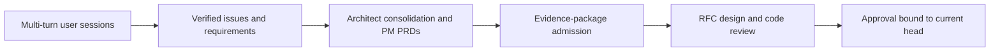
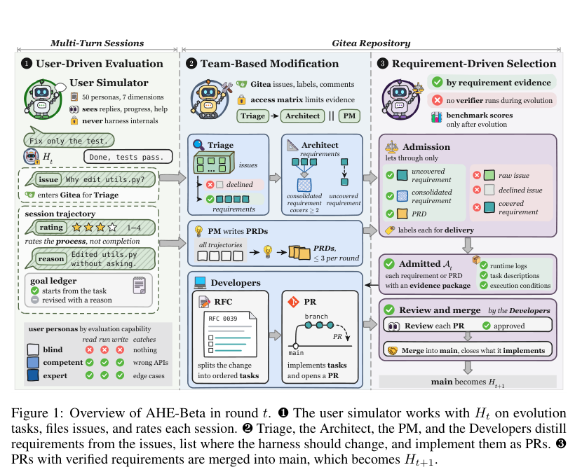

# Agentic Harness Engineering Beta: Requirement-Centered Evolution of Agent Harnesses

<!-- source-sha256: c072a775154067ebca960853051dce722d5c17827c935dab95ad455284cf62b3 -->

[简体中文](README.md)

> **component_only / l0_interface; not an agent capability reproduction.** Full experiments are too costly and not reproduced (review DONE). Not evidence for evolve promotion.

## Paper information

| Field | Value |
| --- | --- |
| Paper link | [Agentic Harness Engineering Beta: Requirement-Centered Evolution of Agent Harnesses](https://arxiv.org/abs/2611.24924v1); [fixed v1 PDF](https://arxiv.org/pdf/2611.24924v1) |
| First-author institution / company / school | Jiahang Lin, Fudan University |
| Original publication date | **2026-11-18 18:52:13 UTC**; November19 review/announcement is not the first-release date |
| Original source code | [Author repository](https://github.com/Curry09/AHE-Beta/tree/0370ec20a9ad90053a5a50ed21d491eb5480b975); MIT |
| Local adapter / key | `ahe-beta`; `adapter=null`, not integrated with evolve |
| Local reproduction code | `src/auto_research/agent_research/ahe_beta.py` |

## Original paper summary

### Background and main changes

AHE-Beta moves evolution selection from benchmark scores to verified user requirements. A simulated user interacts over multiple turns and files issues. Triage verifies generalizable requirements, the Architect consolidates at least two requirements by root cause, and the PM identifies implicit product needs across sessions. Developers receive only admitted requirements and their evidence packages.

The delivery package contains cited runtime logs, public tasks and execution conditions, but excludes user conversations, hidden tests and graders. Design review precedes implementation; code review checks acceptance criteria. Merge approval must bind the current PR head and the unchanged reviewed RFC. Verification is an upstream role judgment, not a formal correctness proof.

### Architecture and flow



### Original paper figure



Fixed v1 PDF page2, Figure 1 with original caption. Only whitespace/unrelated text is cropped; scientific content is unchanged. Copyright belongs to the original authors. [Original paper](https://arxiv.org/pdf/2611.24924v1#page=2) · [Provenance](assets/provenance.json).

### Core equations

$$
A_t=(R_t\setminus C_t)\cup R_t^{con}\cup D_t,\qquad merge=admitted\land review_{design}\land review_{code}\land head_{approved}=head_{current}.
$$

### Reported offline and online results

On 38 held-out Harbor tasks, the paper reports pass@1 increasing from 21.9% to 33.3% and 40.8% fewer execution tokens, excluding user simulation. In a blinded human A/B study, 31 of 48 valid pairs prefer AHE-Beta. This is a controlled user study, not production traffic. Each evolution configuration contributes one evolution run; repeated downstream evaluation is not independent evolution replication.

## Local reproduction

### Data protocol and code mapping

The local slice implements typed Evidence/Requirement delivery, covers resolution for verified consolidations, and a pure merge_eligible decision bound to head and RFC. It does not implement user simulation, semantic Triage/Architect/PM judgments, a coding agent or actual git merging. Typed fields cannot prove their strings contain no hidden answers; this remains L0, not a semantic security claim.

```bash
PYTHONPATH=src python -c 'from auto_research.agent_research.ahe_beta import diagnostic; print(diagnostic(42))'
PYTHONPATH=src python -m pytest tests/test_nov19_latest_agent.py -q
```

[Three-seed CPU diagnostics](metrics/component-cpu-seeds42-44.json) are synthetic control-kernel records, not model success rates.

### Results, negative controls and limits

Tests ensure an unverified consolidation cannot suppress original requirements; raw issues are not delivery types; empty evidence, stale heads, changed RFCs and unfinished suites cannot pass. There are no benchmark-score, gold-answer or hidden-test parameters, but no sandbox for malicious callbacks is provided.

Reviewed same-topic comparison: [ harness2 ](../2610.14224-harness2/README-en.md). Harness² proposes and composes from execution contrasts and accumulates experience without rubrics. AHE-Beta instead centers cross-session requirements, evidence admission and head-bound review. Passing local fixed-role controls establishes neither method's generalization.

### High-cost full experiments

The main N=32 configuration records 1.92B tokens over five modification rounds, with a six-round schedule, multiple frontier APIs, 38 evaluation tasks and E2B sandboxes. A single GPU cannot cheaply reproduce these calls and environments. Only seconds-scale CPU protocol diagnostics run. **Too costly; not reproduced (review DONE).** This is terminal, not an automatic retry or implementation queue. It does not block other delivery. Passing a cheap component does not establish the full paper's results.
