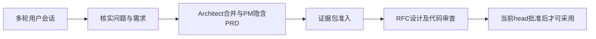
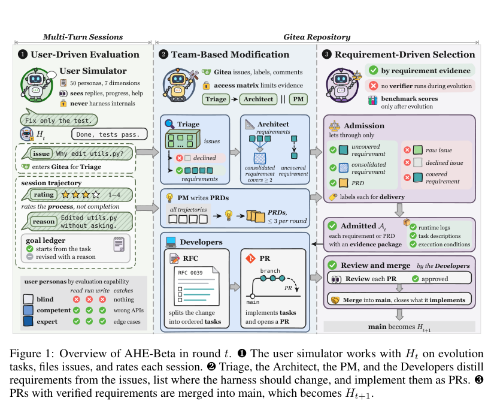

# AHE-Beta：让需求证据而非基准分数决定Harness演进

[English](README-en.md)

> **component_only / l0_interface；不是Agent能力复现。** 完整实验成本过高，不复现（审查 DONE）；不作为Evolve晋级证据。

## 论文信息

| 字段 | 内容 |
| --- | --- |
| 论文链接 | [Agentic Harness Engineering Beta: Requirement-Centered Evolution of Agent Harnesses](https://arxiv.org/abs/2611.24924v1)；[固定v1 PDF](https://arxiv.org/pdf/2611.24924v1) |
| 一作机构 / 公司 / 学校 | Jiahang Lin，Fudan University |
| 首次公开日期 | **2026-11-18 18:52:13 UTC**；11月19日审查／公告不能替代首发日期 |
| 原作者代码 | [作者仓库](https://github.com/Curry09/AHE-Beta/tree/0370ec20a9ad90053a5a50ed21d491eb5480b975)；MIT |
| 本地 Adapter / key | `ahe-beta`；`adapter=null`，未接入Evolve |
| 本地复现代码 | `src/auto_research/agent_research/ahe_beta.py` |

## 原始论文总结

### 背景与主要改动

AHE-Beta把演进的依据从测试分数移到经过核实的用户需求。模拟用户进行多轮交互并提交问题；Triage把问题核实成可泛化需求，Architect按共同根因合并至少两个需求，PM从跨会话记录找隐含产品需求。开发者只接收被准入的需求及其证据包。

证据包只有被引用会话的运行日志、公开任务和执行条件，用户对话、隐藏测试和grader不能传给开发者。RFC先做设计审查，代码再按验收标准审查；合并时批准必须绑定当前PR head，且RFC仍与已审设计一致。这里的“verified”是上游角色判断，不是形式正确性证明。

### 架构与流程



<!-- paper-figure:start -->
### 原论文关键图



固定v1 PDF第2页 Figure 1及图注；仅裁页面留白／无关正文，未改科学内容。图片来自[原论文](https://arxiv.org/pdf/2611.24924v1#page=2)，版权归原作者所有。[资产来源](assets/provenance.json)。
<!-- paper-figure:end -->

### 核心公式

$$
A_t=(R_t\setminus C_t)\cup R_t^{con}\cup D_t,\qquad merge=admitted\land review_{design}\land review_{code}\land head_{approved}=head_{current}.
$$

### 论文离线与线上效果

作者在38个held-out Harbor任务上报告pass@1从21.9%到33.3%，执行token减少40.8%；token不含用户模拟。盲测人类A/B有48个有效配对，其中31个偏好AHE-Beta；这是受控用户研究，不是生产流量A/B。每个演进配置只有一条演进run，不能把下游重复评测当独立演进重复。

## 本地复现

### 数据协议与代码映射

只实现类型化Evidence/Requirement交付集、已核实合并需求的covers消解，以及绑定head与RFC的纯merge_eligible判定。没有模拟用户、Triage/Architect/PM语言判断、开发Agent或真正git合并。结构字段不保证字符串内部绝无隐藏答案，所以保持L0，不把类型检查称为语义安全。

```bash
PYTHONPATH=src python -c 'from auto_research.agent_research.ahe_beta import diagnostic; print(diagnostic(42))'
PYTHONPATH=src python -m pytest tests/test_nov19_latest_agent.py -q
```

[CPU三种子诊断](metrics/component-cpu-seeds42-44.json)仅为合成控制核记录，不是模型成功率。

### 结果、负控与边界

测试确认未核实的合并需求不能吞掉原需求；原始issue不能作为交付类型；证据为空、head过期、RFC变动或全套测试未完成均不能通过。无benchmark score、gold或隐藏test参数，但不提供恶意回调沙箱。

同主题实读对照：[ harness2 ](../2610.14224-harness2/README.md)。Harness²按执行对照提出、组合并积累经验，且不使用rubric；AHE-Beta把跨会话需求、证据准入和head绑定审查作为演进主干。两者都不能由本地固定角色替身的通过数证明泛化能力。

### 高成本完整实验

主N=32配置在五个修改轮记录1.92B token，六轮安排、多角色前沿API、38任务与E2B沙箱；单卡不能廉价等价替代这些调用和环境。只运行秒级CPU协议诊断。 **成本过高，不复现（审查 DONE）**。该决定为终态，不进入自动重试或实现队列，不阻塞其他交付；不把廉价组件的通过数当完整论文效果。
