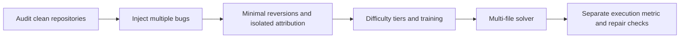
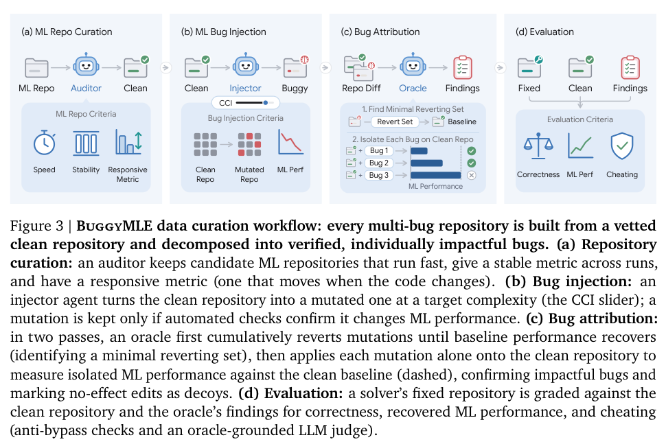

# BuggyMLE: Scaling Machine Learning Engineering Difficulty with Bug Injection

<!-- source-sha256: 21b72be85c8b4ccd6506776531e3572b49cd6e700458a330a8aa371db379025e -->

[简体中文](README.md)

> **component_only / l0_interface; not model or agent capability replication.** Full experiments are too costly and not reproduced (review DONE). No Evolve promotion evidence.

## Paper information

| Field | Value |
| --- | --- |
| Paper link | [BuggyMLE: Scaling Machine Learning Engineering Difficulty with Bug Injection](https://arxiv.org/abs/2611.25088v1); [fixed v1 PDF](https://arxiv.org/pdf/2611.25088v1) |
| First-author institution / company / school | John Wu, Google Research / University of Illinois Urbana-Champaign |
| Original publication date | **2026-11-18 19:26:15 UTC**; November20 announcement/review is not first publication |
| Original author code | No paper-specific public method source verified in fixed v1 and reviewed sources; cited dependencies are not a release. |
| Local Adapter / key | `buggymle-cci`; `adapter=null`, not integrated with Evolve |
| Local reproduction code | `src/auto_research/agent_research/buggymle_cci.py` |

## Original paper summary

### Background and main changes

BuggyMLE audits runnable ML repositories with stable, responsive metrics, then uses an Injector to create controlled mutations. An Oracle first finds a minimal reversion set and then applies each mutation separately to the clean repository to identify individually impactful bugs. Solvers repair multi-file repositories. Execution, metric recovery and per-bug semantic repair are checked separately; compensating through tuning is not equivalent to repairing every bug.

CCI uses task-level median structural features on eight reference benchmarks, applies log1p and feature z-scores, averages within repository, dependency and patch groups, then rescales group scores by reference variance. The negative coefficient-weighted sum is raw CCI, followed by fixed reference min-max scaling. A new task must not refit or clip the scale. Figure10 gives coefficients +0.64, -0.34 and -0.99; the positive repository term is a conditional adjustment, not a claim that larger repositories are always harder.

### Architecture and flow



### Original paper figure



Fixed v1 PDF page8, Figure 3 with original caption. Only whitespace and unrelated body text are cropped; scientific content is unchanged. Copyright belongs to the original authors. [Source](https://arxiv.org/pdf/2611.25088v1#page=8) · [Provenance](assets/provenance.json). Not local evidence.

### Core equations

$$
z_i=\frac{\log(1+f_i)-\mu_i}{\sigma_i},\quad u_G=\frac{|G|^{-1}\sum_{i\in G}z_i}{s_G},\quad C=-\sum_G\beta_Gu_G,\quad C_{scaled}=\frac{C-C_{min}}{C_{max}-C_{min}}.
$$

### Reported offline and online results

Fixed v1 generates over6,600 variants and nearly260K injected lines from222 source repositories. CCI relates to benchmark-average solve rate at R²=0.951; per-model/benchmark LOBO MAE is0.115 while benchmark-average MAE is0.048, with different aggregation units. Across14 evaluated models, the best full-repair rate drops from95% to9% with difficulty. Table3 shows the9B curriculum model improving SWE-bench Lite from24.3% to33.0%. These are author offline results, not local measurements. No production A/B is reported.

## Local reproduction

### Data protocol and code mapping

The local slice implements medians of supplied ten-feature rows, fixed-calibration projection and an optional numerically stable logistic readout. It does not extract ASTs/dependency graphs, run an Injector/Oracle/solver, fit calibration or train models. Complete means, scales, intercept and reference bounds are not released as a loadable artifact, so Calibration is an explicit required input. Diagnostics use synthetic calibration and do not reproduce the author's eight-benchmark CCI. Patch features belong to curation/evaluation; hidden repair patches or their difficulty labels must not be exposed to the evaluated agent.

```bash
PYTHONPATH=src python -c 'from auto_research.agent_research.buggymle_cci import diagnostic; print(diagnostic(42))'
PYTHONPATH=src python -m pytest tests/test_nov20_agent_components.py -q
```

After the shared source freeze, the batch runner writes [three-seed CPU diagnostics](metrics/component-cpu-seeds42-44.json). Synthetic control values are not task success rates.

### Results, negative controls and limits

Controls preserve the positive repository coefficient, group variance scaling and out-of-reference outputs, check median rather than mean, and return no predicted success without an intercept. NaNs, zero scales and degenerate bounds fail. Table4 calls total_lines_delta net line change; values≤-1 make log1p undefined and are rejected, not silently absolutized or replaced with an undocumented transform.

Reviewed same-topic comparison: [agent-research:mle-star](../2506.15692-mle-star/README-en.md). MLE-STAR uses retrieval, actual ablations and validation results to improve model code. BuggyMLE builds difficulty tiers from oracle-attributed injected bugs; CCI is a curation/curriculum scale. Selecting an improved solution differs from shaping evaluation/training tasks, and a structural score is not a validation improvement.

### High-cost full experiments

The full study covers222 repositories,6,600+ variants, repeated ML pipelines, frontier-model Oracle/judges and a five-stage Qwen3.5-9B LoRA SFT/GRPO pipeline, with evaluation episodes allowed up to eight hours. This clearly exceeds a cheap single-A100/A30 or Mac run. No datasets/weights or trial runs are started; only tiny arithmetic controls execute. **Too costly; not reproduced (review DONE).** This is terminal, not an automatic retry or full-implementation queue. Passing the cheap slice does not establish the paper's full results.
