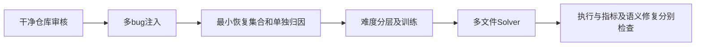
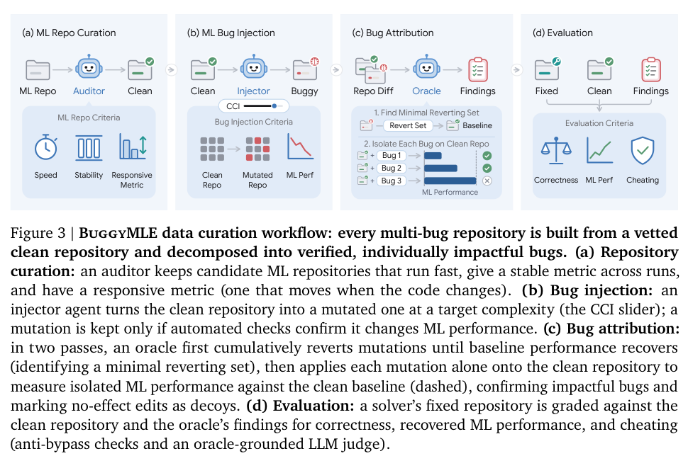

# BuggyMLE：用代码复杂度分层，而不是把指标恢复当完整修复

[English](README-en.md)

> **component_only / l0_interface；不是模型或Agent能力复现。** 完整实验成本过高，不复现（审查 DONE）；不作为Evolve晋级证据。

## 论文信息

| 字段 | 内容 |
| --- | --- |
| 论文链接 | [BuggyMLE: Scaling Machine Learning Engineering Difficulty with Bug Injection](https://arxiv.org/abs/2611.25088v1)；[固定v1 PDF](https://arxiv.org/pdf/2611.25088v1) |
| 一作机构 / 公司 / 学校 | John Wu，Google Research / University of Illinois Urbana-Champaign |
| 首次公开日期 | **2026-11-18 19:26:15 UTC**；11月20日公告/审查不等于首发 |
| 原作者代码 | 固定v1及本轮核对来源未发现可核验的论文专用公开方法源码；不把引用依赖算开源。 |
| 本地 Adapter / key | `buggymle-cci`；`adapter=null`，未接入Evolve |
| 本地复现代码 | `src/auto_research/agent_research/buggymle_cci.py` |

## 原始论文总结

### 背景与主要改动

BuggyMLE先审核可运行、指标稳定且对代码变化敏感的ML仓库，再让Injector注入不同规模的错误。Oracle通过逐个恢复变动找最小恢复集合，再把每个改动单独应用到干净仓库，筛出确有独立指标影响的错误。Solver必须在多文件仓库里真实修复；评价同时检查执行、指标恢复和逐错误语义修复，不能把补偿性调参当修好了全部bug。

CCI在八个参考benchmark上，先取十项结构特征的任务中位数，做log1p和特征z-score，再对repo、dependency、patch三组求均值，并把组分数按参考方差缩放。固定logistic系数的负加权和构成raw CCI，再用参考最小/最大值定标。新任务不能重新拟合或裁剪回[0,1]。Figure10的repo系数为+0.64，dependency为-0.34，patch为-0.99；repo项是给定其他项的条件调整，不支持“仓库越大必然越难”。

### 架构与流程



<!-- paper-figure:start -->
### 原论文关键图



固定v1 PDF第8页Figure 3及原图注；仅裁留白和无关正文，未改科学内容。图片来自[原论文](https://arxiv.org/pdf/2611.25088v1#page=8)，版权归原作者所有；不是本地结果。[资产来源](assets/provenance.json)。
<!-- paper-figure:end -->

### 核心公式

$$
z_i=\frac{\log(1+f_i)-\mu_i}{\sigma_i},\quad u_G=\frac{|G|^{-1}\sum_{i\in G}z_i}{s_G},\quad C=-\sum_G\beta_Gu_G,\quad C_{scaled}=\frac{C-C_{min}}{C_{max}-C_{min}}.
$$

### 论文离线与线上效果

固定v1以222个源仓库生成6600多个变体、近260K行注入代码。八benchmark平均solve rate与CCI的R²为0.951；逐模型/benchmark的LOBO MAE为0.115，benchmark均值MAE为0.048，两者分母不同。14个评测模型中最高完整修复率随难度从95%降至9%；Table3中9B课程模型的SWE-bench Lite从24.3%到33.0%。这是作者离线实验，不是本机结果；未报告生产线上A/B。

## 本地复现

### 数据协议与代码映射

本地仅实现给定十项特征的benchmark中位数、固定校准投影和可选的稳定logistic读数。没有AST/依赖图抽取、Injector、Oracle、LLM solver、校准拟合或模型训练。完整μ/σ、组尺度、截距与参考边界未在原文公开成可直接加载文件，因此API强制调用方显式提供Calibration；诊断用合成校准，不能称为复算了作者八benchmark CCI。Patch特征属于构建/评测端，不能把隐藏修复补丁或其困难标签传给被测Agent。

```bash
PYTHONPATH=src python -c 'from auto_research.agent_research.buggymle_cci import diagnostic; print(diagnostic(42))'
PYTHONPATH=src python -m pytest tests/test_nov20_agent_components.py -q
```

本轮统一冻结源码后由批次runner生成[三种子CPU诊断](metrics/component-cpu-seeds42-44.json)；合成控制值不是任务成功率。

### 结果、负控与边界

负控保留正repo系数、组方差缩放和参考区间外结果；验证median不是mean，未给截距时不捏造预测成功率。拒绝NaN、零尺度和退化边界。Table4把total_lines_delta写成净变化，若值≤-1会使log1p无定义，接口明确拒绝，既不取绝对值，也不补造作者未说明的变换。

同主题实读对照：[agent-research:mle-star](../2506.15692-mle-star/README.md)。MLE-STAR用检索、真实消融与validation结果定位并改进模型代码；BuggyMLE用有Oracle归因的注入错误构建难度阶梯，CCI是评测/课程设计尺度。前者选改进方案，后者塑造训练与评测任务；不能把后者的结构分数当成前者的真实验证收益。

### 高成本完整实验

完整研究涉及222仓库、6600+变体、多次完整ML执行、前沿模型Oracle/评审和Qwen3.5-9B的五阶段LoRA SFT/GRPO；评测episode最高8小时。此规模明显超过单A100/A30或Mac廉价验证预算，不下载数据/权重，不启动探跑；本地只运行毫秒级公式控制。 **成本过高，不复现（审查 DONE）**。此终态不自动重试、不进入完整实现队列，不阻塞其他交付；低成本组件通过不证明完整论文效果。
