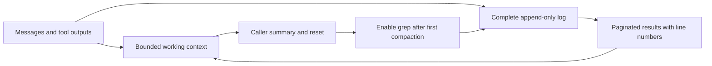
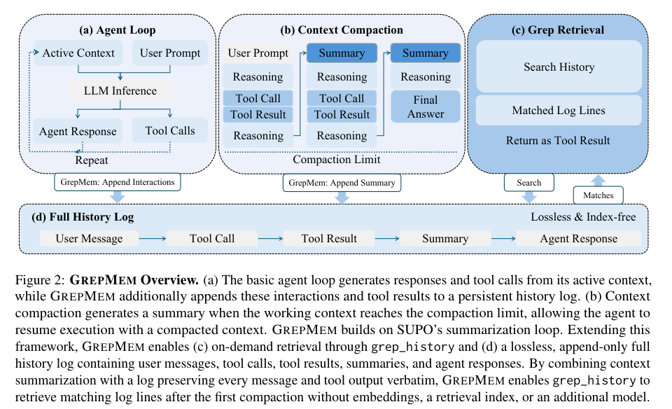

# Forget Freely, Grep Later: Lossless, Index-Free Memory for Long-Horizon LLM Agents

<!-- source-sha256: 577f2b1b106591e9094f1a1901e01ce3592ab70c1e184636e2a0c24c7e27d511 -->

[简体中文](README.md)

> **component_only / l1_mechanism; not model or agent capability replication.** Full experiments are too costly and not reproduced (review DONE). No Evolve promotion evidence.

## Paper information

| Field | Value |
| --- | --- |
| Paper link | [Forget Freely, Grep Later: Lossless, Index-Free Memory for Long-Horizon LLM Agents](https://arxiv.org/abs/2611.25123v1); [fixed v1 PDF](https://arxiv.org/pdf/2611.25123v1) |
| First-author institution / company / school | Ziyan Yang, University of Southern California |
| Original publication date | **2026-11-18 20:02:57 UTC**; November20 announcement/review is not first publication |
| Original author code | [Fixed author repository commit](https://github.com/limenlp/GrepMem/tree/b7e3744c2f7489feac4060b379be6936960dc7bd); MIT |
| Local Adapter / key | `grepmem`; `adapter=null`, not integrated with Evolve |
| Local reproduction code | `src/auto_research/agent_research/grepmem.py` |

## Original paper summary

### Background and main changes

GrepMem separates bounded working context from complete history. Compaction replaces active context with the system prompt, task and summary, while original messages, tool calls/results and summaries remain in an append-only text log. Only after first compaction can the policy use case-insensitive grep_history to recover omitted details. No embeddings, index or extraction are required. Lossless describes log retention, not guaranteed retrieval or answers.

Search returns oldest matches under original record headers and line numbers:10 by default, at most30, with an offset over matching lines rather than records and up to three context lines. Prior grep outputs remain logged but are skipped by searches to avoid recursive duplication. Responses cap at6K characters, clip lines around matches to300 characters, stop at whole matches and return a continuation offset. Invalid regexes and searches exceeding ten seconds return errors.

### Architecture and flow



### Original paper figure



Fixed v1 PDF page3, Figure 2 with original caption. Only whitespace and unrelated body text are cropped; scientific content is unchanged. Copyright belongs to the original authors. [Source](https://arxiv.org/pdf/2611.25123v1#page=3) · [Provenance](assets/provenance.json). Not local evidence.

### Core equations

$$
L_{t+1}=L_t\Vert(a_t,o_t,s_t),\qquad c_{after}=({system},{task},s_t),\qquad retrieve(q)=\operatorname{regex}_i(q,L_t\setminus\text{prior grep outputs}).
$$

### Reported offline and online results

With Qwen3.5-9B trained under five memory strategies, the paper reports95-97% ContextBench accuracy versus at most21% for lossy baselines, and gains of8.8 points over SUPO and7.0 over MemGPT on BCP-Multi. ContextBench token use is about29% of MemGPT's. These are author post-training measurements over all prompt/generated calls, not local regex throughput or disk savings. No production A/B is reported; the raw log still grows with interaction.

## Local reproduction

### Data protocol and code mapping

The local substrate implements append-only records, explicit-summary compaction, post-compaction grep admission, regex/pagination/context/original line numbers, recursive-output exclusion and character limits. Regexes run in a separate worker with a hard timeout over supplied text, never paths. Summaries are explicit caller inputs. There is no LLM summarizer, GRPO, question answering or real-history integration. Tests use synthetic public observations and never read local Codex sessions; string retrieval is not agent capability.

```bash
PYTHONPATH=src python -c 'from auto_research.agent_research.grepmem import diagnostic; print(diagnostic(42))'
PYTHONPATH=src python -m pytest tests/test_nov20_agent_components.py -q
```

After the shared source freeze, the batch runner writes [three-seed CPU diagnostics](metrics/component-cpu-seeds42-44.json). Synthetic control values are not task success rates.

### Results, negative controls and limits

Controls check omitted summary details remain in the log, grep outputs do not duplicate original matches, case-insensitive search and continuation offsets work, and long lines/many hits respect6K. Catastrophic regex backtracking terminates only the worker and a later normal query still works. Model-turn budgets, token estimation and forced-answer calls are outside this storage/tool slice; no automatic compression policy or training gain is fabricated.

Reviewed same-topic comparison: [agent-research:memgpt](../2310.08560-memgpt/README-en.md). MemGPT manages layered memory and archival paging through model tool calls. GrepMem avoids a pre-extracted archive and lexically searches raw trajectories. Both can compact active context, but GrepMem does not reduce raw-log storage. Selecting useful search terms still needs training and real task evaluation; the older local fixed-key MemGPT diagnostic is not a capability baseline.

### High-cost full experiments

Each paper run uses24 H100s (8 trainer,16 rollout) plus a shared three-GPU dense retriever; total training is about6,000 H100-hours over4,000 episodes and a9B model. Full training/evaluation is not reproduced on the single-GPU budget; no model or14.9M-document corpus is downloaded. Only seconds-scale CPU log/retrieval controls run. **Too costly; not reproduced (review DONE).** This is terminal, not an automatic retry or full-implementation queue. Passing the cheap slice does not establish the paper's full results.
