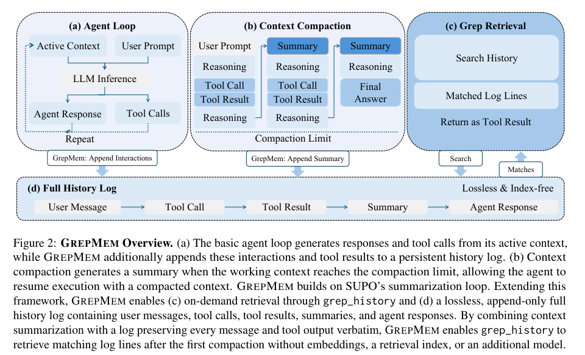

# GrepMem：压缩工作上下文，但保留可grep的原始历史

[English](README-en.md)

> **component_only / l1_mechanism；不是模型或Agent能力复现。** 完整实验成本过高，不复现（审查 DONE）；不作为Evolve晋级证据。

## 论文信息

| 字段 | 内容 |
| --- | --- |
| 论文链接 | [Forget Freely, Grep Later: Lossless, Index-Free Memory for Long-Horizon LLM Agents](https://arxiv.org/abs/2611.25123v1)；[固定v1 PDF](https://arxiv.org/pdf/2611.25123v1) |
| 一作机构 / 公司 / 学校 | Ziyan Yang，University of Southern California |
| 首次公开日期 | **2026-11-18 20:02:57 UTC**；11月20日公告/审查不等于首发 |
| 原作者代码 | [原作者仓库固定提交](https://github.com/limenlp/GrepMem/tree/b7e3744c2f7489feac4060b379be6936960dc7bd)；MIT |
| 本地 Adapter / key | `grepmem`；`adapter=null`，未接入Evolve |
| 本地复现代码 | `src/auto_research/agent_research/grepmem.py` |

## 原始论文总结

### 背景与主要改动

GrepMem把有限工作上下文和完整历史分开：压缩时只把活跃上下文换成系统提示、任务与摘要，原始消息、工具调用/输出和摘要仍追加到纯文本日志。第一次压缩之后才开放grep_history，让模型按需用大小写不敏感正则取回遗漏细节。不需要embedding、索引或知识抽取，但“lossless”只指原日志保留，不代表模型每次都能找对或答对。

grep按原始记录头与行号返回最早匹配，默认10条、最多30条，offset跳过匹配行而非记录；前后context默认1行、最多3行。旧grep结果仍留在原日志，但搜索跳过它们以免递归重复。单次输出上限6K字符，围绕匹配裁到300字符并在完整match边界停止，返回继续offset；非法正则或超过10秒都返回错误。

### 架构与流程


<!-- paper-figure:start -->
### 原论文关键图



固定v1 PDF第3页Figure 2及原图注；仅裁留白和无关正文，未改科学内容。图片来自[原论文](https://arxiv.org/pdf/2611.25123v1#page=3)，版权归原作者所有；不是本地结果。[资产来源](assets/provenance.json)。
<!-- paper-figure:end -->

### 核心公式

$$
L_{t+1}=L_t\Vert(a_t,o_t,s_t),\qquad c_{after}=({system},{task},s_t),\qquad retrieve(q)=\operatorname{regex}_i(q,L_t\setminus\text{prior grep outputs}).
$$

### 论文离线与线上效果

作者用Qwen3.5-9B在五种记忆策略下训练，GrepMem在ContextBench达到95-97%，有损基线最高21%；BCP-Multi比SUPO高8.8个百分点，比MemGPT高7.0点。ContextBench耗用token约为MemGPT的29%。这些是作者训练后测量，token统计包含全部prompt和生成调用，不是本地regex吞吐或磁盘节省。未报告生产A/B；原始日志仍随交互增长。

## 本地复现

### 数据协议与代码映射

本地实现append-only记录、显式摘要压缩、第一次压缩后的grep准入、正则/分页/上下文/原行号、跳过旧grep输出与字符上限。正则在隔离子进程内运行并用硬timeout终止，仅接收输入文本而不打开路径。摘要由调用方明确提供；没有LLM摘要器、GRPO、问题回答或真实历史接入。只对合成公开观察做控制测试，不读取本机Codex会话，也不把字符串检索当Agent能力。

```bash
PYTHONPATH=src python -c 'from auto_research.agent_research.grepmem import diagnostic; print(diagnostic(42))'
PYTHONPATH=src python -m pytest tests/test_nov20_agent_components.py -q
```

本轮统一冻结源码后由批次runner生成[三种子CPU诊断](metrics/component-cpu-seeds42-44.json)；合成控制值不是任务成功率。

### 结果、负控与边界

控制测试验证摘要可遗漏原始细节而日志仍保留、只计原始匹配而不递归grep输出、大小写无关、连续offset不漏页；长行与多匹配验证6K上限，灾难性回溯正则会终止worker，随后正常查询仍可用。论文的模型turn预算、自动token估计与forced-answer调用不在这个存储工具组件内，不捏造自动压缩策略或训练效果。

同主题实读对照：[agent-research:memgpt](../2310.08560-memgpt/README.md)。MemGPT以分层内存、page-out/page-in与模型工具调用管理归档；GrepMem不预先抽取归档结构，保留原始轨迹并做词法搜索。两者都可压缩工作上下文，但GrepMem没有减少原始日志占盘；模型是否会选对检索词仍需训练与真实任务评价，本地固定key的旧MemGPT诊断也不能作能力对照。

### 高成本完整实验

原文每次训练使用24张H100（8 trainer、16 rollout），另有共享3卡dense retriever，合计约6000 H100小时，4000个episode、9B模型。明显超出单卡预算，完整训练/评测不复现，不下载模型和14.9M文档；本地只运行秒级CPU日志/检索控制。 **成本过高，不复现（审查 DONE）**。此终态不自动重试、不进入完整实现队列，不阻塞其他交付；低成本组件通过不证明完整论文效果。
