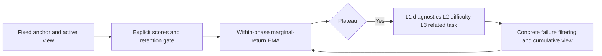
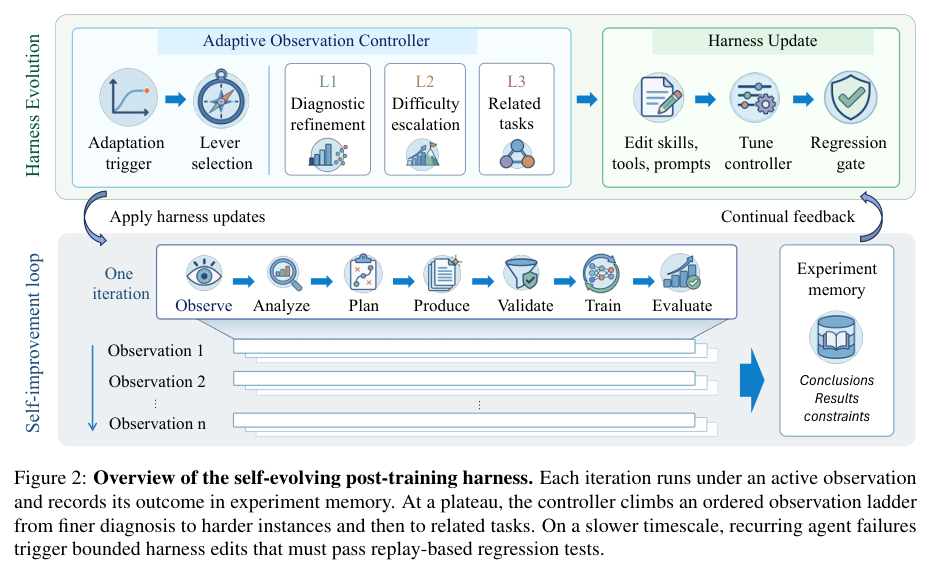

# Sage-Evolve-Preview: Adaptive Observation for Post-Training Self-Improvement

<!-- source-sha256: 215b157cedab8a5a9798cbeabe4734d6e121d2d7ee52054df314488ec887b176 -->

[简体中文](README.md)

> `component_only` / L1 CPU mechanism diagnostic, not capability reproduction or executable Evolve integration. This is an overlap addition first released November19 and announced November20, not a new November21 paper. High-cost full experiments are not reproduced (review DONE).

## Paper information

| Field | Value |
| --- | --- |
| Paper | [Fixed v1](https://arxiv.org/abs/2611.26132v1) |
| First author and affiliation | Yinhao Tang; University of Science and Technology of China / Shanghai AI Laboratory |
| Original publication | 2026-11-19 13:52:46 UTC; announcement2026-11-20 |
| Original source code | No paper-specific method source was found in fixed v1 or reviewed sources; cited benchmark repositories are not a method release. |
| Local adapter / key | No full adapter (`adapter: null`); component `sage-evolve` |
| Local code | `src/auto_research/agent_research/sage_evolve.py`; tests `tests/test_nov21_sage_evolve.py` |

## Original paper summary

### Background and changes

AdaObs separates the fixed anchor objective from the active observation guiding research. Every checkpoint is still checked on the anchor. At a plateau, it first refines diagnostics on existing outputs, then adds a harder tier of the same task, and finally adds a related task in the same capability direction. It changes how training gaps are observed, not the scoring rules, the original objective or test-answer access.

Within one observation phase, marginal return is score change per10,000 retained examples. An EMA with alpha0.3 triggers a plateau only when all three trailing smoothed values are strictly below0.1; changing observations resets that history. A candidate must strictly improve active or anchor score while losing at most0.5 anchor points. L2 selects the hardest tier with held-out reference pass rate in[0.2,0.6], retaining older tiers; L3 retains older tasks. Failure memory excludes a concrete configuration for the current gap, not an entire lever. The paper retrains from M0 on base data plus retained increments; no warm-start replacement is claimed locally.

### Architecture



### Key original figure

[](https://arxiv.org/pdf/2611.26132v1#page=4)

Figure2 and original caption from fixed-v1 PDF page4; copyright belongs to the original authors. Only unrelated text/whitespace is cropped; scientific content is unchanged. [Source](https://arxiv.org/pdf/2611.26132v1#page=4) and [crop/SHA256 provenance](assets/provenance.json). This illustrates the author's method, not local evidence.

### Core equations

$$
\mathrm{MR}_t=\frac{S_t^{act}-S_{t-1}^{act}}{\Delta d_t/10000},\qquad \widehat{\mathrm{MR}}_t=\alpha\mathrm{MR}_t+(1-\alpha)\widehat{\mathrm{MR}}_{t-1}.\qquad \operatorname{Plateau}(t)\iff\max_{t-w<i\le t}\widehat{\mathrm{MR}}_i<\epsilon.
$$

### Reported offline and online results

Table1 optimizes eight anchors independently: AdaObs averages73.66 versus66.44 for FixedObs, not one shared model improved simultaneously on all eight. Reported error bars mainly reflect repeated decoding evaluations, not variance across independent training seeds. A separate PostTrainBench study tests transfer across two agent backends. These are author offline results; no production A/B is reported, and local components do not reproduce these scores.

## Local reproduction and limits

### Data protocol and code mapping

The local slice executes acceptance gates on explicit scores, marginal-return arithmetic, EMA/plateau detection, immutable observation records, first-feasible supplied proposals in L1/L2/L3 order, cumulative tier/task validation, gap-specific failed-configuration filtering and reference-rate tier selection. The first MR initializes the EMA and input order resolves tied proposals: explicit deterministic local conventions. MR requires a positive supplied retained-example count and rejects a zero denominator. Because the paper does not fully define rejected-increment data accounting, attempted examples are not silently called retained; callers may supply a defined MR directly. No LLM analysis/planning/production, data generation, contamination checker, SFT, scheduler or harness editor executes. Proposal feasibility and semantic diagnosis remain external.

```bash
PYTHONPATH=src python -c 'from auto_research.agent_research.sage_evolve import diagnostic; print(diagnostic(42))'
PYTHONPATH=src python -m pytest tests/test_nov21_sage_evolve.py -q
```

Only explicit synthetic control inputs are used. No capability benchmark is loaded and no hyperparameters are selected on test data. After the batch source freeze, the shared runner writes [three-seed CPU diagnostics](metrics/component-cpu-seeds42-44.json). Three seeds do not promote L1 evidence or constitute independent model training.

### Same-topic comparison and limits

Reviewed against [agent-research:harness2](../2610.14224-harness2/README-en.md): Harness² holds model weights fixed and improves task harnesses through reference/candidate execution contrasts and composition, preserving cross-task lessons. Full AdaObs updates model weights while holding the anchor fixed and adapting observations; plateaus concern marginal data returns. Both use memory to avoid repetition, but choosing a harness differs from exposing a new training gap. The local Harness² slice is also a mechanism diagnostic, so their control pass rates cannot compare agent capability.

Controls keep equality with epsilon outside the plateau, reject cross-phase score use, reset history on a phase change, preserve other L1 options after one concrete failure and isolate failures by gap. L2/L3 may not discard prior members or change several axes. Exactly0.5 anchor regression is allowed, while0.501 is rejected. CPU controls establish rules, not successful autonomous data discovery or Evolve promotion.

### High-cost full experiments

The paper uses full-parameter SFT of Qwen3.5-35B-A3B,256K-token samples/packs,64H200s and roughly12hours per iteration, with up to eight concurrent runs. Evaluations allow64K generation and up to1M-token sessions. This clearly exceeds oneA100/A30 or a Mac, so full training/evaluation is not reproduced, without weight downloads or trial runs. Only the small CPU control kernel executes. **Too costly; not reproduced (review DONE).** This is a terminal decision, not an automatic retry or implementation queue. Passing the cheap slice does not reproduce the full paper.
