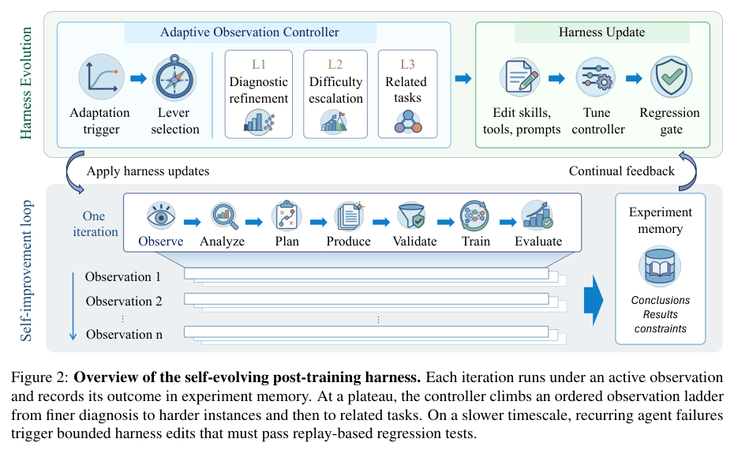

# Sage-Evolve / AdaObs：保持目标不变，平台期先改变观察方式

> `component_only` / L1 CPU机制组件，`diagnostic_only=true`。这是11月19日首发、11月20日公告的重叠池补漏，不算11月21日新论文。高成本完整实验不复现（审查 DONE），不是能力复现或已接入Evolve。

## 论文信息

| 字段 | 内容 |
| --- | --- |
| 论文链接 | [Sage-Evolve-Preview: Adaptive Observation for Post-Training Self-Improvement](https://arxiv.org/abs/2611.26132v1)，本轮固定v1 |
| 公司/机构/学校 | 一作Yinhao Tang；University of Science and Technology of China / Shanghai AI Laboratory |
| 首次公开日期 | 2026-11-19 13:52:46 UTC，arXiv v1；公告日期2026-11-20 |
| 原作者开源代码 | 固定v1及本轮核对来源未发现论文专用方法代码；引用的benchmark仓库不是本方法开源。 |
| 本地 Adapter / 方法 | 无完整adapter（`adapter: null`）；组件key `sage-evolve` |
| 本地复现代码 | `src/auto_research/agent_research/sage_evolve.py`；测试 `tests/test_nov21_sage_evolve.py` |

## 原始论文总结

### 背景与主要改动

AdaObs区分固定anchor目标和引导当前研究的active observation。每轮仍在固定anchor上验收；训练进展停滞时，先细分已有输出的错误诊断，再增加同任务的困难层，最后累计加入同能力方向的相关任务。它改变的是发现训练缺口的观察，不是为了提高分数而改评分器、换掉原目标或把测试答案放进训练。

同一观测阶段内，边际收益按每新增1万条保留样本的分数变化计算，用α=0.3做EMA；最近3次平滑值全部严格小于0.1才判平台。更换观测必须清空该历史。候选增量须让active或anchor至少一个严格改善，且anchor下降不超过0.5分。L2用独立参考模型，在通过率[0.2,0.6]内选最难层，保留旧层；L3保留旧任务。负例记忆排除的是当前gap下的具体配置，不是失败过一次就封禁整个L1。原文的训练每次从M0加base与累计增量重训，本地没有把它改成继续微调前一轮checkpoint。


<!-- paper-figure:start -->
### 原论文关键图

[](https://arxiv.org/pdf/2611.26132v1#page=4)

图片来自[原论文](https://arxiv.org/pdf/2611.26132v1#page=4)固定v1第4页Figure 2及原始图注，版权归原作者所有；仅裁去无关正文/留白，科学内容未修改。[来源与裁剪SHA256](assets/provenance.json)。这是作者方法图，不是本地实验。
<!-- paper-figure:end -->

### 核心公式

$$
\mathrm{MR}_t=\frac{S_t^{act}-S_{t-1}^{act}}{\Delta d_t/10000},\qquad \widehat{\mathrm{MR}}_t=\alpha\mathrm{MR}_t+(1-\alpha)\widehat{\mathrm{MR}}_{t-1}.\qquad \operatorname{Plateau}(t)\iff\max_{t-w<i\le t}\widehat{\mathrm{MR}}_i<\epsilon.
$$

### 论文离线与线上效果

Table1的8个anchor分别独立优化，AdaObs平均73.66、FixedObs66.44，不是一个统一模型在8项上的同时提升。原文的误差条主要是多次解码评测噪声，不是独立训练种子的方差。PostTrainBench另报告两种Agent backend上的迁移。都是作者离线结果，未报告生产线上A/B；本地组件不复算这些分数。

## 本地复现与边界

### 数据协议与代码映射

本地只执行显式分数的增量验收、边际收益算术、EMA/平台判定、不可变观测结构、按L1→L2→L3选首个可行的显式提案、累计层/任务检查、具体gap配置负例过滤和参考通过率选层。首个MR初始化EMA，等分提案按输入顺序，是明确的本地确定性约定。MR函数要求正的显式保留样本数，拒绝0分母；原文未完全展开拒绝增量的Δd口径，因此不擅自把尝试样本当保留样本，调用方也可直接向monitor提供已定义的MR。没有LLM Analyze/Plan/Produce、数据生成、污染检查器、SFT、集群调度或Harness编辑器；可行性和语义诊断由调用方负责。

```bash
PYTHONPATH=src python -c 'from auto_research.agent_research.sage_evolve import diagnostic; print(diagnostic(42))'
PYTHONPATH=src python -m pytest tests/test_nov21_sage_evolve.py -q
```

本轮只用显式合成控制输入，不加载公开能力benchmark，不存在据test选超参的流程。批次冻结源码后的统一runner生成[42/43/44三种子CPU诊断](metrics/component-cpu-seeds42-44.json)，三种子不改变L1层级，也不是三个独立模型训练。

### 同主题比较与边界

与[agent-research:harness2](../2610.14224-harness2/README.md)对照：Harness²固定模型权重，用参考执行、候选执行对照和组合改任务Harness，并保存跨任务经验；AdaObs的完整研究会更新模型权重，固定anchor而改变active observation，平台检测针对数据边际收益。两者都用记忆避免重复，但“哪种执行框架更好”和“当前观察能否揭示新训练缺口”不是同一个选择问题；本地Harness²也是机制替身诊断，不能拿两者本地控制通过率比较Agent能力。

负控包括恰好等于epsilon不能触发平台、跨phase误用分数被拒绝、切换phase清零、一次具体L1失败后同层其他方案仍可选、不同gap不共用封禁、L2/L3不得丢弃旧成员或一次改多个轴、anchor回退0.5分包含边界而0.501分拒绝。CPU控制只证明规则，不证明自动科研会找到更好的训练数据；不接入Evolve晋级。

### 高成本完整实验

原文Qwen3.5-35B-A3B full-parameter SFT，256K样本/pack，64张H200，约12小时/iteration、最多8个并行run；另含64K生成和最高1M会话评测。相对单A100/A30或Mac明显高成本，完整训练与评测直接不复现，不下载权重、不探跑。只允许秒级CPU控制核。 **成本过高，不复现（审查 DONE）。** 完整实验是已终态的成本决定，不进入自动重试或实现队列；便宜组件通过不等于完整论文已被复现。
