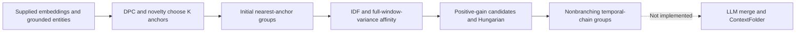
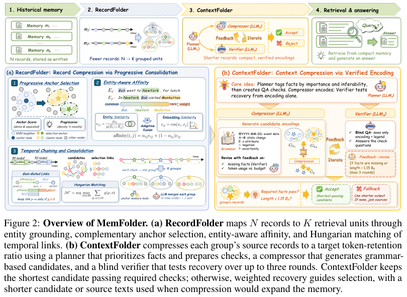

# MemFolder: Structure-Guided Memory Folding for Efficient Agent Memory Management

<!-- source-sha256: d734549ed4d09f71761fbb06873671b0677c35cd80f31b200c16d77ec4e4b392 -->

[简体中文](README.md)

> `component_only` / L1 CPU mechanism diagnostic, not capability reproduction or executable Evolve integration. This is an overlap addition first released November19 and announced November20, not a new November21 paper. High-cost full experiments are not reproduced (review DONE).

## Paper information

| Field | Value |
| --- | --- |
| Paper | [Fixed v1](https://arxiv.org/abs/2611.26427v1) |
| First author and affiliation | Xuyang Liu; Sichuan University |
| Original publication | 2026-11-19 17:05:55 UTC; announcement2026-11-20 |
| Original source code | Yes: [fixed author repository commit](https://github.com/xuyang-liu16/MemFolder/tree/4226577050b468f60ec273f2199b61e20a19efbd). The repository API reports no recognized license; MIT is not invented. |
| Local adapter / key | No full adapter (`adapter: null`); component `memfolder` |
| Local code | `src/auto_research/agent_research/memfolder.py`; tests `tests/test_nov21_memfolder.py` |

## Original paper summary

### Background and changes

MemFolder treats record count and retrieved-context length separately. RecordFolder grounds entities with an LLM, selects a density-peak first anchor and progressively chooses complementary anchors through novelty relative to those already selected. Semantic/entity affinity and temporal chains refine groups before chronological LLM consolidation. ContextFolder reuses groups, encodes facts under importance and token-ratio constraints, and tests recoverability with a blind reader that cannot see source records or expected answers. Grouping is not summary generation, and verification is not a losslessness guarantee.

Entity weights are log(N/df), so an entity common to every record can have zero weight. Shared entity mass and both signal variances adaptively mix weighted Jaccard with cosine. Variances are computed over every earlier/later pair in the W-window before positive-gain filtering and the d-edge-per-successor cap. Gain is measured against the successor's initial-anchor cosine. Hungarian matching maximizes total gain with at most one incoming and outgoing edge, and no incoming anchor edge. Thus links form forward nonbranching chains: anchored chains stay together, anchor-free chains choose the maximum summed cosine group, and unmatched records retain their initial group.

### Architecture



### Key original figure

[](https://arxiv.org/pdf/2611.26427v1#page=5)

Figure2 and original caption from fixed-v1 PDF page5; copyright belongs to the original authors. Only unrelated text/whitespace is cropped; scientific content is unchanged. [Source](https://arxiv.org/pdf/2611.26427v1#page=5) and [crop/SHA256 provenance](assets/provenance.json). This illustrates the author's method, not local evidence.

### Core equations

$$
w(e)=\log\frac{N}{\operatorname{df}(e)},\quad e_{ij}=\frac{\mu(E_i\cap E_j)}{\mu(E_i\cup E_j)},\quad \alpha_{ij}=\frac{\mu_{ij}\sigma_c^2}{\mu_{ij}\sigma_c^2+\sigma_e^2},\quad g(p,s)=\alpha_{ps}e_{ps}+(1-\alpha_{ps})c_{ps}-c_{s,a_0(s)}.
$$

### Reported offline and online results

In Table1,50% fewer records on Mem0 yield a three-text-benchmark average of60.5 versus61.1 uncompressed, or99.0% quality retention. That99.0% is not answer accuracy. MemForest retains97.1% under the same ratio, a1.9-percentage-point retention difference. Further author evaluations cover MemOS and M3-Bench web/robot. These are offline paper results, not local measurements; no production A/B is reported.

## Local reproduction and limits

### Data protocol and code mapping

The local RecordFolder grouping kernel consumes explicit embeddings and grounded entity sets: normalization, DPC/novelty anchors, full-window variances, IDF affinity, positive-gain candidates, actual SciPy Hungarian matching and chain reassignment. Inputs must be chronological and contain at most512 records. Population variance with ddof0,Python rounding,input-order ties and anchors pinned to their own groups under duplicate embeddings are explicit deterministic conventions where the paper leaves details open. There is no LLM entity extraction, alias merging,text consolidation,ContextFolder,embedding model or downstream QA. Callers supply grounded labels and chronological order; lexical Jaccard is not substituted for semantic embeddings. No paths or Codex conversations are read, and no user files are automatically removed or compressed.

```bash
PYTHONPATH=src python -c 'from auto_research.agent_research.memfolder import diagnostic; print(diagnostic(42))'
PYTHONPATH=src python -m pytest tests/test_nov21_memfolder.py -q
```

Only explicit synthetic control inputs are used. No capability benchmark is loaded and no hyperparameters are selected on test data. After the batch source freeze, the shared runner writes [three-seed CPU diagnostics](metrics/component-cpu-seeds42-44.json). Three seeds do not promote L1 evidence or constitute independent model training.

### Same-topic comparison and limits

Reviewed against [agent-research:memforest](../2609.08273-memforest/README-en.md): MemForest builds event-level maximum-spanning trees and progressively merges nodes, retrieving temporal neighbors through anchor-guided propagation. MemFolder first fixes target groups using global complementary anchors,then refines them through entity/semantic gains and Hungarian nonbranching chains,and adds a separate ContextFolder encoding layer. Both preserve structure,but a hierarchy is not a one-in/one-out chain. Local MemForest approximates semantics through lexical overlap while local MemFolder takes supplied embeddings; their unit-test numbers cannot establish a memory-quality winner.

Controls assign every record once,preserve K nonempty groups under duplicate embeddings,handle N1,reduce to cosine for universally common entities,and estimate window variance before filtering. Links must point forward,avoid incoming anchor edges and be nonbranching. A supplied-matrix unit test distinguishes greedy gain0.9 from Hungarian gain1.6; it is not memory accuracy. Verification can misjudge source facts, and the paper's fallback may choose a shorter candidate missing required facts, so ContextFolder must not be described as lossless storage.

### High-cost full experiments

The full study runs on twoA100-80GBs with GPT-4o-mini extraction/merging/judging,GPT-4o multimodal evaluation,OpenAI embeddings,multiple memory frameworks and five text/multimodal evaluation settings repeated three times. Rebuilding the stores and API matrix exceeds this batch's single-A100/A30 or Mac component budget. Full experiments are not reproduced: no data/weight downloads or paid calls are launched. Only small CPU grouping matrices execute. **Too costly; not reproduced (review DONE).** This is a terminal decision, not an automatic retry or implementation queue. Passing the cheap slice does not reproduce the full paper.
