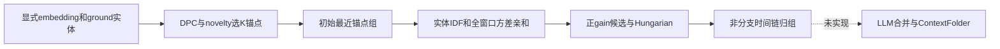
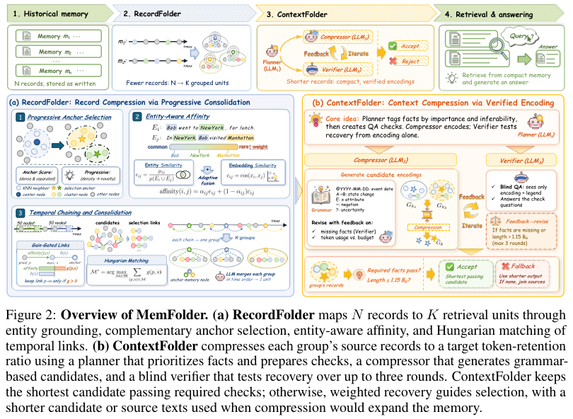

# MemFolder：用互补锚点和非分支时间链减少检索单元

> `component_only` / L1 CPU机制组件，`diagnostic_only=true`。这是11月19日首发、11月20日公告的重叠池补漏，不算11月21日新论文。高成本完整实验不复现（审查 DONE），不是能力复现或已接入Evolve。

## 论文信息

| 字段 | 内容 |
| --- | --- |
| 论文链接 | [MemFolder: Structure-Guided Memory Folding for Efficient Agent Memory Management](https://arxiv.org/abs/2611.26427v1)，本轮固定v1 |
| 公司/机构/学校 | 一作Xuyang Liu；Sichuan University |
| 首次公开日期 | 2026-11-19 17:05:55 UTC，arXiv v1；公告日期2026-11-20 |
| 原作者开源代码 | 是：[原作者固定仓库提交](https://github.com/xuyang-liu16/MemFolder/tree/4226577050b468f60ec273f2199b61e20a19efbd)；仓库API未识别明确许可证，不擅自标注MIT。 |
| 本地 Adapter / 方法 | 无完整adapter（`adapter: null`）；组件key `memfolder` |
| 本地复现代码 | `src/auto_research/agent_research/memfolder.py`；测试 `tests/test_nov21_memfolder.py` |

## 原始论文总结

### 背景与主要改动

MemFolder把记录数和取回上下文长度分开处理。RecordFolder先用LLM统一实体，再以密度峰选首锚点、以相对已有锚点的novelty渐进选互补锚点；语义/实体亲和与时间链修正分组，最后由LLM按时间合并。ContextFolder沿用这些分组，按事实重要性和token比例编码，通过看不到源记录和预期答案的blind reader检查可恢复性。分组不是摘要生成，校验也不是无损保证。

实体权重为log(N/df)，共有的实体权重可为0；weighted Jaccard与cosine按共享实体质量和两种信号方差自适应混合。方差先在整个W窗口的前后记录对上计算，再筛正gain和每后继最多d条候选边；gain相对的是后继与初始锚点的cosine。Hungarian最大化总gain，各节点最多一入一出，锚点不可有入边，所以没有分叉或时间环。有锚点的链留在该组，无锚点链按整链cosine总和选组，未匹配项保留原分组。



<!-- paper-figure:start -->
### 原论文关键图

[](https://arxiv.org/pdf/2611.26427v1#page=5)

图片来自[原论文](https://arxiv.org/pdf/2611.26427v1#page=5)固定v1第5页Figure 2及原始图注，版权归原作者所有；仅裁去无关正文/留白，科学内容未修改。[来源与裁剪SHA256](assets/provenance.json)。这是作者方法图，不是本地实验。
<!-- paper-figure:end -->

### 核心公式

$$
w(e)=\log\frac{N}{\operatorname{df}(e)},\quad e_{ij}=\frac{\mu(E_i\cap E_j)}{\mu(E_i\cup E_j)},\quad \alpha_{ij}=\frac{\mu_{ij}\sigma_c^2}{\mu_{ij}\sigma_c^2+\sigma_e^2},\quad g(p,s)=\alpha_{ps}e_{ps}+(1-\alpha_{ps})c_{ps}-c_{s,a_0(s)}.
$$

### 论文离线与线上效果

Table1在Mem0上减少50%记录后，三个文本benchmark平均60.5，相对未压缩61.1保留99.0%；99.0%是质量保留比，不是答题准确率99%。MemForest同口径保留97.1%，相差1.9个百分点的保留率。原文还有MemOS和M3-Bench web/robot；这些离线作者结果不是本地测试分数，未报告生产线上A/B。

## 本地复现与边界

### 数据协议与代码映射

本地实现显式embedding和已ground实体集合上的RecordFolder分组核，包括归一化、DPC/novelty锚点、全窗口方差、IDF亲和、正gain候选、SciPy真正Hungarian和链级重新归组；仅接收按时间排序的输入，最多512条。用总体方差ddof=0、Python round、相同分数按输入顺序、重复embedding的锚点固定保留本组，是论文未完全指定时公开的确定性约定。没有LLM实体提取、实体别名合并、文本合并、ContextFolder、embedding模型或下游问答；调用方负责提供已ground标签和时间顺序，不用词项Jaccard冒充语义embedding。不接收文件路径，不读取Codex会话，也不自动删除或压缩用户文件。

```bash
PYTHONPATH=src python -c 'from auto_research.agent_research.memfolder import diagnostic; print(diagnostic(42))'
PYTHONPATH=src python -m pytest tests/test_nov21_memfolder.py -q
```

本轮只用显式合成控制输入，不加载公开能力benchmark，不存在据test选超参的流程。批次冻结源码后的统一runner生成[42/43/44三种子CPU诊断](metrics/component-cpu-seeds42-44.json)，三种子不改变L1层级，也不是三个独立模型训练。

### 同主题比较与边界

与[agent-research:memforest](../2609.08273-memforest/README.md)对照：MemForest按事件构建最大生成树并渐进合并，检索时从anchor传播到时间邻域；MemFolder先以全局互补锚点确定目标组数，再用实体/语义gain和Hungarian非分支时间链修正组，并另加独立的ContextFolder编码层。二者都保留结构，但树形层次与一入一出的链不等价。现有本地MemForest用词项重叠近似语义，本地MemFolder只收显式embedding，因此不能凭两者单测数值宣称谁的模型记忆更好。

负控包括全记录恰好分配一次、重复embedding仍保留K个非空组、N=1、所有实体共有时退化为cosine、在筛边前计算窗口方差、时间边向前且锚点无入边、每节点最多一入一出，以及一个greedy得0.9而Hungarian得1.6的显式矩阵单测。后者仅是组合优化单测，不是记忆准确率。上下文验证可能误判源事实，且原文回退可选择缺失required facts的较短候选，不能把ContextFolder宣传为无损存储。

### 高成本完整实验

完整研究在两张A100-80GB上运行，涉及GPT-4o-mini实体抽取/合并/评审、GPT-4o多模态评测、OpenAI embedding、多个记忆框架和5个文本/多模态评测设置、每项3轮。真实重建与API矩阵明显超出本轮单A100/A30或Mac的小型组件预算，直接不复现、不下载数据或权重、不发起收费调用；只运行小矩阵CPU分组。 **成本过高，不复现（审查 DONE）。** 完整实验是已终态的成本决定，不进入自动重试或实现队列；便宜组件通过不等于完整论文已被复现。
