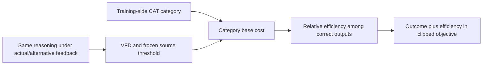
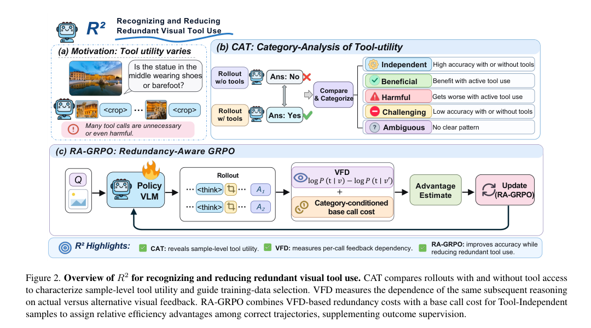

# $R^2$: Recognizing and Reducing Redundant Visual Tool Use

<!-- source-sha256: d754223f4b1880edaf1ef42a819661c828054b444bd408b2ea83d0527a937fe9 -->

[简体中文](README.md)

> `component_only` / L1 CPU formula/scheduling diagnostics, `diagnostic_only=true`. Not agent-capability reproduction or Evolve integration. First released2026-11-20,discovered/reviewed2026-11-23;not a Nov23 first release.

## Paper information

| Field | Value |
| --- | --- |
| Paper | [Fixed arXiv v1](https://arxiv.org/abs/2611.27070v1) |
| Company/institution | First authorYilin Zhao;Tsinghua University |
| Original publication | 2026-11-20 03:38:36 UTC;current update has the same timestamp,no separate revision |
| Announcement/discovery | Identity absent from this batch's announcement pool;announcement date unverified.Discovered/reviewed through official arXiv metadata on2026-11-23 |
| Author source code | No verified paper-specific method source link was found in fixed-v1 text or TeX. Referenced open models and training frameworks are not a release of this method. |
| Local adapter/key | `adapter: null`;CPU component key `r2-tool-redundancy` |
| Local reproduction code | `src/auto_research/agent_research/r2_tool_redundancy.py`; tests `tests/test_nov23_r2_tool_redundancy.py` |

## Original paper summary

### Background and changes

R² separates sample-level tool utility(CAT), the additional likelihood support an observation supplies to the same subsequent reasoning window(VFD), and efficiency comparisons among correct trajectories(RA-GRPO). CAT uses training-side tool/no-tool rollouts and actual invocations, not question-length or keyword heuristics. VFD is neither a gold-answer score nor a causal proof that a call is necessary.

VFD replaces only the current feedback while retaining the source image, other history and scored reasoning tokens. It subtracts mean log probability under three same-sized nonoverlapping random crops from that under actual feedback. During the first10%of training, source-specific30th-percentile thresholds use reasoning windows only, then freeze. Direct-answer windows may be scored later but cannot initialize thresholds. One uniformly sampled eligible call estimates the redundant count byMtimes its indicator; unavailable scores with complete records set the indicator to1, and empty eligible sets cost0. Tool-Independent adds0.5times all calls. Efficiency advantages are centered only among correct trajectories, divided by fixed call budget4, and added with weight0.2 to outcome advantages. Cheap failures receive no efficiency reward.

### Architecture



### Key original figure

[](https://arxiv.org/pdf/2611.27070v1#page=4)

Figure 2with its complete caption comes from fixed-v1 PDF page4;copyright belongs to the original authors.Only unrelated text/whitespace is cropped,with scientific content unchanged.Visually reviewed.[Source](https://arxiv.org/pdf/2611.27070v1#page=4) and [PDF/crop SHA256 provenance](assets/provenance.json).The image is not local evidence.

### Core equations

$$
d=\ell(u\mid h,v)-\frac1J\sum_j\ell(u\mid h,\tilde v^{(j)}),\quad C_i=M_i z_i+K\mathbf1[c(x)=\mathrm{Independent}]N_i,\quad A_i=A_i^{out}+\beta\mathbf1[r_i=1]\frac{\bar C^+-C_i}{B}.
$$

### Reported offline and online results

Across seven visual benchmarks, the paper reports1.13to0.99mean calls versus Vanilla GRPO(12.39%fewer), benchmark macro accuracy67.98to68.13and a3.35-point category-macro gain, with at most four calls per question. Accuracy does not improve on every benchmark: HR-4K,HR-8KandV-starBench decline versus Vanilla GRPO. An additional CoF-SFT experiment learns to avoid tools entirely; the authors stop further tool analysis there. Fewer calls alone do not establish tool-use capability. Results are offline, with no production A/B.

## Local reproduction and limits

### Data protocol and code mapping

The CPU NumPy slice computes same-text token-log-probability VFD, reasoning-only source-frozen thresholds, one-eligible-call redundancy estimation and category base costs, sample-SD outcome advantages, correct-only efficiency terms and a clipped GRPO scalar. Linear quantile interpolation and mean-valid-tokens-per-trajectory then group averaging are explicit local conventions, not bitwise equivalence to an unreleased trainer. Callers must supply aligned reasoning windows, valid crops and complete records; arrays cannot establish those semantics. No VLM, crop construction/scoring, CAT rollout labeling, images, policy backprop/update or visual-agent evaluation runs. Finite differences check a scalar derivative, not training. There is no gold-answer/plan interface;binary rewards are external trainer/evaluator inputs.

```bash
PYTHONPATH=src python -c 'from auto_research.agent_research.r2_tool_redundancy import diagnostic; print(diagnostic(42))'
PYTHONPATH=src python -m pytest tests/test_nov23_r2_tool_redundancy.py -q
```

After source freeze,the shared runner records [seed42/43/44 CPU mechanism results](metrics/component-cpu-seeds42-44.json). Inputs are explicit synthetic controls,with no capability benchmark or test-based tuning. Three seeds are not three trained models and do not upgrade L1 evidence.

### Same-topic comparison and limits

Reviewed against [agent-research:adastep](../2610.03223-adastep/README-en.md):AdaStep weights local credit by between-action return variance relative to within-action noise at a shared anchor state. R² estimates dependence on a current visual observation and relativizes costs only within the correct set. Both supplement outcome rewards, but explained variance is not observation necessity, and VFD does not estimate stochastic return noise. AdaStep weights cannot substitute for VFD, nor may R² efficiency reward failures. Both local slices are statistical/numerical components rather than comparable agent-capability evaluations.

Controls cover zero VFD for identical feedback scores, exclusion of answer windows from calibration, rejection of missing-source warmup, strict threshold inequality, unavailable-score versus empty-eligible behavior, one-call sampling rather than full counting, zero efficiency terms for failures, zero-sum correct-set efficiency, all-wrong/single-correct/equal-cost cases, negative-advantage clipping, padding exclusion and intermediate-overflow rejection. Three seeds of numerical controls do not establish tool-efficiency or accuracy gains.

### High-cost full experiments

The paper uses Qwen3-VL-8B-Instruct,3254examples,406steps,eight questions by eight trajectories per step,8192output tokens and up to20480training context tokens. Eight H100s for about13hours total about104H100GPU-hours, before CAT construction, repeated VFD scoring and seven-benchmark evaluation. This clearly exceeds oneA100/A30or a Mac. Full visual RL/evaluation is not reproduced, with no weight/image downloads or trial runs; only small CPU explicit-array controls execute, estimated in seconds pending runner timing. **Too costly;not reproduced(review DONE).** This is a terminal cost decision,not an automatic retry/implementation queue.Passing a cheap component does not reproduce the full paper.

### Source review

Fixed-v1 PDF SHA256:`58e172716fdb16f089b11b856ca8a7e35ad97552491237ba548851e4fba083d6`.Reviewed locations:§3.1 CAT; §3.2 Eq.1-10; Appendix C.1 Tables9-10; Appendix C.3 Table12; Appendix E all-tool-avoidance caveat.This is a finite incremental selection.It does not move the global Nov15 review watermark or claim exhaustive Google/Meta/Agent coverage.
