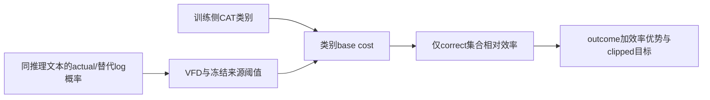
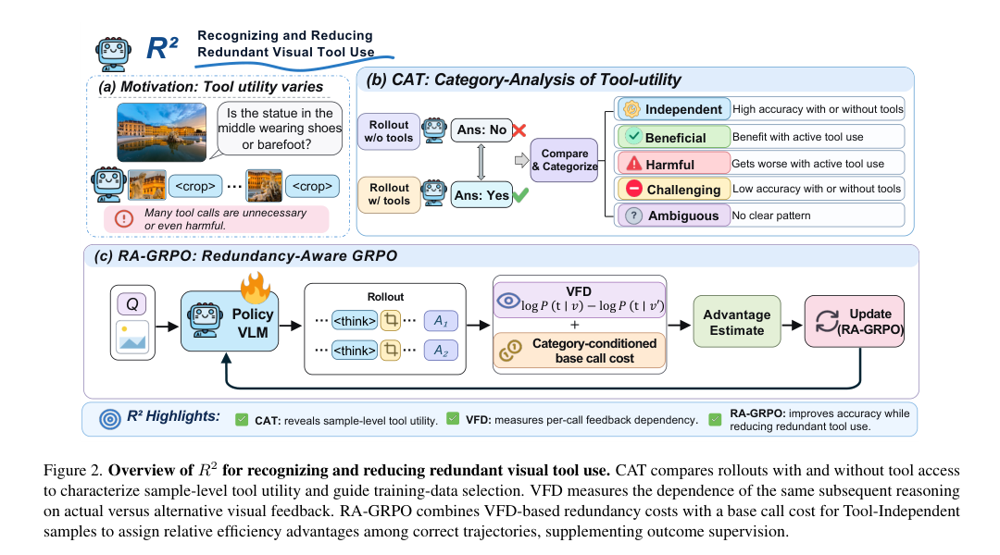

# R²：把视觉反馈依赖变成正确轨迹内的效率优势

[English](README-en.md)

> `component_only` / L1 CPU公式与调度诊断，`diagnostic_only=true`。不是Agent能力复现或Evolve集成。 首发为2026-11-20，发现/审查为2026-11-23，不称11月23日新首发。

## 论文信息

| 字段 | 内容 |
| --- | --- |
| 论文链接 | [$R^2$: Recognizing and Reducing Redundant Visual Tool Use](https://arxiv.org/abs/2611.27070v1)，固定v1 |
| 公司/机构/学校 | 一作Yilin Zhao；Tsinghua University |
| 首次公开日期 | 2026-11-20 03:38:36 UTC，arXiv v1；当前修订同日同时间，没有另一次修订 |
| 公告/发现日期 | 本轮公告池未含此身份，公告日未核实；2026-11-23从官方arXiv元数据发现并审查 |
| 原作者开源代码 | 固定v1正文与TeX未找到本篇方法专属的已核实公开源码链接；文中其他开源VLM/训练框架不等于本方法开源。 |
| 本地 Adapter / 方法 | `adapter: null`；CPU组件key `r2-tool-redundancy` |
| 本地复现代码目录 | `src/auto_research/agent_research/r2_tool_redundancy.py`；测试 `tests/test_nov23_r2_tool_redundancy.py` |

## 原始论文总结

### 背景与主要改动

R²把三个问题分开：CAT描述题目是否可能从工具获益；VFD描述一次返回观察对后续同一段推理文本提供多少额外似然支持；RA-GRPO在答对的轨迹之间比较工具效率，而不是奖励所有少调用的轨迹。CAT标签来自训练侧tool/no-tool rollouts的多次正确性和实际调用，不是根据问题长度或关键词猜测；VFD也不是gold-answer概率或“这次工具有用”的因果证明。

VFD仅替换当前调用的视觉反馈，保留原图、其他历史与待评分推理tokens；实际反馈的平均log概率减去3个同尺寸不重叠随机crop的平均。前10%训练步按来源、只用reasoning windows估计30%分位阈值，之后冻结；直接答案window可在监督时用，但不参与初始化。每轨迹均匀抽一个eligible call，以M×冗余指示量估计全部eligible冗余数，完整记录但score缺失时指示量设1，空eligible集为0。Tool-Independent另加0.5×全部调用数。效率优势只在同题答对轨迹内居中、除固定调用预算4，再以0.2加到outcome优势；不能把失败少调用当高效率成功。



<!-- paper-figure:start -->
### 原论文关键图

[](https://arxiv.org/pdf/2611.27070v1#page=4)

图片来自[原论文](https://arxiv.org/pdf/2611.27070v1#page=4)第4页Figure 2与完整图注，版权归原作者所有。仅裁掉无关正文和留白，科学内容未修改；已目视核对。[源PDF/裁剪SHA256与坐标](assets/provenance.json)。原图不是本地实验。
<!-- paper-figure:end -->

### 核心公式

$$
d=\ell(u\mid h,v)-\frac1J\sum_j\ell(u\mid h,\tilde v^{(j)}),\quad C_i=M_i z_i+K\mathbf1[c(x)=\mathrm{Independent}]N_i,\quad A_i=A_i^{out}+\beta\mathbf1[r_i=1]\frac{\bar C^+-C_i}{B}.
$$

### 论文离线与线上效果

作者在7个视觉benchmark上，RA-GRPO相对Vanilla GRPO平均调用从1.13降到0.99（12.39%），benchmark宏平均准确率67.98→68.13，类别宏平均提升3.35个百分点；每题最多4次工具调用。不是每个benchmark都涨：HR-4K、HR-8K、V⋆Bench相对Vanilla GRPO准确率下降。CoF-SFT附加实验最后完全不调用工具，作者停止对其做进一步工具分析；不能把少调用直接当会用工具。均为离线论文结果，未报告生产线上A/B。

## 本地复现与边界

### 数据协议与代码映射

CPU NumPy组件只执行同文本token log概率的VFD差、reasoning-only分来源冻结阈值、单eligible-call无偏冗余估计和类别base cost、sample-SD outcome advantage、仅正确轨迹效率项及clipped GRPO标量目标。分位数采用线性插值、目标按每轨迹有效token均值再组平均，是公开的数值约定；不宣称与未公开trainer逐位相等。调用方必须已保证同一推理window、有效crop与完整记录；数组不能证明这些语义。没有VLM、crop构造/评分、CAT rollout标注、图像数据、policy反传/更新或视觉Agent评测；数值差分只检验标量目标导数，不是训练。没有gold答案/计划接口，reward为外部trainer/evaluator给定的0/1标量。

```bash
PYTHONPATH=src python -c 'from auto_research.agent_research.r2_tool_redundancy import diagnostic; print(diagnostic(42))'
PYTHONPATH=src python -m pytest tests/test_nov23_r2_tool_redundancy.py -q
```

冻结源码后由统一runner记录[42/43/44三seed CPU机制结果](metrics/component-cpu-seeds42-44.json)。输入是显式合成控制，不加载能力benchmark、不据test选参数。三seed不是三次模型训练，不提升L1证据等级。

### 同主题比较与边界

与已读旧代表[agent-research:adastep](../2610.03223-adastep/README.md)对照：AdaStep看同锚状态下动作间回报方差相对动作内噪声，调节局部信用可靠性；R²看当前视觉反馈对同一后续推理的依赖，并把成本只在correct集合内相对化。它们都补充终局奖励，但方差解释率不是观察必要性，VFD也不衡量动作内随机回报噪声。不能把AdaStep的权重直接当VFD，或把R²效率项施加给失败轨迹。本地两者都是统计/数值组件，不能比较其Agent能力。

负控包括actual与alternative相同时VFD为0、阈值不吸收答案window、来源缺warmup拒绝、d恰好等于阈值不判冗余、None与空eligible区分、抽一个调用而非逐个累加、失败轨迹效率项严格为0、correct集合内效率项和为0、全错/单个correct/相同cost时效率为0、负优势裁剪方向、padding无贡献与中间溢出拒绝。三seed的数值控制不支持工具效率或准确率提升结论。

### 高成本完整实验

原文Qwen3-VL-8B-Instruct、3254训练例、406步、每步8题×8轨迹、8192输出tokens、最大20480训练context；8张H100约13小时，即约104 H100 GPU小时，另含CAT数据构建、多次VFD评分及7个benchmark。对单A100/A30或Mac明显高成本，完整视觉RL与评测直接不复现，不下载权重/图像、不试跑；只运行秒级CPU显式数组核（预估，实测看runner）。 **成本过高，不复现（审查 DONE）。** 完整实验是终态成本决定，不进入自动重试/实现队列，不因便宜组件通过而升级为完整论文复现。

### 来源核对

固定v1 PDF SHA256：`58e172716fdb16f089b11b856ca8a7e35ad97552491237ba548851e4fba083d6`。核对位置：§3.1 CAT；§3.2 Eq.1-10；Appendix C.1 Tables9-10；Appendix C.3 Table12；Appendix E all-tool-avoidance caveat。本页是有限增量选题，不推进全库11月15日审查水位，也不宣称Google/Meta或全部Agent文献已穷尽。
