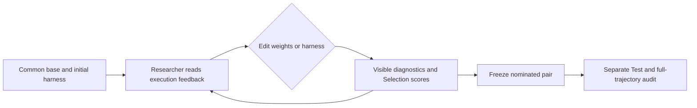
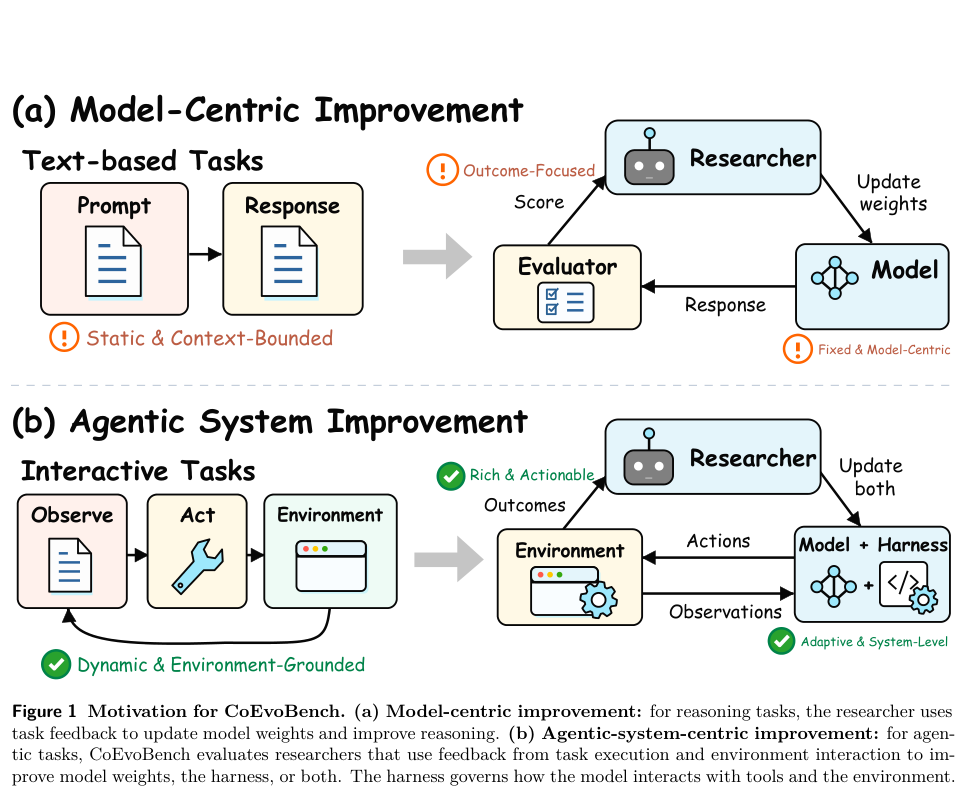

# CoEvoBench: Can LLMs Drive Recursive Co-Evolution of Agentic Systems?

<!-- source-sha256: 46cfd36b03e74f4dcb83e7a643df67b536c616cf039013f14378b7d9cee1ac99 -->

[简体中文](README.md)

> `deferred_high_cost` / review-only, not implemented or run. Too costly; not reproduced (review DONE). First released2026-11-20,discovered/reviewed2026-11-23;not a Nov23 first release.

## Paper information

| Field | Value |
| --- | --- |
| Paper | [Fixed arXiv v1](https://arxiv.org/abs/2611.27116v1) |
| Company/institution | First authorChuan Xiao;Zhejiang University / Alibaba Group / Shanghai Jiao Tong University |
| Original publication | 2026-11-20 04:40:59 UTC;current update has the same timestamp,no separate revision |
| Announcement/discovery | Identity absent from this batch's announcement pool;announcement date unverified.Discovered/reviewed through official arXiv metadata on2026-11-23 |
| Author source code | Yes: [fixed AlibabaResearch commit](https://github.com/AlibabaResearch/CoEvoBench/tree/d39a924c8985806933c94777d8e969d6e756262c),MIT. Its README also discloses acceptance/integrity gaps in current images and final-scoring interfaces; release is not local end-to-end validation. |
| Local adapter/key | `adapter: null`;review-only key `coevobench` |
| Local reproduction code | None: review-only; no reproduction-code directory or adapter was created |

## Original paper summary

### Background and changes

CoEvoBench is a benchmark of autonomous model-harness co-development, not another fixed evolution algorithm. A target system is(theta,H), starting from common base weights and a domain-specific initial harness. The LLM researcher may inspect executions, construct training data/update weights, and edit tools/control logic. A nominated frozen pair is evaluated on separate Test tasks. The question is whether feedback changes the next intervention and final choice, not whether a researcher merely completes diagnosis/training/code-editing stages.

Five domains cover SWE-bench Verified,TB-Lite,AppWorld,Telecom,and BFCL multi-turn/memory. Visible exposes tasks/traces;Selection returns aggregate scores without task contents/traces;Test is operator-only. Each run gets24hours,fourH20s and a100-dollar teacher allowance. Weights and harness are coupled, so their gains are not additive independent contributions. The main rule resets confirmed-violation runs to base weights while retaining their final harness; a stricter alternative resets the whole system. Among759B runs,22confirmed violations all accessed prohibited data and six trained on it. Full data-lineage audits remain essential; intended isolation is not proof that leakage never occurred.

### Architecture

### Key original figure

Figure 1with its complete caption comes from fixed-v1 PDF page2;copyright belongs to the original authors.Only unrelated text/whitespace is cropped,with scientific content unchanged.Visually reviewed.[Source](https://arxiv.org/pdf/2611.27116v1#page=2) and [PDF/crop SHA256 provenance](assets/provenance.json).The image is not local evidence.

### Core equations

$$
S=(\theta,H),\quad a_t\sim R(\cdot\mid\mathcal T_t),\quad\mathcal T_{t+1}=\mathcal T_t\oplus(a_t,o_{t+1}),\quad J_b(R)=\widehat{\mathcal E}_b(S_b^\star)-\mathcal E_b(S_b^{(0)}).
$$

### Reported offline and online results

For the9B target,weighted Test scores are1.09forBase,31.23for the strongest researcher,and37.42for the instruction-tuned reference. Weights normalize inverse reference-minus-base gaps rather than taking an ordinary five-domain mean. In25of28reviewed improving runs without audit issues,the first candidate supplies the largest single gain. Strong coding submissions often use base weights plus an improved harness;training pays off more often on interaction tasks. These are author results,not unbounded RSI or local measurements.No production A/B is reported.

## Local reproduction and limits

### Data protocol and code mapping

Local delivery is review-only: fixed-v1/code metadata,split/audit/cost contracts and a same-topic comparison.No algorithm module,executable adapter,training,researcher API call or benchmark trial is created.The upstream no-GPU toy researcher is explicitly a lifecycle fixture,not an autonomous researcher.Running it cannot reproduce this paper's capability or justify an Evolve operator.A completed high-cost review requires no invented seed metrics or GPU receipt.

There is no local execution command or capability metric. The terminal review-only cost decision needs no invented metrics or GPU validation.

### Same-topic comparison and limits

Reviewed against [agent-research:sage-evolve](../2611.26132-sage-evolve/README-en.md):Sage-Evolve is a specific strategy that keeps an anchor while changing active observations to expose training gaps.CoEvoBench instead fixes development/Selection/Test contracts,lets the evaluated researcher decide whether to edit weights or harness,and scores the nominated system.Changing observations is not changing final graders,and access to two levers does not make fixed alternation successful co-evolution.Both require evidence beyond visible training performance.The local Sage slice is a CPU control kernel and CoEvo is review-only;neither supplies comparable agent gains.

The review preserves both audit scoring rules and does not treat resetting weights as a formal proof that every consequence of prohibited access disappears.Visible-set overfitting and model-harness mismatch are author analyses,not locally measured controls.Repository acceptance status is distinct from paper-reported experiments.No local capability result or automatic implementation/retry queue is created.

### High-cost full experiments

Each development run is budgeted up to4H20s for24hours(96H20GPU-hours),plus100dollars for a teacher;these are protocol limits,not local measurements.The full matrix spans five researchers,five domains,three runs and two target families(Qwen3.5-9B-Base/MiniCPM5-2B-Base),with container/environment building,training,serving and isolated final evaluation.A2B model fitting oneA100/A30does not make long rollouts and the multi-arm research campaign cheap or equivalent.With oneA100/A30or a Mac available,the full study is terminally not reproduced.No checkpoints/large data,Docker/GPU,toy cost probes,teacher or researcher calls are launched. **Too costly;not reproduced(review DONE).** This is a terminal cost decision,not an automatic retry/implementation queue.Passing a cheap component does not reproduce the full paper.

### Source review

Fixed-v1 PDF SHA256:`7555e5f8f2041a7ea2fa8904643a73ab21f986f5685b12fafefd9451fd8a45b8`.Reviewed locations:§3.1-3.4 Eq.1-7; §4 Table1; §5 model-harness coupling; Appendix11 resources; Appendix19 audit; fixed upstream README no-GPU smoke caveat.This is a finite incremental selection.It does not move the global Nov15 review watermark or claim exhaustive Google/Meta/Agent coverage.
