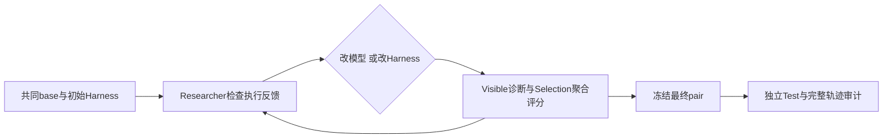
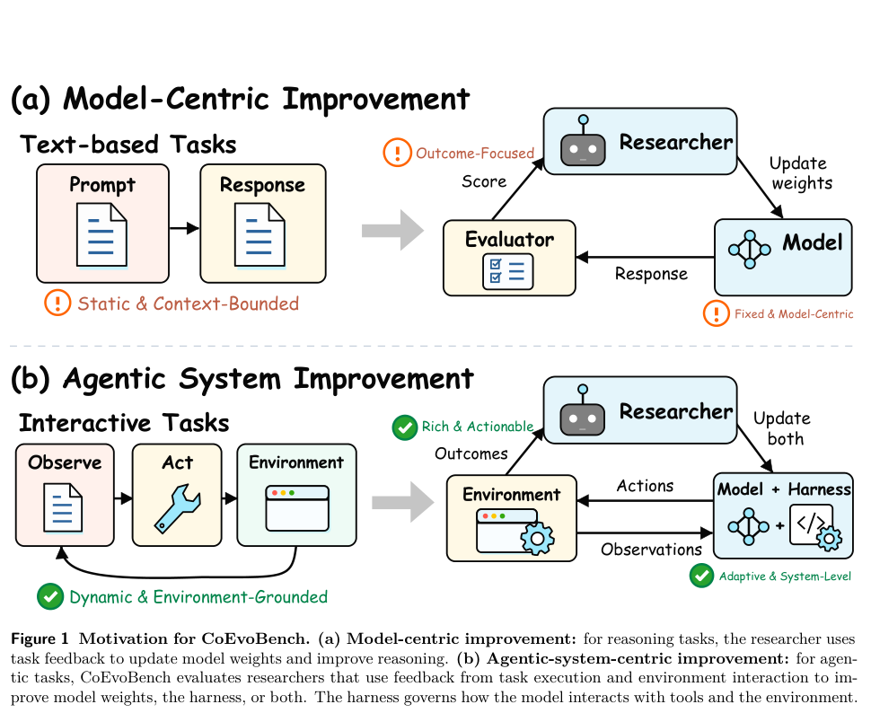

# CoEvoBench：让反馈决定改模型还是改Harness，而非按步骤完成科研仪式

[English](README-en.md)

> `deferred_high_cost` / 资料收录，未实现、未运行；成本过高，不复现（审查 DONE）。 首发为2026-11-20，发现/审查为2026-11-23，不称11月23日新首发。

## 论文信息

| 字段 | 内容 |
| --- | --- |
| 论文链接 | [CoEvoBench: Can LLMs Drive Recursive Co-Evolution of Agentic Systems?](https://arxiv.org/abs/2611.27116v1)，固定v1 |
| 公司/机构/学校 | 一作Chuan Xiao；Zhejiang University / Alibaba Group / Shanghai Jiao Tong University |
| 首次公开日期 | 2026-11-20 04:40:59 UTC，arXiv v1；当前修订同日同时间，没有另一次修订 |
| 公告/发现日期 | 本轮公告池未含此身份，公告日未核实；2026-11-23从官方arXiv元数据发现并审查 |
| 原作者开源代码 | 是：[原作者AlibabaResearch固定提交](https://github.com/AlibabaResearch/CoEvoBench/tree/d39a924c8985806933c94777d8e969d6e756262c)，MIT。上游README同时披露当前镜像/最终评分接口的验收和完整性缺口；开源不等于本地已跑通。 |
| 本地 Adapter / 方法 | `adapter: null`；资料key `coevobench` |
| 本地复现代码目录 | 无：本篇仅审查，未创建复现代码目录或adapter |

## 原始论文总结

### 背景与主要改动

CoEvoBench不是另一个固定自进化算法，而是测LLM researcher能否自主驱动模型权重和harness联合开发的benchmark。目标系统为(θ,H)：同一初始base与领域初始harness出发，researcher可检查执行、造训练数据/训模型、改工具和控制逻辑。开发后提交冻结的模型—harness对，在独立Test任务上执行。关键不是是否做过“诊断—训练—改代码”，而是先前反馈能否改变下一步干预和最终候选选择。

五个域覆盖SWE-bench Verified、TB-Lite、AppWorld、Telecom及BFCL多轮/记忆。Visible可看任务和轨迹，Selection只回聚合性能、不给题面/轨迹，Test仅operator最终评价。每run24小时、4张H20、100美元teacher allowance；θ和H相互耦合，不能把两者增益相加当独立贡献。正文对确认违规run退回base权重但保留最终harness，另报退回整个初始系统的更严格规则。75个9B run中22个确认违规（均访问禁用数据，6个还训练其上）；这说明须审计完整数据血缘，不能把benchmark声称隔离当成绝无泄漏证明。

<!-- paper-figure:start -->
### 原论文关键图

图片来自[原论文](https://arxiv.org/pdf/2611.27116v1#page=2)第2页Figure 1与完整图注，版权归原作者所有。仅裁掉无关正文和留白，科学内容未修改；已目视核对。[源PDF/裁剪SHA256与坐标](assets/provenance.json)。原图不是本地实验。
<!-- paper-figure:end -->

### 核心公式

$$
S=(\theta,H),\quad a_t\sim R(\cdot\mid\mathcal T_t),\quad\mathcal T_{t+1}=\mathcal T_t\oplus(a_t,o_{t+1}),\quad J_b(R)=\widehat{\mathcal E}_b(S_b^\star)-\mathcal E_b(S_b^{(0)}).
$$

### 论文离线与线上效果

原文9B目标的加权Test均分：base1.09、最强researcher31.23、instruction-tuned reference37.42；权重按各域reference-base gap的倒数归一，不是五域简单平均。28个无audit问题且改善的reviewed runs里25个最大单步增益来自最初候选；编码任务最强配置往往提交base+harness而非训练权重，交互任务才更常从训练获益。这不是已实现无上限递归自改进，更不是本文本地测量。未报告生产线上A/B。

## 本地复现与边界

### 数据协议与代码映射

本地只收录固定v1、代码提交、split/审计/成本契约与同主题比较；没有新建算法模块、可执行adapter、训练、researcher API调用或benchmark试跑。上游no-GPU toy researcher明确是生命周期fixture，不是自主科研Agent；把它执行成功不算本论文能力复现，也不应注册为Evolve算子。高成本决定本身已审查完成，不需要伪造种子指标或GPU回执。

本篇没有本地执行命令或能力指标。review-only成本终态不需要也不伪造metrics或GPU验证。

### 同主题比较与边界

与已读旧代表[agent-research:sage-evolve](../2611.26132-sage-evolve/README.md)对照：Sage-Evolve固定anchor并改变active observation来发现新训练缺口，提出具体自改进策略；CoEvoBench固定benchmark开发/选择/Test契约，把选择改模型还是改harness交给被测researcher，并评价其提交结果。前者的“改观察”不是偷偷改最终评分器，后者的“两个可改旋钮”也不是交替更新就算成功。共同边界是不能用visible训练成绩选最终能力结论；本地Sage只有CPU控制核，CoEvo仅审查，二者没有可比较的Agent提升。

审查保留两种audit评分规则，不把reset权重简化成删除所有违规影响的形式证明；论文记录的可见集过拟合和harness—模型错配是方法分析，不是本地负控实测。代码仓库状态与论文报告分开记录。无本地能力结果，不创建自动实现/重试队列。

### 高成本完整实验

正文每个development run为4×H20×24小时上限（96 H20 GPU小时）加100美元teacher allowance，并非本地实测；全矩阵还含5个researcher×5个域×3次独立run×2个目标家族（Qwen3.5-9B-Base/MiniCPM5-2B-Base），并需容器/环境构建、训练、服务与隔离最终评价。即使2B能在单A100/A30放下，也不能据此把长rollout和多臂研究变成廉价等价实验。预算为单A100/A30或Mac，直接终态不复现；不下载checkpoint/大数据、不起Docker/GPU、不运行toy证明成本、不调用teacher或researcher。 **成本过高，不复现（审查 DONE）。** 完整实验是终态成本决定，不进入自动重试/实现队列，不因便宜组件通过而升级为完整论文复现。

### 来源核对

固定v1 PDF SHA256：`7555e5f8f2041a7ea2fa8904643a73ab21f986f5685b12fafefd9451fd8a45b8`。核对位置：§3.1-3.4 Eq.1-7；§4 Table1；§5 model-harness coupling；Appendix11 resources；Appendix19 audit；fixed upstream README no-GPU smoke caveat。本页是有限增量选题，不推进全库11月15日审查水位，也不宣称Google/Meta或全部Agent文献已穷尽。
