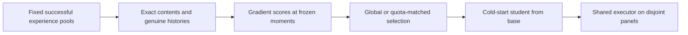
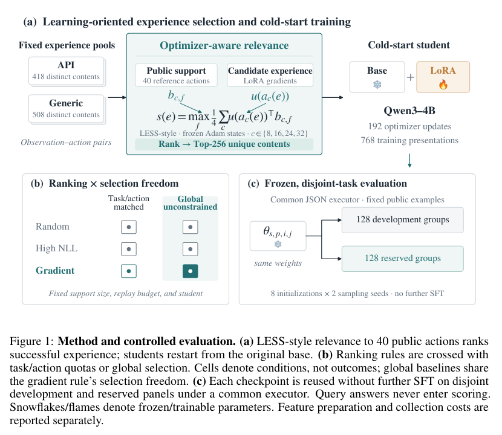

# From Acting to Learning: Experience Selection toward Continually Learning Agents

<!-- source-sha256: b4facbf5a94d973a84390bb3cdff04b8d454e177645cfae4dddfc3f754e55414 -->

[简体中文](README.md)

> `component_only` / L1 CPU formula/scheduling diagnostics, `diagnostic_only=true`. Not agent-capability reproduction or Evolve integration. First released2026-11-20,discovered/reviewed2026-11-23;not a Nov23 first release.

## Paper information

| Field | Value |
| --- | --- |
| Paper | [Fixed arXiv v1](https://arxiv.org/abs/2611.27159v1) |
| Company/institution | First authorYaoyuan Yan;Country Garden Services AI Lab / Omni AI |
| Original publication | 2026-11-20 05:45:48 UTC;current update has the same timestamp,no separate revision |
| Announcement/discovery | Identity absent from this batch's announcement pool;announcement date unverified.Discovered/reviewed through official arXiv metadata on2026-11-23 |
| Author source code | No paper-specific source repository was found or verified in fixed v1. The paper says records are versioned but supplies no verifiable repository link; LESS and ALFWorld dependencies are not this paper's release. |
| Local adapter/key | `adapter: null`;CPU component key `acting-to-learning` |
| Local reproduction code | `src/auto_research/agent_research/acting_to_learning.py`; tests `tests/test_nov23_acting_to_learning.py` |

## Original paper summary

### Background and changes

The paper isolates experience selection after successful interaction: historical pools are fixed, a selector chooses action records, and students share a training budget and deployment executor. The score follows LESS rather than introducing a new general influence formula. Its contribution is the controlled agent-learning comparison, especially crossing ranking criteria with coverage freedom. Only one selection-and-training stage is studied; multi-round continual learning, forgetting and autonomous harness editing are not evaluated.

At warmup checkpoints8/16/24/32, candidate LoRA gradients combine with frozen first/second Adam moments into a ranking feature. Bias correction is omitted, so this is not a full AdamW update. Each public-support gradient is unit-normalized before its family mean; normalized candidate features are dotted with these means, averaged across checkpoints, then maximized across families. Forty public support actions contain no evaluation-query answers. Global selection exactly deduplicates complete message contents, keeps first representative indices, selects256 contents and replays three shuffled passes for768 presentations. Matched selection preserves every reference task/action position and distinct-content quota. Final students restart from the original base, not warmup weights.

### Architecture



### Key original figure

[](https://arxiv.org/pdf/2611.27159v1#page=2)

Figure 1with its complete caption comes from fixed-v1 PDF page2;copyright belongs to the original authors.Only unrelated text/whitespace is cropped,with scientific content unchanged.Visually reviewed.[Source](https://arxiv.org/pdf/2611.27159v1#page=2) and [PDF/crop SHA256 provenance](assets/provenance.json).The image is not local evidence.

### Core equations

$$
a_c(e)=\frac{\beta_1m_c+(1-\beta_1)g_c(e)}{\sqrt{\beta_2v_c+(1-\beta_2)g_c(e)^2+\epsilon}},\quad s(e)=\max_f\frac14\sum_{c\in\{8,16,24,32\}}u(a_c(e))^\top b_{c,f}.
$$

### Reported offline and online results

The author study uses two fixed ALFWorld pools, nine selectors and eight initializations by two sampling seeds, producing2884B students evaluated on128 development task groups with one executor. Global gradient selection exceeds equally unconstrained random by8.25/5.96points and high-NLL by4.10/4.05points. On128 reserved groups, equal-source gains are7.03/5.03points. These are not the official ALFWorld seen/unseen test sets, and eight-by-two is not16 independent initializations. Equal presentations do not equal tokens or FLOPs. The length-control feasibility check fails, leaving length effects unresolved. No production A/B is reported.

## Local reproduction and limits

### Data protocol and code mapping

The independent NumPy float64 slice implements explicit-gradient/frozen-moment features, individually normalized support gradients, checkpoint averaging before family maximization, exact full-string deduplication, global top/random selection with three replay passes, and reference-position/stratum distinct-content quotas. Undefined zero-norm directions and intermediate feature overflow are rejected, not assigned invented scores. Synthetic gradients and historical-action strings exercise the formulas; lexical similarity does not replace gradients. No LoRA extraction, warmup training, ALFWorld, Qwen checkpoint, deployment executor, student SFT or capability comparison runs. Callers must ensure support is public training-side information rather than query answers.

```bash
PYTHONPATH=src python -c 'from auto_research.agent_research.acting_to_learning import diagnostic; print(diagnostic(42))'
PYTHONPATH=src python -m pytest tests/test_nov23_acting_to_learning.py -q
```

After source freeze,the shared runner records [seed42/43/44 CPU mechanism results](metrics/component-cpu-seeds42-44.json). Inputs are explicit synthetic controls,with no capability benchmark or test-based tuning. Three seeds are not three trained models and do not upgrade L1 evidence.

### Same-topic comparison and limits

Reviewed against [agent-research:ace-data](../2608.27260-ace-data/README-en.md):ACE Lens organizes admission around Accuracy, learner-relative Complexity and Diversity. This paper instead ranks already successful actions by optimizer-aware gradient relevance to public task families and controls coverage freedom explicitly. Both distinguish success from learning value; low NLL means predictability, not necessarily greater training benefit. The older ACE mini-suite is not the paper's ALFWorld training comparison and cannot be ranked against its gains.

Controls check checkpoint/family order, no renormalization of the support mean, unchanged random sampling under duplicate rows, first-index score ties, complete shuffled passes, matched access to nonreference contents in the same stratum, rejection of cross-stratum duplicate contents, and rejection of NaNs, negative second moments and intermediate overflow. Seeds change synthetic inputs and schedules, not independently trained models.

### High-cost full experiments

The source uses Qwen3-4B-Instruct-2507 revision cdbee75f17c01a7cc42f958dc650907174af0554,rank16LoRA,192updates,768presentations and2048-token sequences per student. Pools contain721/732action records and418/508contents. Reported costs are62.146GPU-hours for the main study,17.419for64additional students and24.240for reserved evaluation of97checkpoints: at least103.805GPU-hours, excluding earlier collection. The full multi-arm matrix exceeds this batch's short one-A100/A30-or-Mac budget; no weights/data or trial training are launched. CPU array controls are estimated to take seconds; measured timing belongs to the shared runner receipt. **Too costly;not reproduced(review DONE).** This is a terminal cost decision,not an automatic retry/implementation queue.Passing a cheap component does not reproduce the full paper.

### Source review

Fixed-v1 PDF SHA256:`026d8420aa7bfa7e63d17c5f7b54f3c24353460894cb770a45bc095d7ba05cd2`.Reviewed locations:Problem and Selection Procedure: optimizer-aware score and Algorithm 1; Experimental Design: student, shared executor and task groups; Costs and Limitations; Reproducibility appendix.This is a finite incremental selection.It does not move the global Nov15 review watermark or claim exhaustive Google/Meta/Agent coverage.
